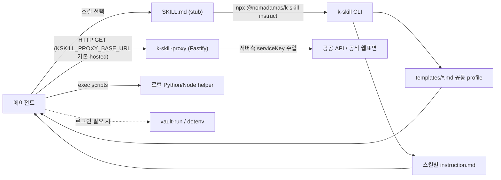

# k-skill

> [!summary] 한줄요약
> 한국 실생활·업무 영역(교통, 부동산, 법령, 세무, 금융, 공공조달, 쇼핑 등) 125개 에이전트 skill을 한 저장소에 모은 번들. 각 `SKILL.md`는 얇은 stub이고 실제 지침은 `npx @nomadamas/k-skill instruct <skill>`로 런타임에 조립되며, 공공 API 키는 운영자가 호스팅하는 `k-skill-proxy`(Fastify, AGPL-3.0)가 대신 보관한다. 저장소 기본 라이선스는 MIT.

## 배경 — 해결하려는 문제

한국 서비스는 공식 Open API(공공데이터포털 data.go.kr, 서울 열린데이터광장, 법제처, 한국은행 ECOS, KOSIS 등)가 흩어져 있고, 각각 키 발급·활용신청·XML/JSON 포맷·호출 한도가 달라 에이전트가 직접 쓰기 번거롭다. 당근·쿠팡·다나와처럼 공식 API가 없는 서비스는 공개 웹 표면을 읽어야 한다. k-skill은 이 지식을 "에이전트가 읽는 절차서(SKILL.md + instruction)" 형태로 한 곳에 모으고, 키가 필요한 조회는 중앙 프록시로 숨겨 사용자가 키를 발급하지 않아도 되게 한다. README의 표현으로는 "추가 클라이언트 API 레이어는 불필요하다. 필요한 경우 `k-skill-proxy` 같은 프록시 서버에 HTTP 요청만 넣으면 된다."

대상 에이전트는 Claude Code, Codex, OpenCode, OpenClaw/ClawHub 등이다. 또한 소스 문서에는 "돌쇠(Dolshoi)"라는 데스크톱 에이전트 런타임에 대한 우선 지원 계약이 따로 있다(아래).

## 동작 원리와 아키텍처

### 한 스킬의 구성

`docs/adding-a-skill.md`가 구조를 정의한다. 모든 스킬은 저장소 루트의 디렉터리 하나이며 다음 파일을 가진다.

| 파일 | 역할 |
|---|---|
| `skill.json` | 필수. `name`(디렉터리명과 일치), `description`, `profiles`(조립할 공통 규칙 목록), `frontmatter` 원문의 **단일 원본** |
| `instruction.md` | 필수. 사이트별 고유 workflow(What this skill does / When to use / Workflow / Done when / Failure modes) |
| `SKILL.md` | **생성물**(`scripts/generate-skill-stubs.js`). 직접 수정 금지 |
| `scripts/`, `references/` | 선택. 헬퍼 스크립트와 레퍼런스 |

구현 유형은 네 가지다: instruction만 있는 것(`kakaotalk-mac`, `railway-timetable`), `packages/` 아래 npm 패키지(`k-lotto`, `daiso-product-search`), `k-skill-proxy` 경유(`seoul-subway-arrival`, `fine-dust-location`), 루트 `scripts/`의 Python(`korean-spell-check`, `sillok-search`).

### SKILL.md는 stub — 실제 지침은 CLI가 조립

`korean-law-search/SKILL.md`를 열어 보면 본문이 거의 없고 "Get the full instructions (required first step)" 아래에 다음을 실행하라고만 적혀 있다.

```bash
npx -y @nomadamas/k-skill@0 instruct korean-law-search
npx -y @nomadamas/k-skill@0 files korean-law-search
npx -y @nomadamas/k-skill@0 update
```

`packages/k-skill-cli`(npm 패키지 `@nomadamas/k-skill`, 확인한 버전 0.9.2, MIT)의 `src/assemble.js`가 `skill.json`의 `profiles`에 따라 `templates/` 아래 공통 템플릿(`core`, `proxy`, `browser`, `vault`, `action-booking`, `action-commerce`, `action-submission`, `action-account`, `action-recruiting`, `legal`, `lookup`, `local`, `operations`)을 이어 붙여 출력한다. `detect.js`는 런타임 capability를 감지한다. 이 방식의 이유는 `docs/dolshoi-runtime.md`에 있다: Vercel `skills add --skill <name>`은 선택한 디렉터리만 설치하고 `docs/`는 포함하지 않으며 symlink/`--copy` 설치 모두 지원되어야 하므로, 저장소 밖 상대 참조에 의존하지 않고 stub이 CLI를 통해 공통 정책을 주입하게 했다. `helper 파일`은 `scripts`, `references`, `tests` 루트만 허용하는 `resolveBundledAsset`로 경로 탈출을 막는다(소스 확인). 

실행형 스킬은 `npx -y @nomadamas/k-skill@0 exec railway-timetable scripts/railway_timetable.py -- search --dep 서울 --arr 부산 --date 20260904` 같은 형태로 번들된 스크립트를 실행한다.



### 공통 정책 profile

`core.md`의 항상 적용 규칙이 이 번들의 행동 원칙을 보여준다. (1) 제품명이 아니라 capability를 감지한다. (2) 합법적 공식 표면이 지원하면 조회에서 멈추지 말고 되돌릴 수 있는 준비 단계까지 진행한다. (3) 결제, 메시지/메일 전송, 최종 제출, 취소, 계정 변경, 공개 게시 같은 **비가역 외부 효과 직전에는 `clarify`로 정확한 대상·금액·효과를 보여주고 승인받는다**. (4) 법률, 물리적 출석, CAPTCHA, 본인확인, 전자서명 경계는 우회하지 않는다. (5) CLI를 쓰기 전 `npx -y @nomadamas/k-skill@0 update`로 갱신한다. 모든 stub에는 CLI 없이도 지키는 "Hard rules"(승인 없는 결제/전송 금지, 평문 credential 금지, 법적 경계 우회 금지)가 들어 있다.

### k-skill-proxy

`packages/k-skill-proxy`는 Fastify 5 단일 의존성(`fastify ^5.10.0`)의 Node 20+ 서버로, 버전 0.12.0, 라이선스 `AGPL-3.0-only`다. `src/server.js`가 약 6,580줄의 composition root이고, 공급자별 모듈(`airkorea.js`, `korean-law.js`, `krx-stock.js`, `kstartup.js`, `molit.js`, `nts-business.js`, `mfds.js`, `kakao-map.js`, `naver-shopping.js`, `komsa-mtis.js`, `vworld.js` 등 약 36개)이 라우트를 나눠 맡는다. README에 나열된 엔드포인트는 `/v1/fine-dust/report`, `/v1/korea-weather/forecast`, `/v1/seoul-subway/arrival`, `/v1/korean-law/search|detail`, `/v1/ev-charger/*`, `/v1/building-register/title`, `/v1/nts-business/status|validate`(POST), `/v1/mfds/*`, `/v1/korean-stock/*`, `/v1/kakao-*`, `/v1/kosis/*`, `/v1/kstartup/*`, `/v1/coupang/products/search`, `/v1/naver-news/search` 등 매우 많다.

운영 특성(소스·개인정보 처리방침 기준): 메모리 캐시 기본 TTL 300초(`KSKILL_PROXY_CACHE_TTL_MS`), 최대 1,000개 항목, IP 기준 rate limit 기본 60초에 60회(`KSKILL_PROXY_RATE_LIMIT_*`), 요청 로깅 비활성(`disableRequestLogging: true`) 후 라우트별 사용량만 구조화 로그. 사용자가 보내는 `apiKey` 파라미터는 무시하고 서버 환경변수 키를 주입한다는 설명이 라우트마다 있다(예: Kakao Local). 예외적으로 VWorld는 호출자가 `x-k-skill-vworld-api-key` 헤더로 자기 키를 위임한다. 컨테이너는 `node:20-alpine`, `USER node`, 8080 포트. `infra/`에는 모니터링 대시보드(`k-skill-proxy-dashboard`, AGPL-3.0)와 `eatpl-relay`가 있다.

## 스킬 카테고리 상세 (README 기준 21개 영역)

README의 표에서 확인한 대표 스킬만 추린다(전부 열거하지 않음).

- **이동·교통·여행**: `railway-timetable`(코레일 공식 XLSX 계획시간표, 조회 전용), `express-bus-booking`·`intercity-bus-booking`(배차·좌석·요금·임시 선점과 예매), `flight-ticket-search`(`fast-flights` 기반 Google Flights 공개 검색), `korean-transit-route`(ODsay + Kakao), `kakao-map`, `seoul-subway-arrival`, `seoul-bike`, `highway-traffic-status`, `mofa-travel-safety`.
- **부동산·주택**: `real-estate-search`(실거래가·전월세), `housing-official-price`·`gongsijiga-search`(realtyprice.kr 공개 표면, 공식 OpenAPI 아님이라고 명시), `building-register-search`, `lh-notice-search`, `sh-notice-search`, `court-auction-notice-search`.
- **법률·공공**: `korean-law-search`(법제처 Open API, 프록시가 `LAW_OC` 주입), `korean-patent-search`(KIPRIS Plus), `iros-registry-automation`(등기부 장바구니 후 수동 결제), `court-payment-order-assistant`, `assembly-bill-vote-search`, `korean-privacy-terms`(`kimlawtech/korean-privacy-terms` Apache-2.0 thin wrapper).
- **사업·상권·세무**: `nts-business-registration`, `biz-health-check`(국세청 상태·국민연금·체납·법인개요·부정당제재를 교차 조회, "점수·판정 없이 사실만"), `nts-tax-delinquency`, `fsc-corporate-info`, `localdata-business-status`, `popbill`(전자세금계산서 등, 로컬 BYOK).
- **정부지원·조달**: `kstartup-search`, `government-support-survey`, `g2b-order-plan-search`, `g2b-sanctioned-supplier`, `d2b-notice-search`, `s2b-notice-search`.
- **금융·투자·경제통계**: `korean-stock-search`(KRX), `k-dart`(공시 14개 endpoint), `toss-investment`(공식 Open API OAuth2, 조회 전용), `kosis-stats`, `bok-ecos-stats`, `multi-asset-morning-briefing`.
- **채용**: `jobkorea-talent-search`·`saramin-talent-search`(기업회원 로그인 세션에서 마스킹 후보를 읽고 유료 열람 전 shortlist만 작성), `job-posting-match`.
- **쇼핑·건강·생활**: `coupang-product-search`, `danawa-price-search`, `naver-shopping-search`, `daangn-*`, `mfds-drug-safety`, `emergency-room-beds`, `household-waste-info`, `delivery-tracking` 등.
- **한국어·글쓰기**: `korean-spell-check`, `korean-character-count`(NEIS byte 포함), `korean-humanizer`(번역투·AI 상투어를 S1/S2/S3로 분류하며 변경률 30% 경고, 50% 중단 — [[im-not-ai]]와 같은 계열의 규칙), `korean-slang-writing`.
- **개발자·문서 도구**: `hwp`(`.hwp/.hwpx` → Markdown/JSON, kordoc 기반 read-only), `rhwp-edit`(`@rhwp/core` WASM으로 HWP 본문 편집), `rhwp-advanced`, `kakaotalk-mac`(macOS 카카오톡 로컬 아카이브 동기화와 BM25/semantic 검색), `kr-whois-lookup`.
- **공통 관리**: `k-skill-setup`(credential 확보, 환경 확인), `k-skill-cleaner`(트리거 횟수 통계로 삭제 후보 추천).

특징적인 설계 선택은 **조회 전용과 행동형의 명확한 구분**이다. KTX는 "로그인·예약·결제·취소를 수행하지 않는다"고 못 박았고, 인재 검색은 유료 열람 전에 멈추며, 등기부 열람은 수동 결제를 요구한다.

## 설치·사용

```bash
# 전체 / 특정 스킬 설치 (Node.js 18+, npx 필요)
npx --yes skills add NomaDamas/k-skill --all -g
npx --yes skills add NomaDamas/k-skill --skill railway-timetable -g

# CLI와 모든 에이전트 스킬 설치 갱신 (확인만: update --check)
npx -y @nomadamas/k-skill@0 update
```

```text
# Claude Code 플러그인
/plugin marketplace add NomaDamas/k-skill
/plugin install k-skill@k-skill
# 호출: /k-skill:lotto-results
```

KTX helper는 Python 3.11+와 `uv`가 추가로 필요하다. 설치 후 `k-skill-setup`으로 credential을 확보한다. 비밀값 해석 순서(`docs/security-and-secrets.md`)는 (1) 돌쇠 vault capability(`DOLSHOI_ACTION_BROKER_URL` + `vault-run`), (2) 없으면 `request_vault_credential`, (3) 이미 주입된 환경변수, (4) 에이전트 vault(1Password, Bitwarden, macOS Keychain 등) 후 `~/.config/k-skill/secrets.env`(`0600`), (5) 호스트의 가장 안전한 입력 표면 순이다. 대부분의 조회는 `KSKILL_PROXY_BASE_URL`이 비어 있으면 기본 호스팅 프록시(`k-skill-proxy.nomadamas.org`)를 쓰므로 키가 필요 없고, 자체 프록시를 쓰려면 환경변수로 지정한다.

```bash
export KSKILL_PROXY_BASE_URL=https://k-proxy.internal.example   # 자체 프록시(예시 URL)
curl "$KSKILL_PROXY_BASE_URL/v1/korean-law/search?target=law&query=개인정보보호법"
```

## 디렉터리·코드 구조에서 확인한 것

- 루트: 스킬 디렉터리 약 127개(`SKILL.md` 보유 수), `packages/`(npm 워크스페이스 29개: `k-skill-cli`, `k-skill-proxy`, `k-skill-browser-runtime`, `k-skill-rhwp` 및 기능별 패키지), `scripts/`(Python/Node helper와 `test_*.py`, 빌드·동기화 스크립트), `infra/`, `docs/`(`features/` 스킬별 문서, `legal/`, `install*.md`, `roadmap.md`), `.changeset/`, `.claude-plugin/`.
- 빌드·품질: npm workspaces, `changesets`로 버전 관리, `npm run ci` = lint + `tsc --noEmit` + test + pack dry-run. `generate:plugin-manifest`가 Claude Code 플러그인 매니페스트를 생성하고 `build:manus-bundle`이 Manus용 번들을 만든다(릴리스 `manus-bundle-latest` 롤링 프리릴리스 확인).
- `docs/legal/`에 조회 전용 7개 스킬의 법적 리스크 검토 기록과 상표 사용 검토가 있다. 제3자 상표는 기능 설명 목적이며 제휴를 뜻하지 않고, 공개정보 조회는 "개인적·비조직적 용도", 대량·체계적 크롤링이나 접근통제 회피 금지라고 README가 밝힌다.
- 공개 프록시 개인정보 처리방침(2026-08-18 시행): 회원가입·쿠키·프로파일링 없음, 일반 로그에 IP·검색어·요청 본문 기록 안 함, rate-limit IP는 메모리에서 최대 60초, 성공 응답 캐시 최대 5분, Cloudflare(DNS/TLS/Tunnel) 수탁과 미국 등 국외 이전을 고지하고, 원치 않으면 로컬/공식 upstream 직접 호출 경로를 쓰라고 안내한다.

## 비교 대상

| 대상 | 차이 |
|---|---|
| k-skill | 한국 도메인 특화, 125개 스킬 + 공용 프록시 + 설치 CLI. 지침이 npx로 동적 조립됨 |
| [[agent-skills]] 류 일반 skill 모음 | 범용 개발 워크플로 중심. k-skill은 한국 공공/민간 서비스 접근이 핵심 |
| [[mengto-skills]] | 웹 디자인/게임/3D 중심의 정적 SKILL.md 폴더. 외부 서비스 접근·프록시 없음 |
| `chrisryugj/korean-law-mcp` | `korean-law-search`가 read-only 도구 표면을 참고했다고 명시(소스). MCP 서버 단독이며 k-skill은 이를 skill+프록시로 감쌈 |
| [[insane-search]] | 차단된 일반 웹페이지 읽기용 escalation 도구. k-skill은 서비스별 전용 조회 절차 |

## 장단점·한계·성숙도

확인한 사실(GitHub API, 2026-10-01): 스타 7,731, fork 940, 열린 이슈 51(PR 포함 집계), 라이선스 MIT(저장소 기본), 생성 2026-03-24, 마지막 push 2026-09-30, 커밋 약 1,142개(API 페이지 수로 추정), 컨트리뷰터 44명(contributors API, 2026-10-01). 최근 머지는 changeset 릴리스 PR #678이며 이슈 번호가 #680대로 매우 활발하다. 열린 이슈 예시: 신규 스킬 요청(#680), 프록시 운영 이슈 #641(24시간 오류 분석: LH/KRX 403, AirKorea 429→500, Naver Shopping 404), #569(502 3.4만 건, 일시 장애 재시도 부재), #604(stale-if-error 캐시 폴백 제안).

장점: 한국 업무 도메인 커버리지가 매우 넓고, 조회 전용/승인 필요 행동의 경계가 문서화되어 있으며, 법적 검토 기록과 개인정보 처리방침까지 갖췄다. 스킬 작성 규약(`skill.json` 단일 원본 + 생성 stub + CI 검사)이 일관적이다.

한계: (1) 상류 API/웹 표면이 바뀌면 깨진다. 예: `daiso-product-search`는 "정확한 매장별 재고 수량은 다이소몰 보안 정책으로 2026-05-05부터 차단"이라고 스스로 적었고, `emergency-room-beds`는 정확한 잔여 병상 수가 공개 목록에 없다고 밝혔다. (2) 공개 프록시는 운영자 1곳이 올리는 서비스라 가용성이 그 운영에 달려 있다(이슈 #569, #641 참조). (3) 비공식 웹 표면(당근, 쿠팡, 올리브영 등) 스킬은 약관·차단 위험이 있다. (4) 이 노트는 125개 스킬 각각의 동작을 실행해 검증하지 않았다(확인 못함).

## 보안·라이선스·운영 리스크

> [!warning] 사내 도입 시 핵심 점검 항목
> 1. **동적 지침 주입(공급망)**: stub이 `npx -y @nomadamas/k-skill@0 ...`로 매번 npm 패키지를 받아 그 출력을 "primary instructions"로 따르게 한다. 에이전트가 따르는 지침이 npm 최신 0.x 버전에 의해 바뀔 수 있으므로 npm 계정 탈취나 악성 릴리스가 곧 프롬프트 인젝션 경로가 된다. 또한 `core` 규칙이 사용 전 `update`를 권장해 **스킬 설치 자체를 자동 갱신**한다. 사내에서는 버전 pin(`@0.9.2`), 사설 레지스트리 미러, 리뷰 후 vendoring을 권한다.
> 2. **조회어의 외부 전송**: 기본 hosted proxy로 가는 모든 질의(사업자번호, 주소, 법령 검색어, 종목 등)가 외부 운영자 서버와 Cloudflare(미국 포함)를 경유한다. 처리방침은 민감정보·주민번호 입력 금지를 명시한다. 사내 데이터는 자체 프록시(`KSKILL_PROXY_BASE_URL`)나 `--direct`만 허용하는 것이 안전하다.
> 3. **라이선스 혼합**: 저장소 MIT, `packages/k-skill-proxy/`와 `infra/k-skill-proxy-dashboard/`는 AGPL-3.0-only. 프록시를 수정해 사내 서비스로 노출하면 AGPL 소스 공개 의무 검토가 필요하다(법무 확인 필요). CLI 패키지는 MIT.
> 4. **자격증명·행동형 스킬**: 팝빌(세금계산서), 기업회원 인재풀, 토스증권, 예매류는 비가역 행동이 가능하다. `clarify` 승인 규칙이 LLM 준수에 의존하므로 사내에서는 조회 전용 스킬만 allowlist하는 편이 안전하다. 비밀값은 `secrets.env`(`0600`)에 평문으로 저장될 수 있다.
> 5. **예약 작업**: 이슈 #561은 `k-skill-setup`이 고지 없이 매일 `claude -p`를 실행하는 예약 작업을 만든다는 제보였다. 현재 `k-skill-setup/instruction.md`는 예약 작업을 사용자가 명시 요청·승인한 경우에만, 그리고 `npx --yes skills check` 하나만 실행하게 하고 "claude -p 같은 AI/CLI 작업을 함께 만들지 않는다"고 정책을 명시한다(소스 확인). 이슈 #561은 2026-10-01 조회 시 아직 open 상태다.
> 6. 설치 흐름에는 사용자 동의 시에만 `gh repo star`를 실행하는 규칙이 있다(README, setup). 자동 star 금지가 명시되어 있으나 에이전트가 이를 지키는지는 별도 확인 대상이다.

## 관련 노트

[[agent-skills]] · [[claude-code-best-practice]] · [[im-not-ai]] · [[insane-search]] · [[mengto-skills]] · [[weknora]]

## 출처

- https://github.com/NomaDamas/k-skill (README 전문, `docs/adding-a-skill.md`, `docs/security-and-secrets.md`, `docs/setup.md`, `docs/dolshoi-runtime.md`, `docs/legal/*`)
- `korean-law-search/{SKILL.md,skill.json,instruction.md}`, `railway-timetable/instruction.md`, `korean-humanizer/instruction.md`, `k-skill-setup/instruction.md`
- `packages/k-skill-cli/{package.json,src/assemble.js,src/update.js,templates/*}`, `packages/k-skill-proxy/{package.json,README.md,Dockerfile,privacy-policy.html,src/server.js}`, 루트 `package.json`, `.claude-plugin/marketplace.json`
- GitHub API(repos/NomaDamas/k-skill, releases, issues, contributors, commits) 2026-10-01 조회. API rate limit 도달로 일부 이슈의 현재 상태는 재확인하지 못함
- 확인 못함: 개별 스킬의 실제 실행 품질, hosted proxy의 현재 가용률
