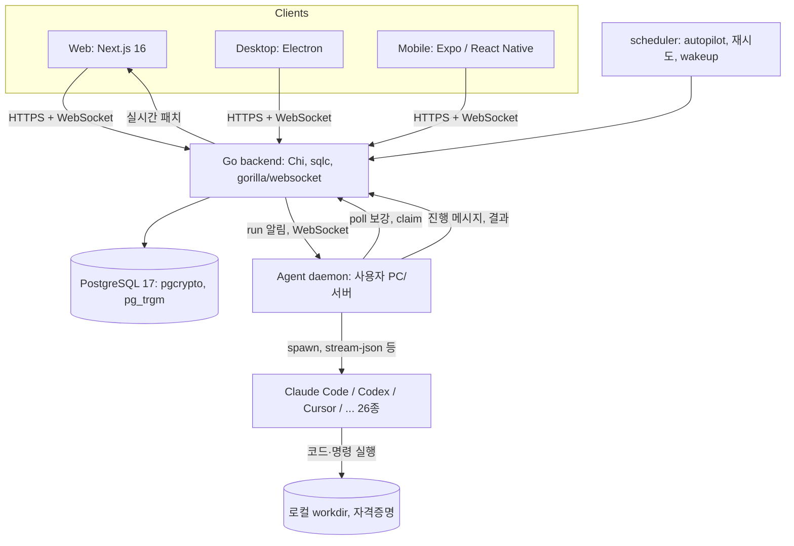

# Multica

> [!summary] 한줄요약
> 기존 코딩 에이전트 CLI를 이슈 담당자로 배정하고, 실행 이력과 리뷰를 한곳에서 관리하는 협업 워크스페이스다.

- **실행 구조**: Go 백엔드 + PostgreSQL이 이슈·실행(run) 기록을 관리한다. 각자의 PC/서버에서 도는 **daemon**이 Claude Code·Codex 등 26종 에이전트 CLI를 자식 프로세스로 띄워 실제 작업을 수행한다.
- **배포**: Docker Compose/Helm으로 자체 호스팅할 수 있다.
- **라이선스**: Apache 2.0 위에 호스팅·임베딩·브랜딩 조건을 얹은 "Multica License"다. OSI 오픈소스가 아니며 GitHub 판정은 NOASSERTION이다.

## 배경 — 해결하려는 문제

README가 지적하는 문제는 에이전트를 늘릴수록 관리할 일이 많아진다는 것이다. Claude Code, Codex 등 여러 에이전트를 쓰면 터미널 탭이 각각 필요하다. 세션이 끝나면 맥락이 사라져 같은 설명도 반복하게 된다.

VISION.md는 이를 "AI 에이전트를 추가하면 관리할 인박스가 하나 늘어나는 상황"이라고 표현한다. 목표는 intent, run, decision, diff를 하나의 이슈에 연결하는 것이다. 누구도 맥락을 다시 구성할 필요가 없고, 사람이 승인하기 전에는 아무것도 배포되지 않는 상태를 지향한다.

따라서 Multica는 **기존 에이전트 CLI를 이슈 트래커의 담당자(assignee)로 등록해 작업 이력과 감사 가능성을 확보하는 오케스트레이션 계층**이다. 새 코딩 에이전트를 만드는 프로젝트는 아니다. 이름은 시분할 OS Multics에서 따왔다(Multiplexed Information and Computing Agent).

## 동작 원리와 아키텍처

### 핵심 개념 (docs/concepts.mdx)

- **Workspace**: 팀의 격리 범위. 사람과 에이전트가 같은 워크스페이스에서 일한다.
- **Issue**: 작업 단위. assignee는 member, agent, squad 중 하나(polymorphic: `assignee_id`와 `assignee_type`를 함께 해석 — AGENTS.md).
- **Agent**: "장시간 도는 프로세스가 아니라 재사용 가능한 설정(이름, instructions, 모델, skills, Access, runtime)". 트리거될 때만 실행된다.
- **Run**: 에이전트의 1회 실행 기록. 이슈 하나에 여러 run이 쌓이며 이전 기록은 덮어쓰지 않는다. run이 completed여도 이슈가 완료인 것은 아니다.
- **Runtime**: 실행 환경 = 컴퓨터 1대 + 그 위의 AI 코딩 툴 1개(또는 커스텀 런타임 프로필).
- **Skill**: `SKILL.md` 중심의 재사용 작업 방법. 여러 에이전트에 붙일 수 있다.
- **Squad**: leader 에이전트 1명 + 멤버(에이전트/사람). 이슈를 squad에 배정하면 leader만 깨어나 누구에게 넘길지 판단한다.
- **Autopilot**: cron(5필드, IANA 타임존)이나 webhook으로 에이전트 run을 자동 발생. "이슈 생성" 모드와 "run only" 모드.
- **Chat / Inbox / Project**: 이슈 비종속 대화, 사람용 알림함(에이전트는 inbox를 쓰지 않음), 관련 이슈 묶음 및 repo·문서 리소스 바인딩.

에이전트가 스스로 일을 시작하는 일은 없고 모든 run은 명시적 트리거(이슈 배정, 댓글 @멘션, 채팅, Autopilot) 중 하나에서 시작한다고 문서가 못 박는다.

### 컴포넌트와 데이터 흐름

README의 아키텍처 도식과 코드 구조를 종합하면 다음과 같다.



1. 이슈를 에이전트에 배정하면 서버가 **run**을 만들어 큐에 넣는다. 런타임이 오프라인이면 대기한다(무한 대기 방지 만료 없음; 런타임이 침묵하고 *동시에* run이 그만큼 오래 큐에 있을 때만 실패 처리 — docs/tasks).
2. 연결된 daemon이 서버로부터 WebSocket 알림을 받아(주기적 poll은 백스톱) run을 **claim**하고, 해당 에이전트에 설정된 CLI를 자식 프로세스로 실행한다.
3. 실행 중 툴 콜, 명령, 에러가 타임스탬프와 함께 서버로 스트리밍되어 이슈의 Execution log에 실시간 표시된다. 완료되면 결과를 이슈 댓글/상태로 되돌려 쓴다.
4. 사람의 개입: 실행 중에 답글을 달면 *현재* run에 전달되는 "steer"(Claude Code, Codex, Grok 지원, README), 중단/재시도, review 상태 게이트.

핵심 경계(docs/how-multica-works)는 "Multica는 이슈·댓글·상태·에이전트 설정·run 기록을 보관하고, AI 툴과 그 자격증명, 코드 디렉터리, 실제 파일 변경과 명령 실행은 연결된 컴퓨터에 남는다"이다. 단 예외로 에이전트의 `custom_env`와 MCP 설정은 서버에 저장되어 실행 시 런타임에 전달된다.

### run 상태 머신

docs/tasks에 정의된 상태 전이는 다음과 같다.

`deferred`(예약) → `queued` → `dispatched` → `waiting_local_directory`(해당하는 경우) → `running` → `completed` / `failed` / `cancelled`

- **디렉터리 대기**: 같은 로컬 디렉터리를 다른 run이 사용 중이면 `waiting_local_directory`에 머문다.
- **자동 재시도**: 런타임 오프라인, daemon 재시작, 타임아웃, 툴 네트워크 중단 같은 일시적 장애가 대상이다. 일반 run은 기본 최대 2회 실행하고, 툴 네트워크 중단은 3회까지 시도한다.
- **원인 해결이 필요한 오류**: 만료된 자격증명이나 쿼터 소진 등 에이전트가 반환한 오류는 보통 재시도하지 않는다.
- **활동 확인**: 서버는 하트비트가 정상인 run을 오래 걸린다는 이유만으로 강제 종료하지 않는다. 정체 여부는 런타임이 실제 활동을 기준으로 판단한다. daemon heartbeat는 15초이며, 비정상 종료 시 약 3분 안에 오프라인으로 표시된다.

### daemon 내부 (server/pkg/agent, server/internal/daemon)

`server/pkg/agent/agent.go`의 `Backend` 인터페이스(`Execute(ctx, prompt, ExecOptions) (*Session, error)`)가 모든 에이전트 CLI를 추상화한다. 파일 목록에는 claude, codex, copilot, cursor, codebuddy, antigravity, acp 계열, codearts 등 provider별 구현이 있고 `ExecOptions`에는 Cwd, Model, MaxTurns, 각종 타임아웃(시맨틱 비활동, 첫 턴 무진행, idle watchdog, handshake), 세션 resume 정보가 있다. 런타임 브리프는 `CLAUDE.md`, `AGENTS.md`, `CODEBUDDY.md`, `QWEN.md` 같은 per-task 컨텍스트 파일로 workdir에 떨어뜨리고, 디스크에서 못 읽는 일부 provider에만 system prompt로 직접 넣는다는 주석이 있다(그래서 AGENTS.md가 Multica 저장소 자체에도 중요하다).

Claude Code 호출은 `server/pkg/agent/claude.go` 1081행 근처에서 확인된다: `--output-format stream-json --input-format stream-json --verbose --permission-mode bypassPermissions --disallowedTools AskUserQuestion`에 모델/`--max-turns`/`--resume`/`--mcp-config` 등을 조건부로 붙인다. `--permission-mode` 등 프로토콜 관련 플래그는 사용자 커스텀 인자로 덮어쓰지 못하게 `blockedWithValue`로 막아 두었다. root 권한에서는 bypassPermissions를 Claude Code가 거부하므로 "비root로 daemon을 실행하거나 진짜 컨테이너라면 `IS_SANDBOX=1`" 에러 메시지가 코드에 있다. 즉 **무인 자동 승인이 기본 동작**이다.

백엔드 쪽에는 `server/internal/scheduler`(autopilot, issue wakeup, 하위 이슈 완료 처리, 검색 인덱스, 사용량 롤업, 플러그인 hook 잡), `server/internal/realtime`, `daemonws`, `entitlement`, `seatcapacity`, `featureflags`, `integrations`, `cloudruntime` 등의 패키지가 보인다. 이 중 entitlement/seatcapacity는 클라우드 상업 기능(좌석 과금 등)의 흔적으로 보이나 정확한 용도는 확인하지 못했다.

## 핵심 기능 상세

**에이전트를 팀원처럼 배정.** 이슈의 assignee 선택기에 에이전트가 사람과 함께 나온다. 이슈가 Backlog이면 트리거되지 않는다(주차장 규칙). 에이전트는 작업 시작 시 `todo`에서 `in_progress`로, 완료 시 `in_review`로 상태를 옮기고 `done`은 사람 리뷰어나 PR merge 같은 연동에 맡기는 계약이다(docs/squads의 설명).

**Squad.** 배정되면 leader run이 만들어지고 leader에게는 매 턴 로스터와 규칙이 system prompt에 덧붙는다. leader는 로스터의 정확한 멘션 마크다운으로 위임 댓글을 하나 달고(그 멘션이 멤버 run을 트리거), `multica squad activity <issue-id> action --reason "..."`으로 평가 이유를 타임라인에 남긴 뒤 멈춘다. 구현은 하지 않고 멤버가 답하면 다시 깨어 다음 단계 위임/에스컬레이션/`in_review` 전환을 한다. Squad는 동시성을 자동으로 늘려주지 않으며 "누구에게 갈 것인가" 문제만 푼다.

**Skills.** 생성 방식 4가지: 직접 작성, 로컬 폴더/`.skill`/`.zip` import, GitHub·ClawHub·Skills.sh URL import, 연결된 컴퓨터에서 복사. 원본 URL이 있는 skill은 `multica skill refresh <id>`로 갱신(에이전트 할당·라벨 등 정체성은 유지, 내용은 덮어씀). `multica skill import --file ./review-helper.skill`. Codex 런은 run 단위 `CODEX_HOME`을 따로 만든다.

**Autopilot.** Runbook(목표/제약/단계) + assignee + 트리거(schedule/webhook). `0 9 * * 1-5` 같은 5필드 cron과 IANA 타임존. Create-issue 모드는 오프라인이어도 이슈를 만들어 대기, Run-only 모드는 런타임이 없으면 skipped.

**관측·통제.** 실행 로그 transcript(툴 콜, 명령, 에러) 재생, 에이전트/이슈별 비용·사용량 분석(`task_usage` 롤업 잡 존재), Inbox, 재시도·타임아웃, 역할 `owner`/`admin`/`member`와 "멤버별로 어떤 에이전트를 실행할 수 있는가" 접근 범위, Slack·Feishu/Lark·DingTalk·WeCom·Telegram 채널 연동(일부는 커뮤니티 유지), GitHub/GitLab/Gitea/Forgejo 연동.

**플러그인 시스템.** `examples/plugins/`(deploy-sentinel, hello-panel, release-checklist, schedule-pulse, triage-notify)와 `packages/plugin-sdk`가 있다. manifest(`multica.plugin.json`)에 `scopes`(`issues:read`, `net:host` 등), `config`(secret 타입 포함), `contributes`(surface, hook, skill 리소스)를 선언한다. UI는 `sandbox="allow-scripts"`(no allow-same-origin) iframe에서 돌고 CSP는 manifest의 `net:` 스코프로 서버가 생성한다. 게시된 버전은 불변이며 관리자가 업그레이드해야 반영된다. 예제 deploy-sentinel은 "에이전트가 롤백 요청을 올리되, 이유가 20자 미만이면 거절"하는 hook을 보여준다. 작은 규모의 설계 철학으로 참고할 만하다.

## 설치·사용

Cloud(multica.ai), Desktop 앱(맥/윈도/리눅스, 실행 PC를 자동 런타임 등록), 셀프호스트 3가지다. 에이전트를 돌릴 머신에는 지원 CLI가 설치·로그인되어 있어야 한다("Multica drives them; it doesn't ship them").

```bash
# 셀프호스트 (Docker 필요, GHCR 이미지)
curl -fsSL https://raw.githubusercontent.com/multica-ai/multica/main/scripts/install.sh | bash -s -- --with-server
multica setup self-host

# CLI만 설치 (Homebrew)
brew install multica-ai/tap/multica
multica login            # 브라우저 OAuth, 90일 PAT 발급, 워크스페이스 자동 등록
multica daemon start     # 백그라운드 daemon; --foreground 로 디버그
multica daemon status
multica daemon logs -f
```

헤드리스는 `multica login --token <mul_...>`. 워크디렉터리 루트는 `multica config set workspaces_root <path>`. 셀프호스트는 `make selfhost`가 `.env`와 임의 `JWT_SECRET`을 생성(문서상 필수 값)하고 docker compose로 올린다. Helm 차트는 `deploy/helm/`에 있다. 개발은 Node 22, pnpm 10.28.2, Go 1.26.6, Docker가 필요하고 `make dev` 한 번으로 환경 구성/마이그레이션/서비스 기동을 한다.

첫 에이전트까지의 흐름(README):

1. Runtimes에서 Add a computer를 선택하고, 표시된 두 명령을 대상 머신에서 실행한다.
2. Agents → New agent에서 런타임·프로바이더·이름을 선택한다. 또는 Build with AI를 사용한다.
3. 이슈를 만들고 assignee로 에이전트를 지정한다.

## 코드·디렉터리 구조에서 확인한 것

- 모노레포(pnpm + turbo): `server/`(Go 모듈, 약 1,956 `.go` 파일 중 테스트 1,160개), `apps/{web,desktop,mobile,docs,ui-lab}`, `packages/{core,ui,views,plugin-sdk,...}`, `deploy/helm`, `e2e/`(Playwright), `examples/plugins`.
- `server/migrations/`에 SQL 파일 1,178개(번호 기준 563번대까지, up/down 쌍). AGENTS.md 규칙: **FK/cascade 금지**(앱 코드에서 정합성 관리), 모든 인덱스는 `CREATE INDEX CONCURRENTLY`이며 파일당 한 문장.
- Go 의존성(go.mod): chi v5, pgx v5, gorilla/websocket, golang-jwt, robfig/cron, go-redis, AWS SDK(S3, Secrets Manager), slack-go, prometheus client, openai-go, resend. Redis 연동이 코드에 있으나 필수 여부는 확인하지 못했다.
- 프런트 규칙: TanStack Query가 서버 데이터, Zustand가 클라이언트 상태. UI가 소비하는 JSON은 zod 스키마와 `parseWithFallback`을 거쳐야 하며(설치된 데스크톱이 더 새로운 백엔드와 통신할 수 있으므로), 새 엔드포인트는 malformed-response 테스트도 갱신.
- AGENTS.md 자체가 "저장소에서 일하는 코딩 에이전트"를 위한 지침(패키지 경계, UUID 처리, 테스트 규칙, 실제 에이전트 CLI를 기본 테스트에서 실행 금지, `MULTICA_RUN_REAL_AGENT_SMOKE=1` 게이트)을 담고 있어 에이전트 친화 저장소 운영의 좋은 샘플이다. `CLAUDE.md`는 11바이트짜리 import 파일뿐이다.

## 비교 대상

| 도구 | 차이점 |
|---|---|
| Multica | 이슈 트래커 중심. 26종 CLI를 provider-agnostic으로 구동, run 기록·재시도·비용 분석·역할 권한, 셀프호스트. |
| [[hermes-bot-mode]] | 개인 데스크톱 채팅 로스터(profile=bot). 이슈/PR/권한 관리 없음. Multica의 provider 중 하나로 Hermes 자체가 지원 목록에 있다. |
| [[claude-code-best-practice]] 의 subagent/Agent Teams | 한 세션 내부의 위임. 이력 보존·팀 가시성·감사 측면은 Multica 같은 외부 시스템이 담당. |
| [[agentspace]] / [[openworker]] | 에이전트 협업/워크플로 계열의 유사 시도. Multica는 PM 도구(이슈-리뷰-PR)와의 결합이 강점. |
| [[onyx]] | 사내 검색/RAG 플랫폼. 목적이 다르며 Multica는 "코딩 작업의 실행·추적" 계층. |
| Linear/Jira + 수동 에이전트 | 이슈 트래커에 에이전트 담당자 개념이 없어 맥락이 흩어지는 문제를 Multica가 대체. |

## 장단점·한계·성숙도

확인한 사실(GitHub API, 2026-10-01): 스타 51,771, fork 6,725, 생성 2026-01-13, 최근 push 2026-10-01, 커밋 5,534개(2026-10-01자 최신 커밋 확인), 최신 릴리스 v0.6.0(2026-09-28) 이전 v0.5.0~v0.5.3이 2026-09-18~24에 연달아 나와 "대부분의 평일에 릴리스"(README)라는 말과 맞는다. `open_issues_count` 1,736은 이슈와 PR을 합친 값이며 기존 조사의 957 이슈 + 779 PR과 합이 일치한다. 라이선스 API 값은 `NOASSERTION`(커스텀 라이선스).

장점: 활동성과 테스트 밀도(Go 테스트 파일 1,160개)가 높고, 데이터/실행 경계가 문서에 명확하며(보안 모델 문서가 한계를 숨기지 않음), 에이전트 CLI 추상화 범위가 넓다. 약관상 사내 단일 조직 사용은 허용된다.

한계는 다음과 같다.

- **호환성과 안정성**: 변화 속도가 빠르고 이슈/PR이 1,700건대여서 지속적인 점검이 필요하다.
- **모바일 배포**: 문서에 따르면 iOS는 소스 빌드만 가능하다. App Store에는 출시되지 않았다.
- **채널 지원**: Feishu/Lark 신규 연결은 중국 본토 Feishu만 지원한다. DingTalk·WeCom·Telegram은 커뮤니티가 유지한다.
- **작업 품질**: 연결한 CLI와 모델에 종속된다.
- **셀프호스트 복잡도**: entitlement 등 클라우드 상업 코드가 섞여 있어 불필요한 복잡도가 생길 수 있다. 이는 코드 구성에 대한 관찰이다.

## 보안·라이선스·운영 리스크

> [!danger] 가장 중요한 사실: Multica는 샌드박스를 제공하지 않는다
> 보안 모델 문서(`security-model.mdx`)는 "기본적으로 run은 daemon을 실행하는 OS 사용자의 전체 권한으로 실행된다. 파일 읽기/쓰기, 그 사용자의 자격증명, 제한 없는 네트워크 접근 가능. 모든 run을 샌드박스 없는 것으로 취급하고 경계를 daemon 바깥에 두라"고 적는다. 기본값은 Codex `sandbox_mode = "danger-full-access"`, Claude Code `--permission-mode bypassPermissions`. 권장 격리는 가벼운 순으로 전용 Unix 사용자, 컨테이너, VM이다. 개인 계정으로 daemon을 돌리면 SSH 키 읽기, 셸 프로필 수정, 문서 삭제가 가능하다.

- Multica가 실제로 하는 격리는 편의/피해 축소 수준: run별 workdir(`~/multica_workspaces/`), run별 `CODEX_HOME`, 그리고 서버가 에이전트·run에 묶어 발급하는 run-scoped `MULTICA_TOKEN`(다른 에이전트나 사용자로 API를 쓰지 못하게).
- `custom_env`와 MCP 설정은 서버에 저장되므로 외부로 나가면 안 되는 비밀을 넣지 말 것.
- **라이선스**: Multica License = Apache 2.0 전문(Part II) + 추가 조건(Part I). 제3자 대상 호스팅 서비스 제공 및 판매/배포 제품에의 임베딩은 상용 라이선스 없이 불가(무료·광고 없는 공개 인스턴스도 해당), **단일 조직의 내부 사용(워크스페이스 여러 개 포함)은 상용 라이선스 불필요**. UI(`apps/web`, `desktop`, `mobile`, `packages/views`, `packages/ui`와 `multica-web` 이미지)에서 로고·제품명·저작권 표기 제거 불가(브랜딩 면제는 별도 서면). 백엔드/daemon/CLI만 재배포하는 경우 NOTICE 유지와 "Multica 기반" 명시 및 링크 의무. 기여 조건으로 생산자(Index Labs (Hong Kong) Limited)가 라이선스를 더 엄격/느슨하게 바꿀 수 있고 기여 코드를 클라우드 사업에 쓸 수 있다. 소속 조직가 사내용으로만 쓰면 문제 없어 보이나, 고객사에 제공하는 제품에 포함시키는 시나리오는 법무 확인이 필수다(해석은 법률 자문이 아님).
- **텔레메트리**: 셀프호스트 서버는 하루 1회 익명 스냅샷(릴리스 버전, 구간화된 워크스페이스/멤버/에이전트/daemon 수, run 집계)을 고정 엔드포인트 `telemetry.multica.ai`로 보낸다. `DO_NOT_TRACK=1`로 끈다. PostHog 연동은 `ANALYTICS_DISABLED`로 별개. 폐쇄망/사내망에서는 끄는 것이 기본값이어야 한다.
- 설치 스크립트를 `curl | bash`로 직접 실행하는 방식은 사내에서 내용 검토 후 사용하고, 업데이트 미러(`MULTICA_RELEASE_API_BASE_URL` 등)로 사내 배포 경로를 고정할 수 있다(CLI_AND_DAEMON.md).
- daemon 자동 업데이트/바이너리 자동 리로드 동작이 있어(셀프호스트 자동 업데이트는 기본 비활성) 변경 관리 정책과 충돌하지 않게 `MULTICA_DAEMON_AUTO_RELOAD=0` 고려.

## 관련 노트

[[hermes-bot-mode]] · [[claude-code-best-practice]] · [[agent-skills]] · [[onyx]] · [[agentspace]] · [[openworker]] · [[sanglard-agent-md]]

## 출처

- https://github.com/multica-ai/multica (README.md 전문, VISION.md, AGENTS.md, LICENSE Part I, NOTICE, CLI_AND_DAEMON.md, SELF_HOSTING.md 텔레메트리 절)
- 저장소 내 문서: apps/docs/content/docs/{how-multica-works, security-model, concepts, tasks, skills, squads, autopilots, daemon-runtimes, agents}.mdx
- 코드: server/go.mod, server/pkg/agent/agent.go, server/pkg/agent/claude.go, server/internal/{daemon,scheduler} 목록, examples/plugins/deploy-sentinel, packages/plugin-sdk/README.md
- GitHub API / releases: repos/multica-ai/multica, `gh release list` (2026-10-01 조회)
- 확인 못함: 공식 사이트(multica.ai) 문서와 저장소 문서의 차이, 클라우드 요금제, Redis의 필수 여부, 실제 PoC 동작 및 성능
