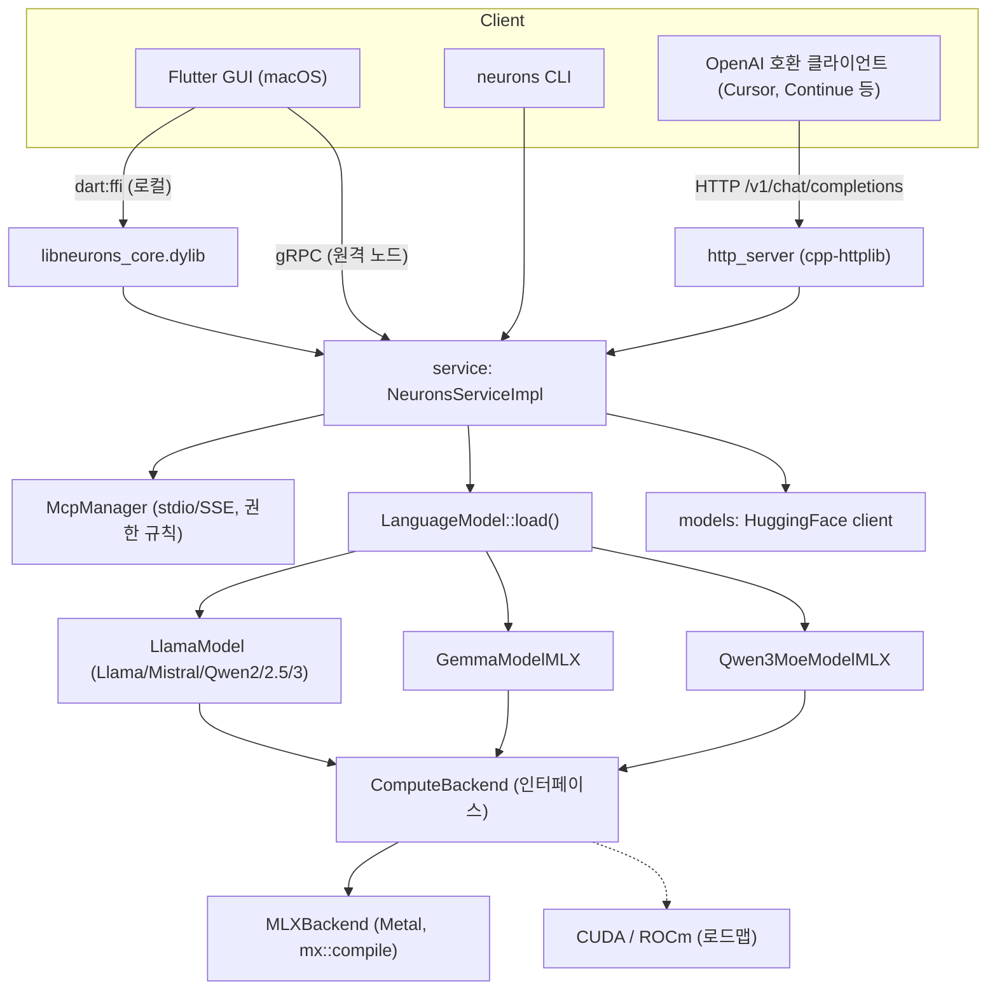
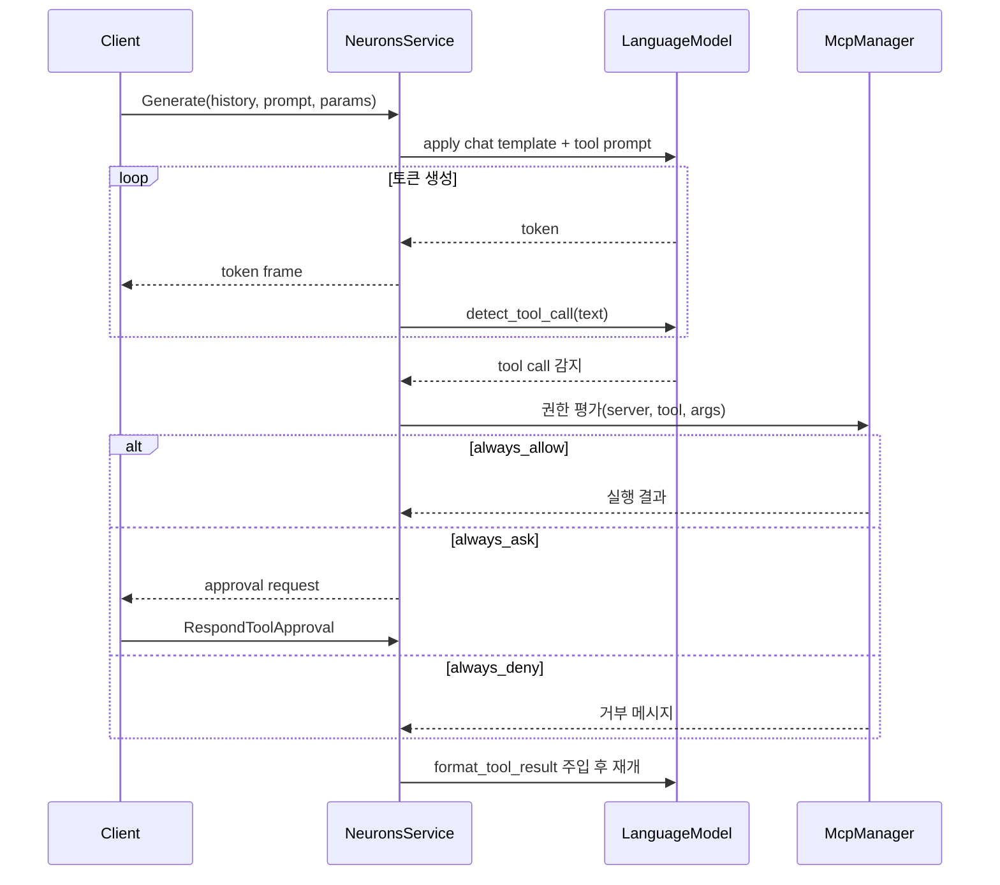

# Neurons

> [!summary] 한줄요약
> llama.cpp·Ollama를 감싸지 않고, Apple MLX의 C++ 연산(`mx::fast::*`) 위에서 transformer forward pass를 직접 구현한 macOS Apple Silicon 전용 로컬 LLM inference 엔진 + CLI + gRPC/OpenAI-compatible 서버 + Flutter GUI. 1인 개발 학습 성격이 강한 소규모 프로젝트(스타 48, MIT, 마지막 push 2026-05-23, v0.7.0)다.

> [!warning] 조사 시점 주의
> 조사일(2026-10-01) 기준 GitHub API상 마지막 push와 최신 릴리스(v0.7.0)가 모두 2026-05-23이다. 약 4개월간 갱신이 없으므로 "활발히 유지되는 프로젝트"로 단정할 수 없다. 이후 변경은 확인하지 못했다.

## 배경 · 해결하는 문제

로컬에서 LLM을 돌리는 도구는 이미 많다. llama.cpp(C/C++ + GGUF), Ollama(llama.cpp 래퍼 + 모델 레지스트리), Apple의 `mlx-lm`(Python), LM Studio 등이 대표적이다. Neurons는 이들과 경쟁하려는 제품이라기보다 README 첫 문장대로 "대규모 언어 모델이 하드웨어 수준에서 실제로 어떻게 동작하는지 이해하기 위해" 만든 프로젝트다. 즉 해결하려는 문제는 "빠르고 편한 로컬 LLM 실행"보다 "추론 스택 전체를 직접 짜 보며 각 층을 이해하고, 그 위에 실제로 쓸 수 있는 앱까지 얹는다"에 가깝다.

그렇지만 단순한 장난감은 아니다. 코드를 보면 다음 층이 모두 존재한다.

- 모델 로딩: HuggingFace 형식 `config.json` + safetensors(MLX 양자화 변형) 파싱, 모델 family별 분기.
- 토크나이저: Rust `tokenizers` 크레이트를 정적 라이브러리(`tokenizers-sys`)로 빌드해 C++에서 호출.
- 채팅 템플릿: Google `minja`(Jinja2 subset)로 모델별 chat template 렌더링.
- 생성 루프: 그리디는 GPU 파이프라이닝, 샘플링 경로는 별도 helper.
- 서비스 계층: gRPC 서버 + OpenAI-compatible HTTP(`/v1/chat/completions`, 스트리밍).
- 에이전트 기능: MCP 클라이언트 런타임(stdio/SSE), 도구 승인 흐름, 내장 filesystem/shell MCP 서버.
- 앱: Flutter macOS GUI(로컬은 `dart:ffi`, 원격은 gRPC).

"from scratch"의 범위는 정확히 짚어야 한다. 코드에서 확인한 바로는 Metal 셰이더를 직접 작성하는 것이 아니라 MLX의 C++ API(`mx::fast::rms_norm`, `mx::fast::rope`, `mx::fast::scaled_dot_product_attention`, 양자화 matmul, `mx::compile`, `mx::async_eval`)를 조합해 모델 그래프를 직접 구성한다. 따라서 "프레임워크 없이 Metal만으로"가 아니라 "MLX를 텐서/커널 런타임으로 쓰되, 모델 구현·KV cache·샘플러·서버는 직접"이라고 이해하는 것이 정확하다. 또한 MLX는 upstream이 아니라 작성자의 fork(`dexwritescode/mlx`)를 특정 커밋으로 고정해 FetchContent로 받는다(아래 리스크 참조).

## 동작 원리 · 아키텍처

### 계층 구조

저장소 최상위는 `compute/`, `models/`, `service/`, `cli/`, `gui/`, `docs/`, `scripts/`이고 루트 `CMakeLists.txt`와 `Makefile`이 C++ 타깃을 한 빌드 트리로 묶는다. 의존 순서는 `compute` → `models` → `service`(gRPC가 있을 때만) → `cli`다.



`ComputeBackend`는 의외로 얇다. `compute_backend.h`를 보면 backend type/name/availability와 `initialize()`/`cleanup()` 같은 생명주기 핸들뿐이고, 실제 수학 연산은 backend 중립 추상화를 거치지 않고 MLX 네이티브 `mx::array`로 직접 수행한다(주석에 "Math operations are performed directly via backend-native APIs"라고 명시). 이는 "pluggable backend"라는 README 표현과 달리 CUDA/ROCm 추가가 단순히 인터페이스 구현만으로 끝나지 않고 모델 구현 자체를 다시 써야 할 가능성이 크다는 뜻이다(이 부분은 코드 구조에 기반한 해석이며 작성자 의도는 확인하지 못함).

### 모델 구현과 추론 경로

`LanguageModel` 추상 클래스(`compute/src/compute/model/language_model.h`)가 앱 코드와 테스트가 바라보는 유일한 인터페이스다. 핵심 멤버는 `generate(input_ids, max_new_tokens, SamplingParams, on_token)`, `config()`, `tokenizer()`, `supports_tool_use()`, `format_tool_system_prompt()`, `detect_tool_call()`, `format_tool_result()`다. 새 아키텍처를 추가하려면 서브클래스 하나와 `LanguageModel::load()` 팩토리의 분기 한 줄이 필요하다고 주석에 적혀 있다. `load()`는 모델 디렉터리의 `config.json`을 읽어 model_type에 따라 구현체를 고르고, 지원하지 않는 타입은 오류를 반환한다.

구현 파일 규모는 `llama_model.cpp` 816줄, `gemma_model_mlx.cpp` 600줄, `qwen3_moe_model_mlx.cpp` 908줄, `qwen3_transformer_moe_model_mlx.cpp` 642줄, `model_config.cpp` 433줄, `sampler.cpp` 145줄 등이다. `llama_model.cpp`에서 확인한 forward pass 구성은 다음과 같다.

- 레이어마다 `mx::fast::rms_norm`(input_layernorm) → Q/K/V 투영(양자화 matmul) → (Qwen3 계열은 q/k norm) → `mx::fast::rope` → KV cache에 `mx::concatenate`로 새 K/V 이어 붙이기 → `mx::fast::scaled_dot_product_attention` → 잔차 → `post_attention_layernorm` → MLP.
- 마지막에 `model.norm` 적용 후 logits.
- 디코드 단계는 `mx::compile(fn, shapeless=true)`로 컴파일한 함수를 재사용하고, `mx::async_eval`로 N번째 토큰의 GPU 작업을 N-1번째 샘플링이 끝나기 전에 큐에 넣는 "GPU-pipelined" 생성을 한다. README는 이 때문에 세션 첫 생성에 1회성 컴파일 비용이 든다고 밝힌다.
- 프리필은 별도 경로(배치 프리필, causal mask 전달)다.

CMake 주석에는 `mx::compile(shapeless=true)`에 필요한 `CustomKernel::output_shapes()`가 upstream MLX에 아직 없어 fork 커밋을 쓰고 "PR이 머지되면 upstream 태그로 되돌린다(TODO)"고 적혀 있다. 즉 성능 경로가 upstream 미반영 패치에 의존한다.

### 샘플링, 토크나이저, 채팅 템플릿

`sampler.cpp`는 temperature==0이면 greedy, 아니면 repetition penalty → temperature 스케일 → top-k(`nth_element`로 임계값 계산) → top-p(누적확률) 순으로 적용하는 CPU 샘플러다. 토크나이저는 `compute/tokenizers-sys`가 Rust `tokenizers = "=0.23.1"`(features: `onig`, default 비활성)을 `staticlib`로 만들고 `tokenizers_c.h`(cbindgen)로 C++가 호출한다. 그래서 빌드 전에 `cargo build --release`가 필요하고 Makefile이 `_tokenizers_sys` 타깃으로 선행 처리한다. 채팅 템플릿은 google/minja를 `GIT_TAG main`으로 받아 헤더만 쓴다.

모델이 `<think>` 토큰을 어휘에 갖고 있으면 reasoning 모델로 판정(`is_reasoning_model()`)하고, tool use 지원 여부는 "토크나이저 어휘 탐색 + 모델명 휴리스틱"으로 로드 시점에 결정한다고 주석에 적혀 있다.

### 서비스와 데이터 흐름

`service/proto/neurons.proto`의 `NeuronsInference` 서비스는 다음 RPC를 가진다.

- 모델: `LoadModel`, `UnloadModel`, `GetStatus`, `ListModels`, `SearchModels`, `GetModelInfo`, `DownloadModel`(스트림), `CancelDownload`, `SetHfToken`(토큰은 메모리에만 보관, 서비스가 영속화하지 않음).
- 생성: `Generate`(서버 스트림: 토큰 프레임, 도구 호출, 도구 결과, 승인 요청 이벤트, 마지막에 done=true와 토큰 합계), `RespondToolApproval`.
- 운영: `StreamLogs`.
- MCP: `ListMcpServers`/`AddMcpServer`/`RemoveMcpServer`/`PushMcpServers`, `ListPermissionRules`/`SetPermissionRule`/`DeletePermissionRule`.

`GenerateRequest`는 history, prompt, `SamplingParams`(temperature, top_p, top_k, rep_penalty, max_tokens, context_window), `active_mcp_servers`, `session_id`, `tool_use_enabled`, `tool_results`(원격 노드에서 클라이언트가 도구를 실행한 결과를 주입), `allow_shell_fallback`을 담는다. 서비스는 모델의 chat template으로 전체 프롬프트를 만든다.



## 핵심 기능 상세

### 1) 로컬 추론과 지원 모델

README 표 기준 지원 family는 Llama 2/3·TinyLlama, Mistral, Qwen2/2.5/3, Qwen3 MoE(예: Qwen3-30B-A3B, Qwen3.6-35B-A3B), Gemma/Gemma2/Gemma3, fp16/bf16 비양자화 모델이다. 모델은 `mlx-community`의 MLX 양자화 변형을 HuggingFace에서 내려받는다. GGUF는 지원 대상이 아니다(README에 GGUF 언급 없음).

성능은 README 자체 측정치(M2 Max 64GB, greedy, release)다. TinyLlama 1.1B 4-bit 약 265 tok/s, Gemma 3 1B 약 190, Gemma 3 4B QAT 약 60, Llama-3.1 8B 4-bit 약 61, Mistral 7B 약 57, Qwen3.6 35B-A3B(활성 3.6B) 약 77 tok/s. MoE는 토큰당 활성 파라미터가 작아 dense 3~4B급 속도라는 설명이 붙어 있다. 독립 재현·비교는 하지 못했다.

### 2) CLI

`neurons chat|load|search|download|list|server|node|token|config` 명령이 있고(`cli/src/cli/commands/`에 각 명령 파일, MCP 명령 파일도 존재), `server`는 gRPC와 선택적 HTTP를 함께 띄운다.

### 3) OpenAI-compatible HTTP

`service/src/http_server.cpp`(cpp-httplib 사용으로 보임)가 `GET /v1/models`, `POST /v1/chat/completions`(스트리밍 지원), `GET /health`를 제공한다. README는 Cursor의 local model 설정, Continue.dev 등에 연결 가능하다고 적는다. 실제 연동 검증은 하지 않았다.

### 4) 원격 노드

각 머신에서 `neurons server`를 띄우고 GUI/CLI에서 `neurons node add <name> grpc://host:50051`로 등록한다. 로드맵(Phase K)의 라우팅·speculative decoding·failover는 아직 진행 중(🚧)이다.

### 5) MCP 런타임과 권한 모델

이 프로젝트에서 에이전트 관점으로 가장 눈여겨볼 부분이다. `mcp_manager.cpp`(629줄)와 `mcp_types.h`를 보면:

- 전송: stdio, SSE. JSON-RPC 2.0 클라이언트(`mcp_client.cpp`).
- 권한 규칙: `server`(이름 또는 `*`), `tool`, `arg_constraints`(인자 필드별 glob 패턴을 담은 JSON), `permission`(`always_allow | allow_session | always_ask | always_deny`), `scope`(`global` → `mcp_permissions.json`에 영속, `session:<id>` → 메모리, `chat:<id>` → ChatSession JSON), `priority`.
- 평가: 우선순위 순서로 첫 매치가 이기고, 매치가 없으면 `always_ask`가 최종 기본값. session/chat 스코프를 먼저 보고 global을 본다.
- 기본 규칙: `neurons-filesystem.read_file`은 always_allow, `write_file`은 always_ask, `neurons-shell.run_command`는 always_ask.
- 내장 서버: `builtin_filesystem`, `builtin_shell`. 셸은 출력 8KB 상한, 타임아웃 기본 30초·최대 120초, `cwd` 지정 가능. README 로드맵 L.8은 아직 진행 중으로 표기돼 있는데 코드에는 이미 파일이 있다(완성도는 확인하지 못함).
- `allow_shell_fallback`: 등록되지 않은 도구 이름을 내장 셸 `run_command`로 보내는 옵트인 옵션(기본 false, 항상 승인 흐름 적용).
- 원격 노드가 "inherit" 모드일 때 컨트롤러가 `PushMcpServers`로 서버 목록을 밀어 넣는다.

GUI/CLI의 MCP 화면은 README 표에서 🚧(미완)이고 gRPC 쪽만 ✅다. 즉 지금 MCP 권한 UX는 API 수준에서만 완성됐다.

### 6) GUI 구조

`gui/lib/services/`에 `neurons_client.dart`(공통 인터페이스), `ffi_neurons_client.dart`(로컬 dylib), `openai_neurons_client.dart`, `app_state.dart`, `chat_repository.dart`, `node_repository.dart`, `token_repository.dart`가 있다. 화면은 chat, connect, model_browser, model_picker, nodes, load_settings 등. 의존성은 `grpc`, `protobuf`, `provider`, `flutter_secure_storage`(HF 토큰용으로 보임), `flutter_markdown_plus`, `ffi`, `openai_dart`다. Dart gRPC 스텁은 `scripts/gen_proto.sh`로 `protoc` + `protoc_plugin`을 써서 생성한다.

## 설치 · 사용법

사전 요건(README): macOS 14+ Apple Silicon, Xcode command line tools, CMake, gRPC, Protobuf, Flutter SDK. Rust 툴체인(`cargo`)도 `tokenizers-sys` 빌드에 필요한데 README 사전 요건 목록에는 빠져 있고 Makefile에서 확인했다.

```bash
xcode-select --install
brew install cmake grpc protobuf
git clone https://github.com/dexwritescode/neurons.git && cd neurons

make help      # 타깃 목록
make cli       # CLI만 (cargo build -> cmake configure -> build)
make all       # compute + CLI + service
make tests     # C++ 테스트
make run       # dylib 빌드 후 Flutter 앱 실행(debug)
make gui       # Flutter macOS release 앱
```

터미널 사용:

```bash
./build/bin/neurons search "qwen 3b"
./build/bin/neurons download mlx-community/Qwen2.5-3B-Instruct-4bit
./build/bin/neurons chat mlx-community/Qwen2.5-3B-Instruct-4bit
```

OpenAI 호환 서버:

```bash
./build/bin/neurons server --http-port 8080 \
  --model mlx-community/Qwen2.5-3B-Instruct-4bit

curl http://localhost:8080/v1/chat/completions \
  -H "Content-Type: application/json" \
  -d '{"model":"local","messages":[{"role":"user","content":"Hello"}],"stream":true}'
```

원격 노드:

```bash
# 원격 머신
neurons server --grpc-port 50051 --http-port 8080
# 노트북
neurons node add my-server grpc://192.168.1.10:50051
neurons node use my-server
```

사전 빌드 `.dmg`(`Neurons-<version>-arm64.dmg`)도 GitHub Releases에 있으나 서명되지 않아 첫 실행 시 `xattr -dr com.apple.quarantine /Applications/Neurons.app`가 필요하다고 README가 안내한다. 이번 조사에서 직접 빌드·실행은 하지 않았다.

## 디렉터리 · 코드 구조에서 확인한 것

| 경로 | 내용 |
|---|---|
| `compute/src/compute/core` | `ComputeBackend`, `BackendFactory`, `BackendManager`(싱글톤), 타입 정의 |
| `compute/src/compute/backends/mlx` | `MLXBackend`(57줄, 얇음) |
| `compute/src/compute/model` | 모델 구현 4종, `language_model`, `model_config`, `model_loader`, `sampler`, `hf_tokenizer`, `chat_template`, `tool_runner` |
| `compute/tokenizers-sys` | Rust staticlib + cbindgen 헤더 |
| `models/` | HuggingFace 클라이언트(검색·다운로드·이어받기·Bearer 토큰), 모델 레지스트리 |
| `service/src` | gRPC 구현(`neurons_service.cpp` 1058줄), HTTP 서버, 로거, `mcp/` |
| `service/proto` | `neurons.proto` |
| `cli/src/cli/commands` | 명령별 파일 |
| `gui/` | Flutter 앱(macOS/Windows/Linux 러너 포함, 실제 지원은 macOS) |
| `.github/workflows` | build, test, gui-test, release, release-macos |

테스트는 `compute/tests/compute`에 토크나이저, config, sampler, chat template, tool runner 단위 테스트와 모델별 integration 테스트(Mistral, Llama3, Qwen2, Qwen3 MoE, Gemma, fp16/bf16)가 있다. integration 테스트는 모델 파일이 없으면 `GTEST_SKIP`으로 건너뛰며, `docs/models.md`에 필요한 모델 다운로드 목록이 있다. CI는 `macos-26` 러너에서 brew로 grpc를 설치하고 Rust 아티팩트를 캐시한다. 코드 총량은 대략 7천 줄 규모(compute 모델 + service 합계)로 읽을 만한 크기라 학습용으로는 장점이다.

## 비교 대상

| 항목 | Neurons | llama.cpp / Ollama | mlx-lm (Apple) | LM Studio |
|---|---|---|---|---|
| 런타임 | MLX C++ 직접 사용 | 자체 ggml(Metal/CUDA 등) | MLX Python | llama.cpp/MLX 기반 상용 앱 |
| 모델 형식 | MLX safetensors | GGUF | MLX safetensors | 둘 다 |
| 플랫폼 | Apple Silicon만(실질) | 전 플랫폼 | Apple Silicon | 데스크톱 |
| 서버 | gRPC + OpenAI HTTP | OpenAI HTTP | OpenAI 호환 서버 있음 | 로컬 서버 |
| 에이전트/MCP | 클라이언트 런타임 + 권한 규칙 내장 | 외부 도구 필요 | 없음 | MCP 지원(확인 못함) |
| 성숙도 | 초기, 1인 | 매우 높음 | 높음 | 높음 |

llama.cpp/Ollama/mlx-lm/LM Studio 열은 일반 지식에 근거한 요약이며 이번에 각 저장소를 열어 확인하지 않았다. Neurons의 차별점은 "추론 엔진과 MCP 권한 체계, 원격 노드 개념을 한 바이너리에 담은 점"과 "읽을 만한 크기의 코드"다. 반대로 속도·모델 지원 범위·안정성은 성숙 도구에 못 미칠 가능성이 크다(비교 벤치마크는 하지 않음).

## 장단점 · 한계 · 성숙도

사실(GitHub API, 2026-10-01 조회): 스타 48, fork 14, 열린 이슈 0, 주 언어 C++, MIT, 생성 2026-04-20, 마지막 push 2026-05-23, 릴리스 v0.5.0(05-11), v0.5.1, v0.6.0(05-12), v0.6.1(05-15), v0.7.0(05-23). 약 한 달에 5개 릴리스를 낸 뒤 멈춘 패턴이다. 로컬 clone의 마지막 커밋도 2026-05-23이다.

장점:
- 코드가 작고 계층이 명확해 "LLM 추론이 실제로 어떻게 구성되는가"를 읽기에 좋다(RMSNorm, RoPE, KV cache, `mx::compile`, 파이프라인 디코드).
- MCP 권한 규칙(스코프, 우선순위, 인자 glob, 기본 always_ask)이 에이전트 거버넌스 설계의 참고가 된다.
- Qwen3 MoE까지 지원하고 CLI/GUI/gRPC/HTTP가 한 저장소에서 일관된다.

단점과 한계:
- Apple Silicon 전용. Linux/Windows는 gRPC 서비스만 빌드되고 MLX 추론은 불가, CUDA/ROCm은 로드맵.
- GUI·CLI의 MCP 화면, RAG(Phase J), 멀티노드 라우팅(Phase K)은 미완성(🚧).
- `ComputeBackend`가 생명주기 핸들 수준이라 백엔드 교체 가능성은 과장됐을 수 있다.
- 사용자·기여자 규모가 작아 버그 발견 속도, 문서(문서는 사실상 README와 `docs/models.md`뿐)가 빈약하다.
- 성능 수치는 README 자체 측정이며, 모델 호환성(새 아키텍처마다 서브클래스 직접 작성)이 확장 비용이다.

## 보안 · 라이선스 · 운영 리스크

- 라이선스는 MIT(LICENSE 첫 줄 확인). 단, 빌드 시 받는 의존성(MLX fork, nlohmann_json, minja, tokenizers, gRPC)의 라이선스는 별도 확인이 필요하다.
- 네트워크 노출: `http_server.cpp`는 `0.0.0.0`에 바인드하고 gRPC도 `0.0.0.0:<port>`에 `grpc::InsecureServerCredentials()`로 연다(`service_runner.cpp`). 코드 검색 범위에서 인증 검사나 TLS는 발견하지 못했다(HTTP 쪽 `Authorization`은 CORS 허용 헤더 목록에만 등장). 사내망에서 그대로 띄우면 같은 네트워크의 누구나 모델 로드/언로드, 로그 스트림, MCP 서버 추가, 권한 규칙 변경까지 호출할 수 있다. 특히 `AddMcpServer`로 임의 command를 stdio MCP 서버로 등록하게 되면 원격 코드 실행에 준하는 위험이다(이 시나리오는 코드 구조에서의 추론이며 실제 익스플로잇은 검증하지 않음). 사용한다면 127.0.0.1 바인딩 또는 리버스 프록시/SSH 터널/방화벽이 필수다.
- 내장 `run_command`는 호스트에서 셸을 실행한다. 기본 always_ask이지만 `allow_shell_fallback`이나 사용자가 always_allow로 바꾸면 프롬프트 인젝션이 곧 호스트 명령 실행이 될 수 있다.
- 공급망: MLX를 개인 fork의 특정 커밋에서 받고, minja를 `GIT_TAG main`(고정 안 됨)으로 받는다. 재현 가능한 빌드와 감사 관점에서 불리하다.
- 배포물: `.dmg`가 미서명(quarantine 해제 요구)이라 사내 배포 정책(Gatekeeper)과 충돌한다.
- HF 토큰: 서비스는 메모리에만 보관하고 영속화하지 않는다고 proto 주석에 있다. GUI는 `flutter_secure_storage`를 쓰는 것으로 보이나 세부는 확인하지 못했다.
- 보안 정책상 사내 기밀·PII를 다루려면 어떤 모델이든 로컬 처리가 장점이지만, 위 노출 문제를 먼저 해결해야 한다.

## 관련 노트

[[nullclaw]] · [[onyx]] · [[openworker]] · [[openviking]] · [[generic-agent]]

## 출처

실제로 연 URL/자료:
- https://github.com/dexwritescode/neurons (README 전문, 2026-10-01 clone)
- 로컬 clone 내부 파일: `README.md`, `docs/models.md`, `CMakeLists.txt`, `Makefile`, `compute/CMakeLists.txt`, `compute/src/compute/core/compute_backend.h`, `compute/src/compute/model/{language_model.h,llama_model.cpp,sampler.cpp}`, `compute/tokenizers-sys/Cargo.toml`, `service/proto/neurons.proto`, `service/src/{http_server.cpp,service_runner.cpp}`, `service/src/mcp/{mcp_types.h,mcp_manager.cpp,builtin_shell.cpp}`, `gui/pubspec.yaml`, `scripts/gen_proto.sh`, `.github/workflows/test.yml`, `LICENSE`
- GitHub API: `repos/dexwritescode/neurons`, `repos/dexwritescode/neurons/releases` (2026-10-01 조회)
