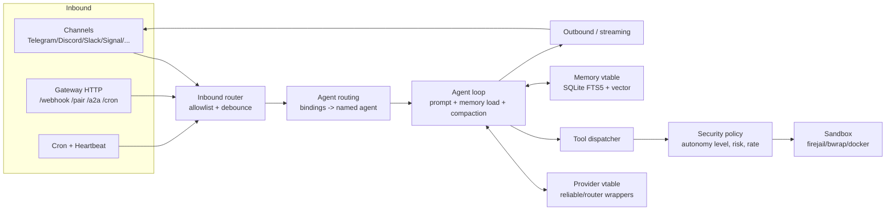

# NullClaw

> [!summary] 한줄요약
> Zig로 작성한 단일 정적 바이너리 기반 AI 비서 런타임으로, 메신저에서 도구를 호출하며 상시 동작한다.

- **구성**: Zig 0.16, MIT, 스타 약 8.1k.
- **기능 범위**: 50+ provider, 19개(이상) 메시징 채널, 10종 memory 엔진, 다층 sandbox, MCP, A2A, cron/heartbeat, 하드웨어 peripheral을 vtable 인터페이스로 교체할 수 있다.
- **수치의 한계**: 바이너리 678KB·RAM 약 1MB는 README 자체 주장이다.

## 1. 배경: 어떤 문제를 푸는가

2026년 초 "Claw" 계열 개인 AI assistant 프레임워크가 쏟아졌다. 계보는 OpenClaw(TypeScript)에서 시작해 NanoBot(Python), PicoClaw(Go), ZeroClaw(Rust)로 이어지고, NullClaw는 그 마지막 줄에 Zig 구현으로 선다. 저장소 README의 비교표가 이 계보를 직접 나열한다. 이 계열이 공유하는 구상은 이렇다. 사용자가 이미 쓰는 메신저(Telegram, Discord, Slack, Signal 등)를 UI로 삼고, 뒤에서 LLM이 도구(shell, 파일, 웹, 메모리)를 호출하며 상시 동작하는 "개인 비서 데몬"이다.

문제는 이런 상시 데몬이 Node.js나 Python 런타임을 통째로 끌고 다닌다는 점이다. README는 OpenClaw가 RAM 1GB 이상, NanoBot이 100MB 이상이라고 주장한다. 값싼 SBC나 오래된 장비, 컨테이너 수백 개를 띄우는 환경에서는 이 비용이 부담스럽다. NullClaw의 답은 단순하다. GC도 VM도 없는 언어(Zig)로 전부 다시 쓰고, 의존성을 libc와 vendored SQLite 정도로 줄인다. 그래서 "Null overhead. Null compromise."라는 슬로건이 붙었다.

두 번째 동기는 OpenClaw 호환성이다. config.json 구조(snake_case, `models.providers`, `agents.defaults.model.primary`, 채널의 `accounts` 래퍼)를 OpenClaw와 맞췄고, `nullclaw migrate openclaw` 명령으로 기존 memory를 옮길 수 있다. 즉 "OpenClaw 사용자가 가볍게 갈아타는 경로"를 의도한 설계다.

## 2. 한눈에 보는 사실 (직접 확인)

| 항목 | 값 | 출처 |
|---|---|---|
| 스타 / fork | 8,103 / 946 | `gh api` 2026-10-01 |
| open issues(PR 포함 집계) | 67 | `gh api` |
| 라이선스 | MIT | `gh api`, LICENSE |
| 생성일 | 2026-02-16 | `gh api` |
| 마지막 push | 2026-09-27 | `gh api`, 마지막 커밋 "Merge pull request #968 ... matrix next_batch persistence" |
| 최신 정식 릴리스 | v2026.5.29 (2026-05-29) | `gh api releases/latest` |
| 릴리스 태그 | 30개(nightly 태그 포함) | `gh api releases` |
| 버전 체계 | CalVer `YYYY.M.D` | `build.zig.zon` version "2026.5.29" |
| 최소 Zig | 0.16.0 (정확히 이 버전) | `build.zig.zon`, README |
| `src/` Zig 파일 수 | 292개 | clone 후 `find` |
| `src/` 총 줄 수 | 약 28.6만 줄(285,763) | clone 후 `wc` |
| `test "..."` 블록 | 약 7,471개 | clone 후 grep |

수치는 **문서의 측정 시점과 조사한 코드의 시점**을 구분해서 읽어야 한다.

- **소스·테스트 규모**: README는 "소스 약 230~250개, 테스트 5,300+"라고 쓰지만, 2026-09 시점 clone에서는 파일 292개·테스트 블록 약 7.4k로 늘어 있었다. README가 코드 성장을 따라가지 못한 상태다.
- **바이너리 크기**: 678KB는 README의 2026-02 로컬 벤치 수치다. 기능이 늘어난 현재 빌드에서도 같은지는 직접 빌드·재측정하지 않아 확인하지 못했다.
- **배포 버전**: 최신 정식 릴리스는 5월이며 그 뒤 4개월간 main이 계속 변경됐다. 운영에서는 nightly를 쓸지, v2026.5.29를 고정할지 정해야 한다.

## 3. 아키텍처

### 3.1 vtable 중심 설계

docs/en/architecture.md의 핵심 문장은 "Subsystems are abstracted via interfaces using `ptr: *anyopaque + vtable`"이다. Zig에는 trait/interface가 없으므로 C 스타일 fat pointer(데이터 포인터 + 함수 포인터 테이블)로 다형성을 만든다. 실제로 `src/runtime.zig`에서 `RuntimeAdapter`가 `ptr: *anyopaque`와 `vtable: *const VTable`(name, has_shell_access, has_filesystem_access, storage_path, supports_long_running, memory_budget)를 갖는 것을 확인했다. Provider, Channel, Tool, Memory, Sandbox, Tunnel, Peripheral, Observer도 같은 패턴이다. 팩토리가 config 값에 따라 구현체를 선택하므로 "config만 바꾸면 교체"가 성립한다.



위 도식은 `src/` 파일 구성(inbound_router.zig, agent_routing.zig, agent/, providers/, tools/, security/policy.zig, memory/, outbound.zig, streaming.zig)과 docs를 바탕으로 내가 정리한 것이다. 각 화살표의 세부 호출 순서까지 코드로 추적한 것은 아니다.

### 3.2 모듈 지도

`src/` 최상위에서 확인한 것은 다음과 같다.

- `agent/`: `prompt.zig`, `compaction.zig`(컨텍스트 압축), `memory_loader.zig`, `dispatcher.zig`, `turn_persistence.zig`, `commands.zig`(슬래시 명령), `max_tokens.zig`, `context_tokens.zig`.
- `providers/`: `anthropic`, `openai`, `openrouter`, `gemini`, `vertex`, `ollama`, `compatible`(OpenAI 호환), `claude_cli`/`codex_cli`/`gemini_cli`(CLI 래핑), `openai_codex`, 그리고 `reliable.zig`(재시도/폴백)와 `router.zig`. `reliable.zig`는 4xx 중 429/408을 제외하면 재시도하지 않는 `isNonRetryable`, 컨텍스트 윈도 초과 판별 같은 오류 분류를 가진다.
- `channels/`: telegram(ingress/api/draft presenter 분리), discord, slack, signal, matrix, whatsapp, irc, email, imessage, line, lark, dingtalk, onebot, qq, wecom, weixin, wechat, mattermost, teams, max, maixcam, nostr, web, cli, 그리고 `external*.zig`(외부 프로세스를 채널로 붙이는 stdio JSON-RPC 프로토콜).
- `tools/`: shell, file_read/write/edit/append/delete 및 `*_hashed` 변형, git, http_request, web_fetch, web_search(여러 검색 provider), browser/browser_open/screenshot, memory_store/recall/forget/list, cron_*, delegate, spawn, schedule, composio, pushover, message, image, i2c/spi/hardware_*, sqlite_query, calculator, anonymize_text.
- `memory/`: `engines/`(sqlite, markdown, postgres, redis, clickhouse, lancedb, lucid, lru, api, none, kg), `retrieval/`(RRF, MMR, temporal_decay, query_expansion, LLM reranker, adaptive, qmd), `vector/`(chunker, 여러 embeddings, pgvector/qdrant store, circuit_breaker, outbox), `lifecycle/`.
- `security/`: policy, sandbox, detect, landlock, firejail, bubblewrap, docker, pairing, secrets, audit, external_content, tracker(rate), botframework_auth, tencent_crypto.
- 기타: `gateway.zig`, `a2a.zig`, `acp.zig`, `mcp.zig`, `skills.zig`, `skillforge.zig`, `cron.zig`, `heartbeat.zig`, `tunnel.zig`, `peripherals.zig`, `hardware.zig`, `service.zig`, `daemon.zig`, `doctor.zig`, `migration.zig`, `redaction.zig`, `workspace_audit.zig`, `voice.zig`, `main_wasi.zig`.

특이한 점은 `main_wasi.zig`가 있어 WASI 타깃으로 별도 진입점을 둔다는 것, 그리고 `build.zig.zon`의 의존성이 vendored `sqlite3`, 자사 포크 `websocket`, 자사 포크 `wasm3` 셋뿐이라는 것이다. 즉 "libc만 필요"라는 주장은 대체로 사실이되, SQLite와 wasm3를 소스째 정적 링크한 결과이다.

### 3.3 빌드 시 기능 선택

`build.zig`에는 `-Dstatic`, `-Dembedded_wasm3`, `-Dversion` 외에 채널 목록과 memory 엔진 목록을 문자열 옵션으로 받아 `enable_channel_*`, `enable_memory_*` 플래그를 `build_options`로 주입하는 코드가 있다. 이것이 바이너리 크기를 줄이는 실제 수단이다. 안 쓰는 채널과 엔진은 컴파일에서 빼버리는 방식이다. 정확한 옵션 이름(`-Dchannels=...`, `-Dengines=...`)은 내가 `option` 호출 두 곳의 인자까지는 열어보지 않아 확인하지 못했다. `zig build -h`로 확인하는 것이 안전하다.

### 3.4 Gateway와 A2A

`nullclaw gateway`는 기본 `127.0.0.1:3000`에서 HTTP 서버를 띄우고, 설정된 모든 채널·계정, heartbeat, scheduler를 한 프로세스에서 구동한다. docs/en/gateway-api.md가 나열한 엔드포인트는 다음과 같다.

| Endpoint | 인증 | 용도 |
|---|---|---|
| `GET /health` | 없음 | 헬스체크 |
| `POST /pair` | `X-Pairing-Code` | 1회용 6자리 코드를 bearer 토큰으로 교환 |
| `POST /webhook` | Bearer | `{"message":"..."}` 전송 |
| `POST /media/transcribe` | Bearer | base64 오디오 STT |
| `/cron`, `/cron/add|remove|pause|resume|update` | Bearer(공개 바인드 시) | 라이브 스케줄러 제어 |
| `POST /telegram` | `X-Telegram-Bot-Api-Secret-Token` | Telegram 웹훅 |
| `GET /whatsapp` | query | Meta 검증 |

`src/a2a.zig`는 Agent2Agent 프로토콜(코드상 `A2A_PROTOCOL_VERSION = "0.3.0"`)을 구현한다. `/.well-known/agent-card.json` Agent Card 노출, `POST /a2a` JSON-RPC(`message/send`, `message/stream`, `tasks/get|cancel|list|resubscribe`), 태스크 상태 머신(submitted → working → completed | failed | canceled | rejected | input-required | auth-required), 레지스트리 최대 1000건 축출이 소스 상단 주석에서 확인된다. `acp.zig`도 있으나 열어보지 못했다.

## 4. 핵심 기능 상세

### 4.1 Provider

50+ provider를 내장한다(README 열거: OpenRouter, Anthropic, OpenAI, Azure OpenAI, Gemini, Vertex AI, Ollama, Groq, Mistral, xAI, DeepSeek, Together, Fireworks, Perplexity, Cohere, Bedrock 등). 임의의 OpenAI 호환 엔드포인트는 `custom:https://your-api.com` 형태로 붙인다. Vertex는 bearer 토큰 또는 서비스 계정 JSON을 받고, 서비스 계정일 때는 RS256 JWT 서명을 위해 `openssl`이 PATH에 있어야 한다는 점이 README에 적혀 있다. 이는 "libc만 필요"라는 문구의 예외다. 모델 지정은 `openrouter/anthropic/claude-sonnet-4`처럼 `provider/model` 문자열이고, 에이전트별로 다른 provider를 지정할 수 있다(`agents.list[]`).

### 4.2 Channel과 라우팅

채널 정책의 기본값은 "비어 있으면 전부 거부"다.

- `allow_from`이 빈 배열이면 inbound 전체를 차단한다.
- `"*"`는 명시적으로 전체를 허용한다.
- 그 외 값은 정확히 일치할 때만 허용한다.

이 기본값은 `SECURITY-PATCH-PLAN-2026-05-10.md`에서 보강된 것으로 보인다. 문서가 수정 대상으로 적은 취약점은 네 가지다.

1. Telegram 웹훅 위조 및 인증 부재
2. `curl` argv를 통한 비밀 노출
3. cron shell job의 shell tool 보안 우회
4. 빈 `allow_from`을 전체 허용으로 처리하는 동작

초기 버전에 이런 취약점이 있었다는 기록이다. 수정 계획을 공개한 점은 긍정적이지만, 도입 시에는 **어느 버전부터 수정됐는지** 별도로 확인해야 한다. 릴리스 노트별 대응 여부는 이번 조사에서 확인하지 못했다.

`bindings[]`로 채널·계정·peer(채팅/포럼 topic)를 이름 붙은 agent profile에 연결한다. Telegram 포럼 topic은 `"<chat_id>:thread:<topic_id>"` 형태로 지정하며, topic 바인딩이 그룹 바인딩보다 우선한다(배열 순서는 무관). 채팅에서 `/bind coder`를 치면 `~/.nullclaw/config.json`에 정확한 바인딩이 기록된다. `agents.list[].workspace_path`를 주면 에이전트별 워크스페이스와 `agent:<id>` memory namespace가 분리된다. 하나의 데몬에 여러 역할 에이전트를 두고 대화방별로 나누는 구성이 가능하다는 의미다.

### 4.3 Memory

README가 강조하는 "외부 의존 없는 hybrid 검색"은 SQLite 안에서 이뤄진다. 임베딩을 BLOB로 저장해 cosine similarity를 계산하고, FTS5 가상 테이블의 BM25로 키워드 검색을 하며, 둘을 가중 병합한다(예시 `vector_weight: 0.7`, `keyword_weight: 0.3`). 이는 별도 벡터 DB 없이 단일 파일로 끝낸다는 장점과, 대규모 코퍼스에서 선형 스캔이 되기 쉽다는 한계를 함께 가진다(후자는 내 추론이며 코드로 확인하지 않음). 대규모가 필요하면 `vector/`에 pgvector, qdrant store가 따로 있고 postgres/redis/clickhouse/lancedb 엔진도 있다. `retrieval/`에는 RRF, MMR, temporal decay, query expansion, LLM reranker가 있어 단순 병합 이상의 후처리 계층이 갖춰져 있다.

운영 측면에서 `nullclaw memory export-jsonl`(기본 PII 마스킹), `nullclaw memory hygiene-report`(중복 그룹 dry-run 보고)라는 거버넌스용 명령이 문서에 있다.

### 4.4 Tools와 Skills

도구 35+종이라는 README 주장은 `src/tools/`의 파일 구성과 대체로 일치한다. 흥미로운 것은 `file_read_hashed`/`file_edit_hashed`로, 이름상 내용 해시 앵커로 편집 충돌을 막는 변형으로 보이나 구현은 열어보지 않았다. MCP는 `mcp_servers` 설정으로 stdio와 http transport를 지원하고, `timeout_ms` 초과 시 stdio 서버를 런처 프로세스 그룹째 종료한다고 README에 명시돼 있다. Skills는 `SKILL.md`의 YAML frontmatter 또는 TOML/JSON manifest를 읽고, `nullclaw skills install <Git URL|경로|well-known HTTPS endpoint>`, `--name <query>`로 레지스트리 검색 설치를 한다. `skillforge.zig`는 Scout → Evaluate → Integrate 파이프라인으로 외부 스킬을 자동 발견·점수화(`min_score` 기본 0.7)해 통합하는 기능이며 기본값은 `enabled = false`다. 외부 코드를 자동 도입하는 기능이므로 켤 때는 정책 검토가 필요하다.

### 4.5 Autonomy와 보안 정책

`src/security/policy.zig`에서 자율성 수준이 네 단계(`read_only`, `supervised`, `full`, `yolo`)이고 기본이 `supervised`임을 확인했다. `yolo`는 allowlist, 구문, 위험도, 승인, rate limit을 전부 우회한다고 코드 주석에 적혀 있다. 명령 위험도는 low/medium/high로 나뉘며, `rm`, `sudo`, `dd`, `mkfs`, `chmod`, `chown`, `ssh`, `iptables` 등이 high-risk 목록으로 하드코딩돼 있다. 시간당 행동 수 제한(`max_actions_per_hour`, 예시 20)이 있고, shell 자식 프로세스에는 `PATH`, `HOME`, `TERM`, `LANG`, `USER`, `SHELL`, `TMPDIR` 등 최소 환경변수만 전달해 키 유출(CWE-200)을 막는다. `LD_LIBRARY_PATH` 같은 경로형 변수는 `tools.path_env_vars`로 열 수 있고, 모든 구성요소를 realpath로 정규화해 workspace/allowed_paths 안에 있을 때만 통과시키며 하나라도 실패하면 변수 전체를 버린다.

### 4.6 Sandbox

`security/detect.zig`가 선택하는 옵션은 `auto`, `none`, `landlock`, `firejail`, `bubblewrap`, `docker`다. 코드 주석의 자동 선택 우선순위는 플랫폼별로 다르다.

- **Linux**: firejail > bubblewrap > docker > noop
- **macOS**: docker > noop. Docker가 없으면 사실상 sandbox가 없다.
- **Windows**: 확인하지 못했다.

**Landlock은 문서와 코드 주석을 구분해야 한다.** README와 docs에는 지원 항목으로 나오지만, 코드에는 "Landlock is not surfaced until rule installation is implemented"라고 적혀 있다. 적어도 조사 시점의 주석상 자동 선택 경로에는 노출되지 않으므로 보안 평가에서 확인해야 할 불일치다.

### 4.7 PII redaction

docs/en/security.md의 "Privacy Redaction Boundary"는 흥미롭다. 활성화하면 이메일·전화·Luhn 유효 카드번호·ID·토큰 패턴을 `[EMAIL_1]` 같은 결정적 placeholder로 바꿔 provider 호출, 세션 저장, memory autosave, 진단, 임베딩 동기화 전에 적용한다. HMAC-SHA256 지문으로 키잉하고 원문은 보관하지 않는다. 복원(rehydrate)은 단일 사용자 세션의 메모리 내 reverse map으로만 가능하고, 공용 채널에서는 placeholder 그대로 내보낸다. 도구 인자는 기본적으로 placeholder 유지라 "provider → tool 유출 경로"를 막는다고 설명한다. 단 문서도 스스로 "가벼운 텍스트 스캐너이지 DLP/OCR이 아니다"라고 한계를 밝히며 한국어 주민등록번호 같은 로케일 특화 포맷을 지원하는지는 확인하지 못했다. `sqlite_query` 도구는 항상 마스킹된 결과를 반환하고 `hex()`, `substr()` 같은 변환 함수를 거부한다.

`nullclaw workspace audit`은 워크스페이스, staged diff, git 리비전 범위에서 시크릿 유출을 스캔한다. 토큰 prefix(`AKIA`, `ghp_`, `glpat-`, `xoxb-`, `sk-` 등), 키워드 점수 기반 할당 매처, PEM/URL 내 자격증명, 고엔트로피(길이 16 이상, Shannon 4.0 이상) 토큰을 탐지하고, `--fail-on` 종료코드로 CI에 붙일 수 있다. `--llm-triage`는 비밀 값 자체를 제외한 봉투만 LLM에 보낸다고 한다.

### 4.8 Edge/WASM, 하드웨어

`examples/edge/cloudflare-worker/`는 호스트(JS)가 네트워크·시크릿·Telegram 웹훅·OpenAI 호출을 맡고 아주 작은 Zig WASM 모듈(`agent_core.zig`)이 응답 정책만 결정하는 하이브리드 예제다. peripheral(Serial, Arduino, RPi GPIO, STM32/Nucleo), `i2c`/`spi` 도구도 있어 "임베디드 에이전트"를 표방한다. 이 부분은 사내 업무와 거리가 멀어 실행해 보지 않았다.

## 5. 설치·사용법

```bash
# 가장 쉬운 경로
brew install nullclaw
nullclaw --help

# 소스 빌드 (Zig 정확히 0.16.0)
git clone https://github.com/nullclaw/nullclaw.git && cd nullclaw
zig version                      # 0.16.0 이어야 함
zig build -Doptimize=ReleaseSmall
zig build test --summary all
zig build -Doptimize=ReleaseSmall -p "$HOME/.local"   # PATH에 ~/.local/bin

# 초기 설정(대화형) 후 실행
nullclaw onboard --interactive
nullclaw agent -m "Hello, nullclaw!"
nullclaw gateway --port 8080     # 채널+스케줄러+heartbeat 상시 구동
nullclaw status --json
nullclaw doctor

# 상시 서비스 (Linux systemd user/OpenRC)
nullclaw service install && nullclaw service status
# ~/.nullclaw/service-env 가 실행 가능하면 서비스 시작 전에 실행(dotenvx/sops로 시크릿 주입)

# OpenClaw에서 이전
nullclaw migrate openclaw --dry-run
```

Docker Compose 경로는 Makefile 래퍼다(`make build`, `make config`, `make up`, `make logs`). gateway는 컨테이너 내부 `0.0.0.0`에 바인드하고 호스트 localhost로만 publish하며 기본 포트는 3210이다. README는 `NULLCLAW_BIND=0.0.0.0`을 신뢰 네트워크에서 pairing, webhook secret, allowlist, 방화벽을 갖춘 경우에만 쓰라고 경고한다. 또 `make config CONFIG_ARGS`에 API 키를 넣지 말라고 한다(셸 히스토리·프로세스 목록 노출).

최소 보안 config(docs/en/security.md 권장):

```json
{
  "gateway":  { "host": "127.0.0.1", "port": 3000, "require_pairing": true, "allow_public_bind": false },
  "autonomy": { "level": "supervised", "workspace_only": true, "max_actions_per_hour": 20 },
  "security": {
    "sandbox": { "backend": "auto" },
    "audit":   { "enabled": true, "retention_days": 90 }
  },
  "secrets": { "encrypt": true }
}
```

주의: config 값은 리터럴이며 `${VAR}` 확장을 하지 않는다(README 명시). 환경변수 기반 시크릿은 배포 도구로 config를 미리 렌더링해야 한다. 이는 컨테이너 운영에서 흔한 불편이다.

## 6. 비교 대상

| | NullClaw | OpenClaw | ZeroClaw | PicoClaw | NanoBot |
|---|---|---|---|---|---|
| 언어 | Zig | TypeScript | Rust | Go | Python |
| README 주장 RAM | ~1MB | >1GB | <5MB | <10MB | >100MB |
| README 주장 바이너리 | 678KB | ~28MB | ~8.8MB | ~8MB | 스크립트 |

위 표는 NullClaw README의 자체 벤치 표를 옮긴 것이고, 경쟁 프로젝트 수치는 내가 독립 확인하지 못했다. 같은 계열이 아닌 비교도 의미가 있다.

- [[claw-code]], [[generic-agent]]: 에이전트 하네스를 다룬 다른 노트. NullClaw는 "코딩 에이전트"가 아니라 "메신저 기반 상시 비서 인프라"라는 점이 다르다.
- [[hermes-bot-mode]], [[copilotkit-openbot]]: 봇형 에이전트와 비교할 만하다. NullClaw는 UI 프레임워크가 아니라 채널 어댑터를 직접 가진다.
- [[openworker]]: 데스크톱 거버넌스 에이전트. 승인 사다리·audit trail이라는 개념이 NullClaw의 autonomy 4단계·risk 분류와 겹친다. OpenWorker는 사람이 승인 UI를 보는 쪽, NullClaw는 정책을 config로 선언하는 쪽이다.
- [[onyx]], [[weknora]]: 조직 지식 RAG 플랫폼. NullClaw의 memory는 개인/에이전트 단위 장기 기억이고 커넥터·문서 파싱·ACL 같은 엔터프라이즈 RAG 기능은 없다. 용도가 겹치지 않는다.
- [[neurons]]: 같은 "from-scratch 저수준 구현" 계열이지만 추론 엔진이다.

## 7. 장단점과 성숙도

장점
- 정적 단일 바이너리, 빌드 시 기능 선택으로 배포·이식이 간단하다. 컨테이너 이미지 크기와 메모리가 중요한 환경에 유리하다.
- 안전 기본값: loopback 바인드, pairing, workspace_only, 빈 allowlist 거부, 암호화 시크릿(ChaCha20-Poly1305 로컬 키 파일), 환경변수 최소 전달.
- 기능 폭이 비정상적으로 넓다. A2A, MCP, cron, PII redaction, 시크릿 감사까지 한 레포에 있다.
- 문서가 영/중 두 벌로 충실하다. 기여 가이드(`AGENTS.md`, `CONTRIBUTING.md`)도 갖춰 에이전트 협업 개발 흔적이 있다.
- 취약점을 공개 계획 문서로 다룬 점은 투명하다.

단점·한계
- 정식 릴리스가 2026-05-29 이후 없고(확인), main은 계속 변하므로 "릴리스 대비 얼마나 앞선 상태인지" 추적이 필요하다.
- 28만 줄 규모를 소수 메인테이너가 유지한다. 기여자 수·번들 팩터는 확인하지 못했다.
- Zig 0.16.0 정확 고정 + Zig 언어 자체가 1.0 이전이라 컴파일러 업그레이드 시 깨질 위험이 있다.
- 문서와 코드 불일치 사례(파일 수·테스트 수, Landlock 노출)가 있어 문서만 믿으면 안 된다.
- 한국어 UX, 한국 메신저(KakaoTalk 등) 채널은 목록에 없다. 중국·일본·러시아 계열 채널(Lark, DingTalk, WeCom, QQ, Line, Max)이 강하다.
- 주장 수치(RAM, 기동 시간)는 자체 측정이며 현재 기능 규모 기준 재검증을 하지 않았다.

## 8. 보안·라이선스·운영 리스크

1. 상시 자율 에이전트 + shell 도구 + 외부 채널 입력 조합은 근본적으로 prompt injection 노출면이다. 채널 allowlist와 `supervised` 유지, `full`/`yolo`와 `allowed_commands: ["*"]` 금지가 필수다. docs/en/security.md의 "High-risk Settings" 목록이 이를 열거한다.
2. config.json에 키가 들어가므로(암호화 옵션이 있어도) 파일 권한과 시크릿 관리 정책이 필요하다. `${VAR}` 미지원이므로 렌더링 파이프라인에서 평문이 남지 않게 해야 한다.
3. macOS 개발기에서는 sandbox가 docker 외에 없다. 직원 PC 배포는 부적합할 수 있다.
4. `skillforge`, `skills install <URL>`은 외부 코드를 가져오는 공급망 경로다. 사내에서는 비활성/사내 미러만 허용하는 정책이 적절하다.
5. MIT라 라이선스 부담은 낮다. 의존 포크(websocket, wasm3)와 vendored SQLite의 라이선스는 개별 확인하지 못했다.
6. Telegram 등 외부 SaaS 메신저를 경유하는 순간 사내 데이터가 해당 사업자를 지나간다. 소속 조직 정책상 PII/기밀은 이 경로에 흘리지 않아야 한다. PII redaction이 있어도 "가벼운 스캐너"임을 전제하고 의존하지 말 것.
7. SECURITY.md는 "최신 릴리스만 지원"이다. 장기 지원 브랜치가 없으므로 패치는 항상 최신으로 따라가야 한다.

## 10. 확인하지 못한 항목

- 678KB/1MB RAM/기동 시간 수치의 현재 버전 재현(빌드·측정 미수행).
- 다른 Claw 계열 프로젝트의 비교 수치 독립 검증.
- `-Dchannels`/`-Dengines` 옵션의 정확한 인자 형식, `file_*_hashed` 도구와 `acp.zig`의 내부 구현.
- 한국어 PII 포맷(주민번호 등) redaction 지원 여부.
- 기여자 수, 이슈 대응 속도, 취약점이 수정된 정확한 릴리스.
- 의존 포크와 vendored SQLite의 개별 라이선스.

> [!note] 2026-10-01 팩트체크
> A2A Agent Card 경로를 `/.well-known/agent.json`으로 적었으나 `src/a2a.zig`와 README 모두 `/.well-known/agent-card.json`이라 바로잡았다. 스타·릴리스·파일 수(292)·줄 수·테스트 블록(7,473, 노트는 약 7,471)·sandbox 우선순위·정책 수준·게이트웨이 엔드포인트·README 비교표 수치 등 나머지는 일치.

## 관련 노트
[[claw-code]] · [[generic-agent]] · [[neurons]] · [[openworker]] · [[hermes-bot-mode]] · [[onyx]] · [[weknora]] · [[copilotkit-openbot]]

## 출처
- https://github.com/nullclaw/nullclaw (README 전문, git clone --depth 1 로 2026-10-01 확인)
- 저장소 내 파일: `docs/en/architecture.md`, `docs/en/security.md`, `docs/en/gateway-api.md`, `docs/en/commands.md`, `SECURITY.md`, `SECURITY-PATCH-PLAN-2026-05-10.md`, `config.example.json`, `build.zig`, `build.zig.zon`, `examples/edge/cloudflare-worker/README.md`
- 소스: `src/runtime.zig`, `src/security/policy.zig`, `src/security/detect.zig`, `src/providers/reliable.zig`, `src/a2a.zig`, `src/skillforge.zig`, `src/main_wasi.zig`, `src/` 디렉터리 구조
- GitHub API(`gh api repos/nullclaw/nullclaw`, `/releases`, `/releases/latest`, `/commits`) 2026-10-01
