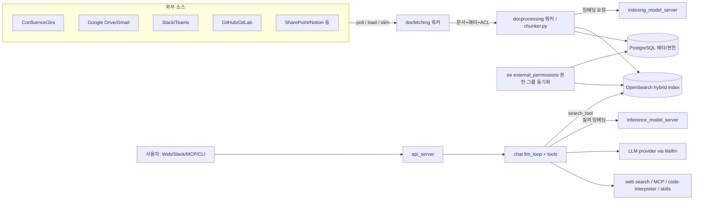

# Onyx

> [!summary] 한줄요약
> 사내 앱의 문서와 권한을 미리 인덱싱해 검색·에이전트 기능에 제공하는 자체 호스팅 가능 AI 플랫폼이다.

- **연결 대상**: Confluence, Google Drive, Slack, GitHub 등 50+ 사내 앱의 문서·메타데이터·권한.
- **제공 기능**: hybrid 검색 기반 Agentic RAG, Deep Research, custom agent, MCP 서버, 코드 샌드박스.
- **이력과 라이선스**: 옛 이름은 Danswer로 보인다. Community Edition은 MIT이고 `ee` 디렉터리는 별도 Enterprise 라이선스를 따른다.

> [!info] 이 노트의 근거
> 2026-10-01 시점에 `git clone --depth 1`로 받은 저장소(README 전문, `LICENSE`, `backend/`, `deployment/`, `docs/`, `cli/`, `pyproject.toml`, `backend/onyx/connectors/README.md`, `backend/onyx/background/README.md`, `backend/onyx/document_index/opensearch/README.md`, `backend/onyx/mcp_server/README.md`, `docs/AUDIT_LOGGING.md`)와 `gh api` 결과를 직접 읽고 쓴 것이다. 실제로 기동해 보거나 성능을 측정하지는 않았다. 읽지 못했거나 확인하지 못한 부분은 본문에 "확인 못함"으로 표시했다.

## 1. 배경: 무엇을 풀려는 프로젝트인가

LLM은 공개 지식은 잘 알지만 "우리 팀에서 지금 무슨 일이 일어나는지"는 모른다. README의 첫머리 인용문이 이 문제의식을 그대로 보여 준다. "AI new hire(신입)가 아니라 AI coworker(동료)를 원한다"는 문장이다. 동료가 되려면 회사의 위키, 티켓, 메신저, 드라이브, 코드 저장소에 접근해야 하고, 이때 두 가지 문제가 따라온다.

첫째는 검색 방식이다. 최근에는 에이전트가 각 SaaS의 MCP 서버를 호출해 그때그때 검색하는 "index-free" 접근이 흔하다. README는 이 방식을 정면으로 비교 대상으로 삼는다. Onyx는 "MCP 기반 검색이나 index-free 방식보다 더 신뢰할 수 있고, 지연이 낮고, 비용이 낮은 컨텍스트"를 주장한다. 에이전트가 수십 개 MCP를 돌며 반복 검색하느라 수천 토큰을 쓰는 대신, 내부 표현(representation)에서 즉시 가져와 가장 관련 높은 원문 문서만 걸러 준다는 것이다. 이 주장은 README의 서술이며, 우리가 벤치마크로 검증한 것은 아니다.

둘째는 권한과 데이터 주권이다. 조직 지식을 연결하면 "외부뿐 아니라 내부의 엉뚱한 사람에게도" 정보가 새면 안 된다. Onyx는 커넥터가 문서 본문뿐 아니라 메타데이터와 권한(permissions)까지 같이 가져와 인덱스에 넣고, 질의 시 사용자 권한으로 필터링하는 구조를 택한다. 또 문서 인덱스, DB, 처리 파이프라인을 모두 자기 환경 안에 두는 air-gappable self-host 배포를 내세운다. 임베딩 모델과 LLM 공급자도 로컬(Ollama, vLLM, LiteLLM 등)로 고를 수 있다.

정리하면 Onyx는 단순 "채팅 UI + 벡터DB"가 아니라, 커넥터 → 권한 동기화 → 하이브리드 인덱스 → 에이전트 하네스 → 다중 접점(Web, Slack, MCP, CLI, 확장 프로그램)을 한 덩어리로 묶은 "엔터프라이즈 컨텍스트 레이어"다.

## 2. 프로젝트 개요와 이력

- 저장소: `onyx-dot-app/onyx`. LICENSE 첫 줄의 저작권자는 "DanswerAI, Inc."(2023-present)로, 프로젝트가 Danswer에서 이어졌음을 시사한다. GitHub API상 생성일은 2023-04-27이다. (Danswer라는 옛 이름은 LICENSE의 회사명에서 추정한 것이며, 개명 경위를 설명하는 공식 문서는 읽지 못했다.)
- 주 구성: Python 백엔드(FastAPI, Celery), TypeScript 프론트엔드(Next.js), Go CLI, Tauri 데스크톱 앱, Chrome 확장, 임베드 위젯, Terraform provider.
- 배포 단위: Docker Compose, Helm(Kubernetes), AWS ECS Fargate, Terraform. 클라우드 서비스(Onyx Cloud)도 따로 있다.

## 3. 아키텍처

### 3.1 컴포넌트

`deployment/docker_compose/docker-compose.yml`(템플릿에서 생성되는 파일)에 정의된 서비스를 그대로 옮기면 다음과 같다.

| 서비스 | 이미지/역할 |
|---|---|
| `api_server` | `onyxdotapp/onyx-backend` — FastAPI. 채팅, 검색, 관리 API |
| `background` | 같은 backend 이미지 — Celery 워커 묶음(커넥터 동기화, 인덱싱, 정리) |
| `web_server` | `onyxdotapp/onyx-web-server` — Next.js |
| `inference_model_server` | `onyx-model-server` — 질의 시 임베딩 등 딥러닝 모델 추론 |
| `indexing_model_server` | 같은 이미지 — 인덱싱 시 임베딩(질의용과 분리해 서로 영향 안 주게 함) |
| `relational_db` | PostgreSQL 15.2 — 메타데이터, 사용자, 설정, 커넥터 상태 |
| `opensearch` | OpenSearch 3.6.0 — 문서 청크의 키워드+벡터 hybrid 인덱스 |
| `cache` | Redis 7.4 — Celery 브로커/락/캐시 |
| `object-store`(SeaweedFS), `minio` | 업로드 파일·blob 저장(S3 호환), `object-store-copy`는 보조 서비스 |
| `nginx` | 리버스 프록시(80/443) |
| `code-interpreter` | `onyxdotapp/code-interpreter` — 코드 실행 도구용 컨테이너 |

문서 인덱스 구현은 코드상 두 개다. `backend/onyx/document_index/`에 `vespa/`와 `opensearch/`가 같이 있고 `factory.py`가 설정에 따라 고른다. `app_configs.py`에서 확인한 기본값은 `ENABLE_OPENSEARCH_INDEXING_FOR_ONYX=true`, `ONYX_DISABLE_VESPA=true`다. 그리고 이번에 읽은 compose 파일에는 Vespa 서비스가 없고 OpenSearch만 있다. 즉 현재 기본 경로는 OpenSearch이고 Vespa는 레거시/마이그레이션 대상으로 남은 것으로 보인다. `background/celery/tasks/`에 `opensearch_migration`, `port`(`indexing/port_reembed.py`)가 있는 것도 이 전환을 뒷받침하지만, 전환 일정과 정책은 공식 문서를 못 읽어 확인하지 못했다. 따라서 "Vespa 기반"이라고 단정하면 안 된다.

### 3.2 백엔드 프로세스 구성

`backend/supervisord.conf`에 정의된 프로그램은 `celery_worker_primary`, `celery_worker_light`, `celery_worker_heavy`, `celery_worker_docprocessing`, `celery_worker_user_file_processing`, `celery_worker_scheduled_tasks`, `celery_worker_docfetching`, `celery_worker_monitoring`, `celery_beat`, `slack_bot`, `discord_bot` 등이다. `backend/onyx/background/README.md`는 워커와 큐의 매핑을 표로 정리해 둔다.

- Primary: 기본 `celery` 큐. 단일(singleton) 코디네이터이며 Redis의 `PRIMARY_WORKER` 락으로 하나만 살아 있게 한다. 시작 시 redis/postgres/document index가 모두 정상일 때까지 기다린 뒤 락을 잡고 백그라운드 작업 관련 Redis 상태를 정리한다.
- Light: `vespa_metadata_sync`, `connector_deletion`, `doc_permissions_upsert`, `checkpoint_cleanup`, `index_attempt_cleanup`.
- Heavy: `connector_pruning`, `connector_doc_permissions_sync`, `connector_external_group_sync`, `csv_generation`, `sandbox`.
- Docfetching: `connector_doc_fetching` — 커넥터에서 문서를 가져온다.
- Docprocessing: `docprocessing`, `port` — 청킹, 임베딩, 색인.
- User File Processing: 사용자가 채팅/프로젝트에 올린 파일 처리·삭제.
- Monitoring: 큐 길이 등 메트릭 보고.
- Beat: `DynamicTenantScheduler`로 테넌트별 주기 작업을 생성.

"가져오기(docfetching)"와 "처리하기(docprocessing)"를 서로 다른 워커/큐로 분리한 점이 중요하다. 느린 외부 API 호출과 CPU/GPU를 쓰는 임베딩을 독립적으로 스케일할 수 있다. Helm 차트(`deployment/helm/charts/onyx/templates`)에 워커별 Deployment, HPA, KEDA 스타일 `ScaledObject`, metrics Service가 각각 있다는 점에서 이 설계가 실제 배포 단위로 이어진다.

### 3.3 데이터 흐름



데이터는 다음 순서로 흐른다.

1. **수집**: 커넥터가 외부 소스에서 문서를 가져온다.
2. **색인·저장**: 문서를 청크로 나누고 임베딩해 OpenSearch에 색인한다. 청킹 코드는 `backend/onyx/indexing/chunker.py`이며 의존성에 `chonkie`가 있다. 문서·커넥터 상태·사용자는 PostgreSQL에 저장한다.
3. **권한 동기화**: 별도 작업이 소스의 권한과 그룹을 주기적으로 동기화한다.
4. **질의·검색**: 사용자가 질문하면 `api_server`의 채팅 루프(`backend/onyx/chat/llm_loop.py`)가 LLM을 호출한다. LLM이 `search_tool`을 부르면 인덱스를 검색하고 사용자 권한에 맞는 청크만 반환한다.
5. **응답**: 결과에 인용(citation, `citation_processor.py`)을 붙여 스트리밍한다.

이 흐름은 디렉터리·모듈 이름과 README를 종합한 것이다. 모든 호출 경로를 코드로 끝까지 추적한 것은 아니다.

## 4. 핵심 기능 상세

### 4.1 커넥터와 인덱싱 모델

`backend/onyx/connectors/` 아래 디렉터리 이름만으로 확인한 지원 소스는 airtable, asana, axero, bitbucket, blob(S3 등), bookstack, box, braintrust, canvas, clickup, coda, confluence, discord, discourse, document360, dropbox, drupal_wiki, egnyte, file, fireflies, freshdesk, gitbook, github, gitlab, gmail, gong, google_drive, google_site, guru, highspot, hubspot, imap, jira, linear, loopio, lumapps, mediawiki, notion, onedrive, outline, outlook, productboard, salesforce, sharepoint, slab, slack, teams, testrail, web, wikipedia, xenforo, zendesk, zoom, zulip 등이다. README의 "50+ applications"는 이 수치와 맞는다.

`backend/onyx/connectors/README.md`는 커넥터를 몇 가지 흐름으로 설명한다.

- Load Connector: 특정 시점 기준으로 전체를 한 번에 색인(API 전체 조회 또는 덤프 파일).
- Poll Connector: 시간 범위를 받아 증분 업데이트. 백그라운드 작업이 주기적으로 호출하며, 전체를 매번 임베딩하지 않아도 되게 해 준다.
- Slim Connector: 문서 본문 없이 ID만 가져와 "아직 소스에 존재하는가"를 확인한다. 정리(pruning) 작업이 이걸 써서 삭제된 문서를 인덱스에서 제거한다.
- Event Based: 이벤트 수신형. README상 현재 백그라운드 작업에서는 쓰이지 않고 향후 설계용이다.

새 커넥터는 `LoadConnector`, `PollConnector`, `CheckpointedConnector`, `CheckpointedConnectorWithPermSync` 중 하나 이상을 상속하고 `load_credentials`로 자격증명을 받는다. 일일 테스트는 `backend/tests/daily/connectors`에 추가하도록 안내한다. 사내 시스템에 맞는 전용 커넥터를 만들 수 있다는 뜻이며 구조가 비교적 명확하다.

별도로 `federated_connectors/`(현재 `slack` 하위 존재)가 있다. 문서를 인덱싱하지 않고 질의 시점에 소스를 직접 조회하는 연동으로 보인다(디렉터리 구성과 `federated_retrieval.py` 이름에서 읽은 것이며 동작 세부는 확인 못함).

### 4.2 검색 파이프라인과 OpenSearch hybrid

`backend/onyx/document_index/opensearch/README.md`는 구현자가 겪은 함정을 솔직히 적은 흔치 않은 문서다. 요점은 다음과 같다.

- OpenSearch hybrid query는 키워드/벡터 질의를 각자 독립된 Search phase로 돌리고, normalization processor가 마지막에 점수를 합친다.
- 한쪽에만 걸린 문서는 다른 쪽 점수가 0으로 들어가고, 이것이 사실상 "최솟값 클리핑" 효과를 낸다.
- 임베딩 점수는 0~1에 균일하지 않고 대략 0.6~0.8에 몰리며 모델·질의별로 다르다. 그래서 정규화 전에 가산/승산 boost를 적용하면 오히려 최하위로 밀려날 수 있다.
- 따라서 시간 감쇠(time decay) boost는 OpenSearch 질의 단계에서 적용하지 않기로 결정했고, OpenSearch는 초기 필터링을 맡고 이후 정제·boost는 Onyx 코드에서 한다.

`backend/onyx/document_index/FILTER_SEMANTICS.md`와 `context/search/`(pipeline, preprocessing, retrieval, federated)가 이 위의 필터·전처리·검색 단계를 구성한다. 자체 RAG를 만들 때 "점수 정규화 방식(min-max vs z-score)과 boost 적용 시점"을 어디서 할지 고민하는 팀에게 이 문서 자체가 좋은 참고가 된다.

### 4.3 권한 동기화 (EE 영역)

`backend/ee/onyx/external_permissions/` 아래에는 box, canvas, confluence, github, gmail, google_drive, jira, microsoft_utils, onedrive, outlook, salesforce, sharepoint, slack, teams 하위 디렉터리가 있다. `sync_params.py`는 소스별 doc-sync/group-sync 주기 상수(예: `CONFLUENCE_PERMISSION_DOC_SYNC_FREQUENCY`, `GITHUB_PERMISSION_GROUP_SYNC_FREQUENCY`)를 가져오고, 각 구현을 "lazy" 로드한다(코드 주석: SDK가 약 60MB를 차지하므로 첫 호출 시점에 import). `post_query_censoring.py`는 질의 후 결과를 걸러내는 단계로 보인다.

여기서 중요한 사실은 **이 권한 동기화 코드가 `ee` 디렉터리에 있다**는 점이다. 라이선스를 지키면서 쓰려면 이 부분이 Enterprise 계약 대상인지 반드시 확인해야 한다(6장).

### 4.4 채팅 루프, 도구, Deep Research

- `backend/onyx/chat/`: `llm_loop.py`, `llm_step.py`, `process_message.py`, `citation_processor.py`, `compression.py`(`COMPRESSION.md`), `token_budget.py`, `stream_buffer.py`, `incognito*.py`. 대화 압축과 토큰 예산, 시크릿(incognito) 채팅 등을 포함한다.
- `backend/onyx/tools/tool_implementations/`: `search`, `web_search`, `open_url`, `python`, `bash`, `coding_agent`, `file_reader`, `images`, `knowledge_graph`, `mcp`, `memory`, `custom`. 에이전트가 쓰는 도구 집합이다.
- `backend/onyx/deep_research/dr_loop.py`: 오케스트레이터가 clarification → 연구 계획(`RESEARCH_PLAN_PROMPT`) → 하위 research agent 호출 → 최종 보고서(`FINAL_REPORT_PROMPT`)를 만드는 다단계 루프. 파일 상단 TODO에 "계획 저장 후 재생", "사용자 정의 프롬프트" 등이 향후 과제로 적혀 있다. 즉 Deep Research는 존재하지만 아직 개선 중이다.
- `backend/onyx/kg/`: 지식그래프 추출/클러스터링 모듈과 `knowledge_graph` 도구가 있다. 기본 활성 여부는 확인 못함.
- `backend/onyx/skills/`와 `skills/builtin/`: browser, company-search, github, gmail, google-calendar, google-drive, hubspot, image-generation, linear, notion, pptx, slack 등 내장 skill 번들. `ingest_from_github.py`가 있어 GitHub에서 skill을 들여오는 경로가 있는 것으로 보인다(세부 확인 못함). Claude Code skill과 포맷이 호환되는지는 확인 못함.

### 4.5 샌드박스와 egress 프록시

`code-interpreter` 컨테이너(compose)와 `docs/craft/`(Onyx Craft, install.sh 도움말에 "AI-powered web app building"으로 설명), 그리고 `backend/onyx/sandbox_proxy/`가 있다. `sandbox_proxy/server.py`는 mitmproxy 기반 egress 프록시 진입점으로, `GateAddon`, `CredentialInjectionDispatcher`, `McpRequestEvaluator`, `ExternalAppRequestEvaluator`, docker/k8s별 CA·identity 모듈을 import한다. 이름과 import만으로 읽으면 "샌드박스에서 나가는 HTTP/MCP 요청을 프록시가 가로채 허용 여부를 평가하고 자격증명을 주입한다"는 설계로 보이지만, 실제 정책 동작은 코드를 끝까지 추적하지 않아 **확인 못함**이다. 에이전트에게 토큰을 직접 주지 않고 프록시가 주입하는 패턴이라면 우리에게 매우 유용한 아이디어다. 비교: [[openworker]]는 OpenShell 샌드박스와 승인 사다리를 쓴다.

### 4.6 접점(Surfaces)

README가 나열하는 접근 경로는 다음과 같다.

- 웹/데스크톱 앱(`web/`, `desktop/` Tauri), 모바일(`mobile/` 존재, 세부 확인 못함).
- Slack, Discord 봇(supervisord에 `slack_bot`, `discord_bot`).
- MCP 서버: `backend/onyx/mcp_server/README.md`에 따르면 FastMCP + FastAPI 래퍼, 기본 포트 8090(API 서버와 도메인 공유), 자체 DB 없음(모든 작업을 API 서버에 위임). 인증은 Onyx Personal Access Token 또는 API Key를 `Authorization: Bearer`로 받고 요청마다 검증해 통과시킨다. `read:search`처럼 범위(scope)를 제한한 토큰을 권장한다. 즉 Claude Code, Codex, Open Code 등이 사내 지식을 "그 사용자의 권한 그대로" 검색하게 할 수 있다.
- Chrome 확장(`extensions/chrome`), 임베드 위젯(`widget/`, `docs/WIDGET_JWT_PASSTHROUGH.md`).
- Go 기반 `onyx-cli`(`cli/`, PyPI `onyx-cli`도 있음): `onyx-cli chat` TUI와 에이전트·스크립트용 비대화형 명령. PAT로 인증하고 환경변수 `ONYX_SERVER_URL`, `ONYX_PAT` 등으로 설정한다. `onyx-cli deploy install/status/logs/stop/upgrade/uninstall`로 배포 관리도 한다(install.sh 도움말).

### 4.7 엔터프라이즈 기능과 감사

README의 Enterprise 항목은 SSO(Google OAuth, OIDC, SAML), SCIM 프로비저닝, RBAC, 사용량 분석, 질의 이력(query history), 커스텀 코드 훅(PII 제거·민감 질의 차단), 화이트라벨링이다. 저장소의 `backend/ee/onyx/server/`에 `scim`, `user_group`, `query_history`, `analytics`, `billing`, `license`, `token_rate_limits`, `usage_limits`, `enterprise_settings`, `log_export`, `tenants` 등이 실제로 있어 README 서술과 일치한다. 이 코드가 어느 라이선스 범위인지는 6장에서 다룬다.

`docs/AUDIT_LOGGING.md`는 감사 이벤트가 `onyx.audit` 로거 트리로 나가고, 메시지 본문이 단일 JSON 객체이며 OCSF 클래스(authentication, account_change, user_access_management, group_management, api_activity)에 맞춘다고 설명한다. SIEM(Splunk, Sentinel, Elastic 등)에 별도 통합 없이 로그 수집기로 바로 보낼 수 있고, 고빈도 이벤트는 Redis로 중복 제거하되 Redis를 쓸 수 없으면 항상 방출하는 방향(인프라 문제로 감사 이벤트가 조용히 사라지지 않도록)이다. SOC 2 CC7, NIST 800-53 AU 계열과 매핑된다고 문서에 적혀 있다.

## 5. 설치와 사용

### 5.1 가장 빠른 방법

```bash
# README의 한 줄 설치 (원격 스크립트이므로 실행 전 내용 확인 권장)
curl -fsSL https://onyx.app/install_onyx.sh | bash
```

저장소의 `deployment/docker_compose/install.sh`를 읽어 보면 이 스크립트는 직접 설치하지 않고 Go로 만든 `onyx-cli`를 내려받아 `onyx-cli deploy install`에 인자를 그대로 넘기는 얇은 부트스트랩이다. 환경변수 `ONYX_CLI_VERSION`, `ONYX_CLI_BIN_DIR`로 버전과 설치 위치를 정하고, 필요하면 셸 프로필(`~/.bashrc`, `~/.zshrc`, fish 설정)에 PATH를 추가한다. 옵션은 `--lite`, `--include-craft`, `--tag`, `--local`, `--no-prompt`, `--dry-run`, `--verbose`, `--no-wait`, `--dir`이다. 설치 후에는 `onyx-cli deploy status|logs|stop|upgrade|uninstall`로 관리한다.

사내 정책상 curl-pipe-bash가 막혀 있다면, 같은 파일을 먼저 받아 읽고 `--dry-run`으로 동작을 확인한 뒤 실행하는 것이 안전하다.

```bash
curl -fsSLO https://raw.githubusercontent.com/onyx-dot-app/onyx/main/deployment/docker_compose/install.sh
less install.sh
bash install.sh --dry-run
bash install.sh --lite --no-prompt   # 인덱싱 없이 UI만 시험
```

### 5.2 Docker Compose 수동 배포

`deployment/README.md`에 따르면 compose 파일 세 개(`docker-compose.yml`, `docker-compose.prod.yml`, `docker-compose.prod-no-letsencrypt.yml`)는 `docker-compose.template.yml`에서 `ods generate-compose --write`로 생성된다. 따라서 생성된 파일을 직접 수정하면 안 된다.

운영용 compose 상단 주석은 다음 하드닝을 요구한다. 기본 파일은 평가용으로 읽어야 한다.

- nginx(80/443) 외의 포트 노출 제거
- 기본 `minioadmin` 대신 강한 객체 저장소 자격증명(`S3_AWS_*`) 설정
- nginx에 SSL 인증서 볼륨 추가
- 환경에 맞는 `DOMAIN` 지정

```bash
git clone --depth 1 https://github.com/onyx-dot-app/onyx.git
cd onyx/deployment/docker_compose
cp env.template .env          # 값 검토 후 수정
docker compose -f docker-compose.yml up -d
```

(위 명령은 저장소 구조와 파일 이름에서 구성한 일반적 예시이며, 공식 문서의 정확한 절차와 다를 수 있다. 실제 실행은 하지 않았다.)

### 5.3 Lite와 Standard

README는 두 모드를 구분한다.

- Standard: 벡터+키워드 인덱스, 커넥터 동기화용 백그라운드 컨테이너와 워커, 모델 추론 서버, Redis 캐시와 MinIO blob 저장소 포함. "진지한 사용자와 큰 팀에 권장".
- Lite: 1GB 미만 메모리로 도는 경량 AI Chat UI. 문서 인덱싱은 불가. `docker-compose.onyx-lite.yml`에는 `api_server`, `background`, `cache`, 모델 서버, opensearch, object-store 서비스 항목이 오버라이드로 들어 있다(서비스 이름만 확인). `DISABLE_VECTOR_DB` 설정이 이와 관련되어 보이나 정확한 연결은 확인 못함.

### 5.4 Kubernetes

`deployment/helm/charts/onyx` 차트에 api, 워커별 Deployment/HPA/ScaledObject, discordbot, ingress(api, mcp, mcp-oauth-callback, scim), external-secret, grafana-dashboards, 모델 서버 Deployment 등이 있다. `onyx-cnpg-crds` 차트는 CloudNativePG CRD를 담는 것으로 보인다. 큐 길이 기반 오토스케일링과 Prometheus 메트릭이 이미 차트에 들어 있어, 대규모 운영을 염두에 둔 구조다.

### 5.5 CLI로 질의하는 예

```bash
pip install onyx-cli
export ONYX_SERVER_URL=https://onyx.example.internal
export ONYX_PAT=<발급받은 PAT>        # 코드/노트에 실제 값을 남기지 말 것
onyx-cli chat --agent-name "Support Agent"
```

## 6. 라이선스와 에디션

이 부분은 오해하기 쉬워 따로 길게 적는다.

- README 배지는 MIT이고 README 본문도 "Community Edition(CE)은 MIT, 핵심 RAG·채팅·에이전트·액션 기능 포함, Enterprise Edition(EE)은 대기업용 추가 기능"이라고 설명한다.
- 그러나 GitHub API의 `license.spdx_id`는 `NOASSERTION`이다. 이유는 `LICENSE` 파일의 구조다. 파일 앞부분이 "Portions of this software are licensed as follows"로 시작하고, `ee` 디렉터리 하위 콘텐츠(`backend/ee/LICENSE`, `web/src/app/ee/LICENSE`, `web/src/ee/LICENSE`)는 Onyx Enterprise License를, 서드파티 컴포넌트는 원 라이선스를, 그 외는 MIT를 따른다고 한다.
- `backend/ee/LICENSE`를 읽어 보면, 이 소프트웨어는 Onyx Subscription Terms of Service 등 계약에 동의하고 좌석 수에 맞는 유효한 Enterprise License가 있을 때만 **프로덕션에서** 쓸 수 있다. 개발·테스트 목적의 복사·수정은 구독 없이 가능하고, 수정물·패치를 공개할 수는 있으나 재배포·sublicense·판매는 금지된다.
- 그런데 `ee` 코드는 같은 저장소 안에서 CE 코드와 섞여 import된다(예: `perm_sync_types.py`가 `ee.onyx.db.external_perm`을 import). 그래서 "CE만 쓰면 `ee`는 로드되지 않는가"는 코드상 단순하지 않을 수 있다. 어떤 설정이 EE 기능을 켜는지(`backend/ee/onyx/main.py`, `ee/onyx/server/license`)는 이번에 끝까지 확인하지 못했다.

**운영 결론**: 사내에서 외부 권한 동기화(external_permissions), SCIM, 질의 이력, 분석, 화이트라벨 같은 기능이 필요하면 유료 EE 계약 여부를 법무·조달과 먼저 확인해야 한다. MIT로 쓸 수 있는 범위는 "코어 RAG·채팅·에이전트·액션"이라는 README 문장을 근거로 하되, 우리가 쓰려는 구체 기능이 `ee` 디렉터리 안에 있는지 파일 단위로 대조해야 한다. 이것은 법률 자문이 아니다.

## 7. 코드·디렉터리 구조에서 확인한 것

루트: `backend/`, `web/`, `cli/`, `desktop/`, `mobile/`, `extensions/`, `widget/`, `deployment/`, `docs/`, `examples/`, `integrations/`, `tools/`, `terraform-provider-onyx/`, `contributor_ip_assignment/`, `AGENTS.md`, `CLAUDE.md`, `SECURITY.md`.

`backend/onyx/` 주요 패키지: `access`, `auth`, `background`, `chat`, `coding_agent`, `connectors`, `context`, `db`, `deep_research`, `document_index`, `external_apps`, `federated_connectors`, `file_processing`, `file_store`, `hooks`, `image_gen`, `indexing`, `kg`, `llm`, `mcp_server`, `natural_language_processing`, `oauth`, `onyxbot`, `prompts`, `sandbox_proxy`, `skills`, `tools`, `tracing`, `voice`. `backend/model_server/`는 별도 서비스(encoders.py 등). `backend/alembic`와 `alembic_tenants`는 DB 마이그레이션(멀티테넌트 포함).

`pyproject.toml` 의존성에서 확인한 것: Python `>=3.13`, FastAPI, `litellm[google]`(다중 LLM 공급자 추상화), `celery==5.5.1`, `SQLAlchemy`, `opensearch-py`, `redis`, `fastmcp`와 `mcp[cli]`, `fastapi-users`(인증), `markitdown`(문서 → 텍스트), `unstructured-client`, `chonkie`(청킹), `playwright`·`trafilatura`(웹 크롤링), `kubernetes`·`docker`(샌드박스 오케스트레이션), 각종 SaaS SDK(atlassian, boxsdk, simple-salesforce, hubspot, asana, dropbox 등), `azure-cognitiveservices-speech`(음성), `discord.py`, `slack-sdk`. 임베딩 쪽은 `cohere`, `voyageai`, `openai`, `google-genai`가 공유 의존성에 있다.

저장소 루트의 `CLAUDE.md`와 `AGENTS.md`, `backend/CLAUDE.md`는 이 프로젝트 자체가 Claude Code 같은 에이전트로 개발되는 것을 전제로 규칙을 정리해 둔 파일로 보인다(내용은 정독하지 않음).

## 8. 비교 대상

| 대상 | 성격 | Onyx와의 차이 |
|---|---|---|
| [[weknora]] (Tencent) | 문서 RAG·Agent·Wiki, Go, 내장 MCP | Onyx는 커넥터 폭(50+)과 권한 동기화·엔터프라이즈 기능이 강하고 Python/Celery 중심. WeKnora는 Go 백엔드와 Lite 단일 바이너리, wiki 생성이 특징. 둘 다 MCP 서버 제공. |
| [[openviking]] | 에이전트용 Context Database(`viking://`) | OpenViking은 에이전트 메모리·스킬을 파일시스템 모델로 관리하는 개발자용 컨텍스트 계층, Onyx는 조직 SaaS 지식을 인덱싱하는 완제품 플랫폼. 라이선스도 AGPL-3.0 vs MIT+EE로 다름. |
| [[openworker]] | 데스크톱 AI coworker | OpenWorker는 단일 사용자 데스크톱 에이전트와 거버넌스, Onyx는 서버형 다중 사용자 지식 플랫폼. 권한 모델 설계는 서로 참고 가능. |
| [[headroom]], [[multica]], [[firecrawl-web-agent]] | 각각 별도 노트 참조 | 이 노트에서 직접 비교하지는 않았다(해당 노트 확인 필요). |
| 직접 MCP 연결(index-free) | 에이전트가 SaaS MCP를 실시간 호출 | 지연·토큰 비용·권한 일관성에서 Onyx가 유리하다고 README가 주장. 단 인덱스 동기화 지연과 운영 비용이 생긴다. |

이 표에서 Onyx 외 제품의 세부 기능은 해당 노트의 기록에 의존했으며 이번에 다시 검증하지 않았다. Glean, Dify, RAGFlow 같은 다른 상용·오픈소스 제품과의 비교는 이번 조사에서 근거를 확보하지 못해 적지 않는다.

## 9. 성숙도와 활동 (2026-10-01 기준)

- GitHub API: 스타 32,302, fork 4,517, `license: NOASSERTION`, 생성 2023-04-27, 마지막 push 2026-10-01T04:55Z. 열린 이슈 158건, 열린 PR 373건(GitHub search API 기준). API의 `open_issues_count`는 531로 이슈와 PR을 합산한 값으로 보이며 숫자가 서로 다르다.
- 최신 정식 릴리스 `v4.8.2`(2026-09-30). `v4.9.0-beta.0`(2026-09-30)이 같은 날 올라왔다. Helm 차트도 `helm/onyx-0.9.0` 등으로 거의 매일 릴리스된다. 개발이 매우 활발하다는 뜻이면서, 업그레이드 주기가 빠르다는 운영 부담이기도 하다.
- 기여자 수는 API 페이지네이션 마지막 페이지가 194로 나와 대략 190여 명이다.
- `--depth 1` 클론이라 커밋 총수는 확인하지 못했다. 이전 노트의 "커밋 10,429개"는 이번에 재확인하지 못했다.

장점: 커넥터 폭, 권한 동기화 개념, 상세한 배포 자산(Compose, Helm, Terraform, ECS), 감사 로그와 OCSF 정렬, MCP 서버·CLI·Chrome 확장 등 접점의 풍부함, 매우 빠른 개발 속도, OpenSearch hybrid 구현 과정을 문서로 남기는 문화.

한계는 운영 부담과 검증 공백으로 나눌 수 있다.

- **운영 복잡도**: PostgreSQL, OpenSearch, Redis, MinIO/SeaweedFS, 모델 서버 2개, Celery 워커 다수가 필요하다. Lite 외에는 가볍게 돌리기 어렵다.
- **라이선스 경계**: 엔터프라이즈 기능은 EE 라이선스에 묶여 있다.
- **마이그레이션**: Vespa에서 OpenSearch로 인덱스를 전환하는 흔적이 있어 업그레이드 시 주의가 필요하다.
- **커스텀 유지 비용**: Python 3.13을 요구하고 고정된 의존성이 많다. 사내 커넥터를 수정하면 포크 유지 비용이 생긴다.
- **미확인 품질**: 한국어 검색 품질(토크나이저, 임베딩 모델 선택)은 확인하지 못했다. 성능·정확도 수치도 제3자 벤치마크로 검증하지 못했다.

## 10. 보안·운영 리스크

- 원격 스크립트 설치(`curl | bash`)는 사내 보안 정책에 걸릴 수 있다. 스크립트를 먼저 받아 검토하고, 사내 미러에서 `onyx-cli` 바이너리와 이미지를 가져오도록 고정하는 것이 좋다. 이미지 태그는 `latest` 대신 특정 릴리스로 고정한다(compose의 `IMAGE_TAG` 변수).
- 기본 compose의 `minioadmin` 같은 기본 자격증명과 다수의 노출 포트는 운영 전에 제거해야 한다. 운영 compose 상단 주석이 같은 지침을 준다.
- 커넥터 자격증명(OAuth 토큰, API 키)이 Onyx DB에 저장된다. 접근 통제·암호화·백업 정책을 따로 세워야 한다(저장 방식 상세는 확인 못함).
- 코드 실행(`python`, `bash` 도구, code-interpreter, Craft)은 공격 표면이다. egress 프록시 설계가 있으나 실제 격리 수준은 우리가 검증한 것이 아니다. 사내에서는 초기에 비활성화하는 것을 검토한다.
- 외부 LLM 공급자를 고르면 인덱싱된 문서 조각이 질의 때 그쪽으로 나간다. 데이터 분류 정책에 맞춰 로컬 모델 또는 승인된 공급자만 쓰도록 제한해야 한다.
- 권한 동기화는 소스의 ACL 변화를 주기적으로 따라가므로 즉시 반영되지 않는 시간 창이 있다(주기 상수 존재). 권한 회수가 반영되기 전 구간의 노출 위험을 이해해야 한다.
- `SECURITY.md`: 취약점은 GitHub Private Vulnerability Reporting으로 제보하고, 보안 패치는 `main`과 최신 태그 릴리스에만 적용한다. 즉 오래된 버전은 백포트를 기대할 수 없으므로 업그레이드 체계가 필수다.
- MCP 서버는 Bearer 토큰만으로 접근한다. 범위가 없는 토큰은 사용자 전체 권한을 가지므로 `read:search` 같은 범위 토큰을 발급해 쓴다.

## 12. 열린 질문 (확인 못함)

- 한국어 검색에 쓸 수 있는 임베딩/리랭커 기본 모델과 토크나이저 설정.
- EE 기능 활성화 방식과 CE 단독 사용 시 `ee` 코드 경로 로딩 여부.
- Vespa 제거 일정과 기존 사용자 마이그레이션 절차.
- Standard 배포 최소 사양(CPU/RAM/디스크)과 문서 수 대비 인덱싱 비용. 공식 문서를 읽지 못했다.
- sandbox_proxy의 실제 정책 평가 로직과 격리 강도.
- Lite 모드와 `DISABLE_VECTOR_DB`의 정확한 관계.
- `mobile/` 앱의 배포 상태.

## 관련 노트

[[weknora]] · [[openviking]] · [[openworker]] · [[actguard]] · [[headroom]] · [[multica]] · [[firecrawl-web-agent]] · [[neurons]] · [[agentspace]]

## 출처

- https://github.com/onyx-dot-app/onyx (README, LICENSE, SECURITY.md, `pyproject.toml`, `deployment/` 전반, `deployment/docker_compose/install.sh`, `deployment/README.md`, `cli/README.md`, `docs/AUDIT_LOGGING.md`; 2026-10-01 clone)
- 같은 저장소 `backend/onyx/connectors/README.md`, `backend/onyx/background/README.md`, `backend/onyx/document_index/opensearch/README.md`, `backend/onyx/mcp_server/README.md`, `backend/supervisord.conf`, `backend/ee/LICENSE`, `backend/onyx/deep_research/dr_loop.py`, `backend/onyx/sandbox_proxy/server.py`, `backend/ee/onyx/external_permissions/sync_params.py`
- GitHub API: repos/onyx-dot-app/onyx, releases, search/issues (2026-10-01)
- https://docs.onyx.app 는 이번에 열람하지 않았다.
