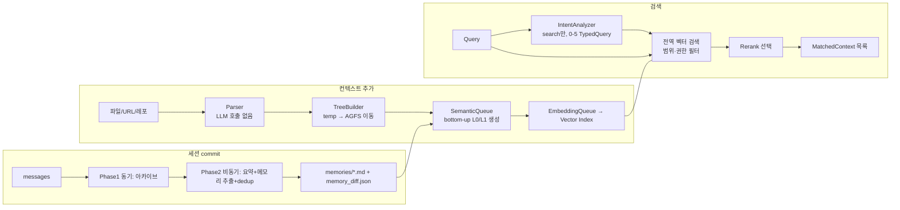

# OpenViking

> [!summary] 한줄요약
> 에이전트가 아는 모든 것(문서·메모리·skills)을 `viking://` 가상 파일시스템 하나에 담고, 디렉터리마다 L0(abstract)/L1(overview) 요약을 붙여 "요약 먼저, 원문은 필요할 때만" 읽게 하는 오픈소스 Context Database. ByteDance/Volcengine 제작, AGPL-3.0, Python + Rust + C++.

## 1. 배경: 어떤 문제를 푸는가

LLM 에이전트의 장기 메모리 구현은 대개 "대화에서 텍스트를 뽑아 임베딩하고 벡터 DB에 넣는" 구조다. 이 방식에는 사용자 관점에서 세 가지 불편이 있다. 첫째, 무엇이 저장됐는지 사람이 들여다보기 어렵다(블랙박스). 둘째, 평평한(flat) 벡터 풀 전체를 검색하므로 프로젝트·사용자 단위로 범위를 좁히기 어렵고, 검색 결과가 많아지면 토큰만 늘어난다. 셋째, 지식(문서), 기억(선호·경험), 능력(skills)이 서로 다른 저장소·다른 API로 흩어진다.

OpenViking의 README는 이 문제를 "agent용 context database"라는 정의로 풀어낸다. 핵심 발상은 세 가지다.

1. 모든 컨텍스트를 `viking://{scope}/{path}` URI를 가진 파일/디렉터리로 취급한다. 에이전트와 사람 모두 `ls`, `tree`, `read`, `write`, `grep`으로 탐색·편집할 수 있다.
2. 디렉터리마다 생성된 요약(L0/L1)을 두어, 에이전트가 요약을 먼저 보고 원문(L2)을 읽을지 결정하게 한다.
3. 세션을 커밋하면 대화를 아카이브하고, 메모리를 사람이 읽을 수 있는 Markdown 파일로 추출한다.

즉 "벡터 DB를 감춘 메모리 라이브러리"가 아니라 "파일시스템 인터페이스를 가진 지식·메모리 서버"로 포지셔닝한다. 같은 노트 폴더의 [[weknora]](문서 → RAG/Agent/Wiki 플랫폼)와 같은 문제 영역(사내 지식 + 에이전트)을 다루지만, OpenViking은 "에이전트가 소비하는 컨텍스트 저장소"에 더 무게가 있다.

## 2. 아키텍처

### 2.1 컴포넌트

공식 문서(`docs/en/concepts/01-architecture.md`)가 설명하는 구성은 다음과 같다.

| 모듈 | 역할 |
|---|---|
| Client | 통일된 진입점. 모든 작업을 Service 계층에 위임 |
| Service | FSService(ls/mkdir/rm/mv/tree/read/abstract/overview/grep/glob), SearchService(search/find), SessionService, ResourceService(add_resource/add_skill), PackService(ovpack export/import/backup), DebugService |
| Retrieve | IntentAnalyzer(의도 분석), HierarchicalRetriever(검색), Rerank |
| Session | 메시지 기록, 사용량 추적, 압축, 메모리 commit |
| Parse | 문서 파서(PDF/MD/HTML/코드/이미지/비디오/오디오), TreeBuilder, 비동기 semantic 생성 |
| Compressor | 스키마 기반 메모리 추출과 LLM 중복 제거 판단 |
| Storage | VikingFS 가상 파일시스템 + AGFS(콘텐츠) + Vector Index(색인) |

저장은 이중 계층이다. AGFS가 L0/L1/L2 전체 콘텐츠와 멀티미디어를 보관하고, Vector Index는 URI·벡터·메타데이터만 가진다(파일 내용 없음). 문서가 강조하는 원칙은 "Single Data Source: 모든 내용은 AGFS에서 읽고 벡터 인덱스는 참조만 저장"이다. 그래서 인덱스가 날아가도 원본에서 재구축할 수 있다. 문서 `09-transaction.md`는 이를 "FS가 source of truth, VectorDB는 파생 인덱스"라고 명시하고, 설계 철학을 "Better to miss a search result than to return a bad one"으로 요약한다.

AGFS는 원래 c4pt0r의 Go 구현(AGFS)이며 저장소의 `crates/ragfs/ORIGIN.md`에 따르면 Rust로 재구현한 RAGFS가 들어 있다. `RAGFS_IMPL=auto|rust|go` 환경변수로 구현을 고를 수 있다(auto는 rust 우선, go 폴백). 벡터 인덱스는 `src/` 아래 C++ 엔진(`index/`, `store/`)과 `third_party/`(croaring, leveldb, rapidjson, spdlog 등)로 구현되어 있다. 인덱스 설정 예는 `flat_hybrid`, cosine 거리, int8 양자화이며 dense + sparse 벡터를 함께 저장한다. 벡터 백엔드로는 `local`, `http`, `volcengine`(VikingDB)이 문서에 나온다.

### 2.2 데이터 흐름



**추가 경로.** Parser는 LLM을 호출하지 않고 문서를 파일/디렉터리 구조로 바꾼다. 문서가 1024 토큰 이하면 단일 파일, 초과하면 헤더 기준 분할(512 토큰 미만 섹션은 병합, 1024 초과는 하위 디렉터리)이라고 문서에 적혀 있다. TreeBuilder가 임시 디렉터리를 AGFS로 옮기고 SemanticMsg를 큐에 넣는다. SemanticQueue는 리프 디렉터리에서 루트 방향으로(bottom-up) 처리하며, 디렉터리당 파일 요약을 최대 10개 동시 생성하고, 자식 디렉터리 abstract를 모아 `.overview.md`를 만든 뒤 거기서 `.abstract.md`를 추출한다. 코드 파일은 `tags.scm` 쿼리 → `tree-sitter-language-pack` → 최후 수단으로 LLM 요약(`semantic.code_summary`) 순서의 skeleton 추출 경로를 쓴다(의존성에 tree-sitter 계열이 버전 고정되어 있음).

**검색 경로.** 이 부분은 README와 코드 문서의 뉘앙스가 다르다. README는 "디렉터리 범위 검색"과 TrieHI(디렉터리 인덱스)를 전면에 내세우지만, `07-retrieval.md`와 `hierarchical_retriever.py` 도크스트링은 "쿼리당 전역 벡터 검색 1회, 대상 디렉터리·context type·권한·메타 필터·level이 범위를 제한, 디렉터리 재귀 탐색(priority queue, parent→child score 전파, convergence round)은 제거됨"이라고 쓴다. 즉 현재 코드(2026-10-01 클론 기준)의 `find`/`search`는 범위 필터가 걸린 전역 벡터 검색 + 선택적 rerank이며, 옛 계층 재귀 방식은 걷어낸 상태다. TrieHI 논문(아래 7절)이 "OpenViking에 통합됐다"고 밝히는 것과 이 문서 사이의 정확한 관계(어느 백엔드에서 활성인지)는 확인하지 못했다.

- `find()`: 세션 불필요, 단일 쿼리, 낮은 지연. QUICK 모드(벡터 점수만, rerank 없음).
- `search()`: 세션 컨텍스트 필요. IntentAnalyzer가 LLM으로 (세션 압축 요약 + 최근 5개 메시지 + 현재 쿼리)를 분석해 0~5개의 `TypedQuery`(query, context_type=MEMORY/RESOURCE/SKILL, intent, priority 1~5)를 만든다. 인사말이면 0개(검색 생략). rerank가 설정돼 있으면 THINKING 모드: 후보를 `2 × limit`개 가져온 뒤 rerank 한 번으로 `limit`개를 반환한다. 이미지 쿼리는 텍스트 rerank를 건너뛴다.

**세션 commit 경로.** `session.commit()`은 Phase 1(동기)에서 compression_index 증가, `messages.jsonl`을 `history/archive_NNN/`에 기록, 현재 메시지 비우기, `task_id` 반환까지 즉시 수행한다. Phase 2(비동기 백그라운드)에서 구조화 요약(`.abstract.md`/`.overview.md`) 생성, 장기 메모리 추출, `memory_diff.json`(adds/updates/deletes/skipped의 감사 로그) 기록, `.done` 마커를 쓴다. 메모리 추출은 "LLM 후보 추출 → 벡터로 유사 메모리 사전 필터 → LLM dedup 결정(candidate: skip/create/none, 기존 항목: merge/delete)" 순이다. `SessionCompressorV3 → ExtractLoop → MemoryUpdater` 경로이며, 먼저 활성화된 user-memory 스키마(`cases` 포함)를 추출하고 case가 하나라도 나올 때만 trajectory/experience/실행형 session-skill 학습이 돈다고 문서가 설명한다.

### 2.3 Viking URI와 컨텍스트 유형

URI 형식은 `viking://{scope}/{path}`이고 공개 scope는 `resources`(계정 공유 지식), `user`(사용자별 데이터와 세션), `agent`(공유 skills 등)다. `temp`, `queue`, `upload`는 내부용이다. `viking://~`는 호출자의 `viking://user/{user_id}`로 서버가 확장하는 홈 별칭이다. 파일 ID는 `md5(f"{account_id}:{uri}")`로 결정적으로 계산되어 벡터 레코드의 primary key로 쓰이고, 파일을 옮기면 ID가 바뀐다.

세 가지 컨텍스트 유형은 다음과 같다.

- **Resource**: 사용자가 추가하는 정적 지식(API 문서, 코드 레포, 논문 등).
- **Memory**: 상호작용에서 학습한 지속 지식. 내장 유형은 profile, preferences, entities, events, identity, soul, cases, trajectories, experiences. 사용자 템플릿으로 확장 가능. 사용자(또는 peer) 네임스페이스에 저장되며 `viking://~/memories/...`로 접근한다.
- **Skill**: `viking://user/{user_id}/skills/{skill_name}/SKILL.md` 형태로 저장되는 에이전트 능력 정의. `add_skill`로 추가하면 privacy 설정(`13-privacy.md`)에 따라 `api_key`, `token`, `base_url` 같은 민감값을 LLM으로 추출해 `{{ov_privacy:skill:<name>:<field>}}` 플레이스홀더로 치환해 저장하고, 읽을 때 활성 버전의 값으로 복원한다(버전 관리/롤백 포함).

### 2.4 L0/L1/L2 계층

| 계층 | 위치 | 기본 길이 제한 | 용도 |
|---|---|---|---|
| L0 Abstract | 디렉터리의 `.abstract.md` | 256자 | 벡터 검색, 빠른 필터링 |
| L1 Overview | 디렉터리의 `.overview.md` | 4000자 | rerank, 내용 탐색 |
| L2 Detail | 원본 파일 | 제한 없음 | 필요할 때만 로드 |

중요한 사실 하나: L0/L1은 "디렉터리 단위" 사이드카이지 모든 파일마다 생기는 요약이 아니다. 파일 요약은 해당 디렉터리 L1에 합쳐지는 입력이다. 사이드카는 YAML frontmatter + Markdown 본문(OKF 형식)이고, 임베딩 입력에는 본문과 화이트리스트(현재 `directory`만)가 들어간다. 디렉터리 직계 자식이 32개(`semantic.overview_sample_limit`)를 넘으면 결정적·순서 보존 샘플링을 써서 같은 트리를 반복 갱신해도 본문이 흔들리지 않게 한다(Git diff 소음 방지). 자식 L0가 바뀌어도 부모 갱신은 `pending_child_changes / total_entries`가 0.10(`freshness_refresh_ratio`)에 도달할 때 이뤄진다. `docs/design/freshness-aware-parent-bubbling-design.md`, `l0-l1-okf-sidecars-rfc.md` 등 설계 문서가 저장소에 있다.

### 2.5 멀티테넌시·접근 제어·암호화

- 신원 모델은 `account_id`(외곽 테넌트) → `user_id`, 역할은 ROOT/ADMIN/USER. 저장 계층에서는 URI에 `/local/{account_id}/...` 접두가 자동으로 붙는다. 일반 요청의 파일시스템·검색은 `account_id`로 자동 필터링돼 "검색 가능한 것 = 읽을 수 있는 것"이 일치한다.
- 인증 모드(`server.auth_mode`): `api_key`(권장), `oidc`, `ldap`, `trusted`(신뢰 게이트웨이가 `X-OpenViking-Account/User` 주입), `dev`(무인증, 항상 ROOT; localhost 전용). `root_api_key`를 설정하면 자동으로 api_key 모드, 없으면 dev 모드가 선택된다. 일반 트래픽에는 root key가 아니라 user key를 쓰라고 문서가 권고한다(root key로는 메모리를 읽고 쓸 수 없다고 README가 밝힘).
- 공유 리소스 ACL(`viking://resources/...`만 대상): `user:{id}`, `group:{id}`, `user:*` 주체, read/write/manage 3단계, 디렉터리 상속 + `restricted` 경계. 계정 단위 `acl.enabled`는 기본 비활성이다.
- 저장 암호화: Root Key(KMS 또는 `~/.openviking/master.key`) → HKDF로 계정별 KEK 파생 → 파일마다 랜덤 DEK를 AES-256-GCM으로 봉투(envelope) 암호화. VikingFS 계층에서 투명 처리하며 기존 비암호화 파일도 읽힌다.
- 일관성: path lock(EXACT/TREE, AGFS 또는 Redis 기반 provider)과 영속 `session_commit` 큐(프로세스 재시작 후 Phase 2 재개)를 쓴다. 문서는 VikingFS·VectorDB·QueueManager에 걸친 원자적 트랜잭션은 아니라고 명시한다.

## 3. 핵심 기능 상세

### 3.1 CLI(`ov`)와 서버

`ov`는 Rust로 작성된 CLI(`crates/ov_cli`, Apache-2.0)이고 pyproject의 `ov`/`openviking` 엔트리포인트가 이를 감싼다. 서버는 `openviking-server`(FastAPI + uvicorn, 기본 `127.0.0.1:1933`)다. `openviking-server init`(설정 마법사), `doctor`(설정·모델 접근·인증 점검), `--with-bot`(VikingBot 동반 기동) 서브커맨드/옵션이 있다. `init`은 `~/.openviking/ov.conf`를 쓰며 Volcengine, OpenAI, Codex OAuth, Kimi, GLM, 로컬 Ollama를 지원한다. 서버에는 Prometheus/OTel 메트릭·트레이스·로그 내보내기 설정(`server.observability`)이 있고 Redis 캐시 provider 설정 예(`cache.provider=redis`)도 `examples/ov.conf.example`에 있다.

### 3.2 에이전트 통합

README의 통합 표: Claude Code(Hooks + MCP), Codex(Hooks + MCP), Cursor, TRAE(Hooks + MCP), OpenClaw(context engine), Hermes(내장), OpenCode(Plugin + MCP), pi(native extension), DeerFlow, DSH, Doubao Work(Connector), LangChain(Tools + store), 일반 MCP 클라이언트와 Agent Plugins 1.0. 설치는 `curl -fsSL https://openviking.ai/install | bash` 한 줄이며 macOS/Linux, Node.js 18+, curl 필요, sudo 불필요라고 적혀 있다.

Claude Code 플러그인 문서가 설명하는 동작은 [[claude-code-best-practice]]를 쓰는 입장에서 특히 참고할 만하다.
- 매 프롬프트 전에 OpenViking을 검색해 관련 메모리를 주입, 응답 후 새 대화 턴을 캡처, 세션 시작 시 프로필·메모리 인덱스·skill 카탈로그(`<available-skills>`) 주입, compaction 직전과 종료 시 pending 메시지 commit, 서브에이전트마다 격리된 메모리 세션 할당.
- `viking://` 경로를 네이티브 파일 도구로 건드리면 호출을 막고 OpenViking MCP 도구를 쓰라고 안내.
- 쓰기는 모두 비동기라 대화를 막지 않는다. 주요 환경변수: `OPENVIKING_AUTO_RECALL`(기본 true), `OPENVIKING_RECALL_LIMIT`(10), `OPENVIKING_RECALL_TOKEN_BUDGET`(2000), `OPENVIKING_SKILL_CATALOG_TOKEN_BUDGET`(1200), `OPENVIKING_SESSION_START_MAX_BYTES`(9500), `OPENVIKING_BYPASS_SESSION`, `OPENVIKING_RECALL_QUERY_FILTERS`/`OPENVIKING_CAPTURE_FILTERS`(프롬프트·캡처 전 정규식 필터 — 사내에서 PII 마스킹 훅으로 쓸 수 있는 지점), 설정 우선순위는 환경변수 > `ovcli.conf` > `ov.conf` > 기본값.
- 도구 출력은 `tool_output_externalization.threshold_chars`(기본 20000) 초과 시 세션의 tool-result 저장소로 빼고 synopsis 스텁만 남긴다.

### 3.3 Context compilation(`ov compile`)

`ov compile --from <소스> --to <대상> --skill <스킬> [--instruction]`은 쌓인 자료를 구조화된 지식으로 컴파일한다. VikingBot 에이전트 루프가 Skill 명세를 로드해 소스를 읽고 페이지를 써서 `cmp_...` task를 비동기로 돌린다. 제공 예시 Skill은 LLM Wiki(상호 링크된 Markdown + `index.md`), Knowledge Graph(`entities/*.md` + `relations.jsonl`), Daily Report(날짜별 페이지), Knowledge Distillation(주제별 결론 페이지)이다. `--skill memory`는 특수 모드로, VikingBot을 거치지 않고 기존 메모리를 중복 제거·병합·분리·압축하는 메모리 consolidation이다.

### 3.4 Agent Evolution

설정에 `agent_evolution` 섹션이 있고(기본 `enabled: false`), `memory_policy.memory_types`에 `experiences`를 넣으면 cases/trajectories까지 켜지는 "Agent Evolution" 파이프라인이 동작한다고 문서가 설명한다. 어떤 Experience를 읽은 trajectory와 결과 분포를 조회하는 HTTP API(`19-agent-evolution.md`)도 있다. 이 부분의 실효성은 tau2-bench 결과(아래)가 유일한 근거이며 독립 검증은 확인하지 못했다.

### 3.5 Studio, Desktop, VikingBot

`web-studio/`(Vite + TypeScript SPA)는 컨텍스트 탐색과 시맨틱 검색 UI이며 `openviking/server/static`과 Docker 빌드 단계로 서버에 번들된다. Desktop App(beta, macOS/Windows x64)은 로컬 에이전트 통합을 설정하고 recall/capture 이벤트를 점검한다. VikingBot(`bot/`, `pip install "openviking[bot]"`)은 OpenViking 위에서 동작하는 에이전트 프레임워크로 `ov chat`으로 대화한다.

## 4. 설치·사용법

README와 `docs/en/guides/*`에서 확인한 실제 명령은 다음과 같다.

```bash
# 서버 설치 + 설정 마법사 (uv, Python 3.10+ 필요)
uv tool install openviking --upgrade && openviking-server init
openviking-server doctor     # 설정·모델 접근·인증 점검
openviking-server            # 포그라운드 실행, 기본 127.0.0.1:1933

# CLI로 탐색
ov status
ov add-resource https://github.com/volcengine/OpenViking   # task_id 반환
ov task status TASK_ID
ov ls viking://resources/
ov tree viking://resources/volcengine -L 2
ov find "what is openviking"
ov grep "openviking" --uri viking://resources/volcengine/OpenViking/docs/en

# Claude Code / Codex / Cursor 등 메모리 플러그인
curl -fsSL https://openviking.ai/install | bash -s -- --yes --url <SERVER_URL>

# VikingBot
pip install "openviking[bot]" && openviking-server --with-bot && ov chat
```

`~/.openviking/ov.conf`의 최소 형태(문서 발췌, 값은 자리표시자)와 멀티테넌트 인증 설정은 다음과 같다.

```json
{
  "server": { "auth_mode": "api_key", "root_api_key": "<강한-랜덤-키>" },
  "storage": {
    "workspace": "./data",
    "vectordb": { "name": "context", "backend": "local" },
    "agfs": { "backend": "local" }
  },
  "embedding": { "dense": { "api_base": "<endpoint>", "api_key": "<key>", "provider": "<provider>", "dimension": 1024, "model": "<model>" } },
  "vlm": { "api_base": "<endpoint>", "api_key": "<key>", "provider": "<provider>", "model": "<model>" }
}
```

```bash
# ROOT가 계정과 첫 관리자 생성 → ADMIN이 일반 사용자 등록 → user key로 데이터 접근
curl -X POST http://localhost:1933/api/v1/admin/accounts \
  -H "X-API-Key: $ROOT_KEY" -H "Content-Type: application/json" \
  -d '{"account_id":"acme","admin_user_id":"alice"}'
curl -X POST http://localhost:1933/api/v1/admin/accounts/acme/users \
  -H "X-API-Key: $ROOT_KEY" -H "Content-Type: application/json" \
  -d '{"user_id":"bob","role":"user"}'
curl "http://localhost:1933/api/v1/fs/ls?uri=viking://" -H "X-API-Key: $BOB_USER_KEY"
```

Python SDK 흐름(문서 `08-session.md` 발췌): 세션을 만들고 메시지를 추가한 뒤 commit하면 백그라운드에서 메모리가 추출된다.

```python
session_info = client.create_session(session_id="chat_001")
session = client.session(session_id=session_info["session_id"])
session.add_message(role="user", content="I prefer dark mode")
result = session.commit()            # {"status":"accepted","task_id":...}
task = client.get_task(task_id=result["task_id"])   # pending|running|completed|failed
hits = client.find(query="UI preferences", target_uri="viking://~/memories/")
```

배포 형태는 Docker 이미지(VikingBot 포함 기본 기동, Rust 1.91.1 툴체인·Node 24 Studio 빌드·uv Python 3.13 멀티스테이지), `deploy/helm/openviking` Helm 차트, `docker-compose.yml`, `Caddyfile`이 저장소에 있다. 호스팅 옵션으로 Volcengine "OpenViking Service"(README: 처음 50개 파일 무료, 서버 주소 `https://api.vikingdb.cn-beijing.volces.com/openviking`)도 있다. 임베딩 모델과 VLM이 모두 필요하다는 점이 도입 비용이다. 그리고 README의 벤치마크는 Doubao 모델로 수행됐다.

## 5. 디렉터리·코드 구조에서 확인한 것

저장소 최상위: `openviking/`(Python 서버 본체, 약 21만 줄), `openviking_cli/`, `crates/`(`ov_cli`, `ragfs`, `ragfs-python`), `src/`(C++ 인덱스/스토어 엔진), `sdk/`(go, python, typescript), `agent-plugins/`(plugin.json, mcp.json, skills: openviking-memory, openviking-skills, ov-experience-memory, ov-kanban, ov-memory-troubleshoot; `servers/mcp-proxy.mjs`), `bot/`(VikingBot), `web-studio/`, `examples/`(claude-code-memory-plugin, codex-memory-plugin, hermes-plugin, openclaw-plugin, opencode-plugin, langchain, multi_tenant, compile, k8s-helm, grafana 등), `benchmark/`(locomo, tau2, longmemeval, skillsbench, RAG, vectordb_perf 등), `deploy/`, `docs/`(en/zh, `design/` 설계 문서), `tests/`(파이썬 테스트 파일 797개), `third_party/`.

`openviking/` 하위: `retrieve/`(`hierarchical_retriever.py` 375줄, `intent_analyzer.py` 191줄), `session/`(`compressor_v3.py`, `memory_policy.py`, `archive_store.py`, `tool_result_store.py`, `train/`, `skill/`), `storage/`(`viking_fs/`, `acl.py`, `queuefs/`, `transaction/`, `vectordb/`, `ovpack/`), `parse/`(parsers, `tree_builder.py`, `directory_scan.py`, `gitignore.py`), `server/`(`app.py`, `auth/`, `api_keys/`, `oauth/`, `mcp_endpoint.py`, `routers/`), `crypto/`, `privacy/`, `metrics/`, `observability/`, `core/`(URI 검증·namespace·peer_id 등).

`pyproject.toml` 확인 사항: 이름 `openviking`, `requires-python >=3.10`, 라이선스 `AGPL-3.0`, 분류자 `Development Status :: 3 - Alpha`, 의존성에 FastAPI/uvicorn, `litellm`, `openai`, `volcengine`·`volcengine-python-sdk[ark]`, `mcp>=1.27,<2`, `pdfplumber`, `scrapy`, `trafilatura`, `firecrawl-anydoc`, tree-sitter 다수(버전 고정), OpenTelemetry, `cryptography`, `argon2-cffi`, `lark-oapi`(Feishu 연동), `apscheduler`가 있다. 빌드는 setuptools + CMake + maturin(Rust)이 섞여 있어 소스 빌드 난이도가 높다(배포는 wheel/Docker 권장). 서버 CLI 엔트리포인트는 `openviking-server`, `vikingbot`도 별도다. extras: `auth`(python-jose, python-ldap), `gemini`, `ocr`, `eval` 등.

한 가지 눈에 띈 점은 문서 일부가 구현 변경을 따라가는 중이라는 점이다. 예컨대 최근 커밋 제목에 "docs: fix examples and values that contradict the implementation"(#5503)이 있고, 검색 문서는 옛 방식(재귀 계층 탐색)이 "removed"라고 적어 놓았다. 빠르게 변하는 프로젝트이므로 README의 개념 설명과 코드가 어긋날 수 있다.

## 6. 비교 대상

| 대상 | 차이 |
|---|---|
| mem0, Supermemory | 메모리 전용 서비스/라이브러리. OpenViking은 메모리 + 리소스 + skills를 파일시스템 URI로 통합하고 사람이 읽고 고치는 Markdown 형태를 강조. 저장소의 `benchmark/locomo/`에 mem0·supermemory 평가 스크립트 디렉터리가 있어 비교 실험 대상으로 삼은 것은 확인했으나, 그 수치는 직접 보지 못했다. |
| [[weknora]] (Tencent) | 문서 → RAG/Agent/Wiki의 완제품 플랫폼(Go). OpenViking은 에이전트용 컨텍스트 저장소·메모리 서버(Python/Rust/C++)로, 에이전트 하네스(Claude Code, Codex 등)에 플러그인으로 붙는 쪽이 강하다. |
| [[onyx]] | 50+ 커넥터의 엔터프라이즈 검색/채팅 플랫폼. 사용자용 앱 중심. OpenViking은 에이전트 메모리·skills 레이어와 파일시스템 모델이 차별점. |
| [[headroom]] | 컨텍스트 압축 계열. OpenViking의 L0/L1 계층 로딩은 "저장 시점에 요약을 만들어 두는" 접근이라 성격이 다름(둘은 결합 가능하다고 추정 — 직접 검증 안 함). |
| [[hermes-bot-mode]], [[agentspace]] | 에이전트 실행/오케스트레이션 쪽. OpenViking은 이들의 메모리 백엔드로 연결되는 위치(Hermes 플러그인 예제가 저장소에 있음). |
| 순수 벡터 DB(Chroma, Qdrant 등) | 디렉터리 개념·세션·메모리 추출 파이프라인·멀티테넌시를 내장했다는 점이 다름. 반대로 단순 RAG에는 과한 구조. |

## 7. 연구 논문(arXiv 초록 직접 확인)

README가 인용한 세 논문의 arXiv 초록 페이지를 열어 확인했다(본문 전체는 읽지 않음).

- **VikingMem**(arXiv:2605.29640, VLDB 2026): "Memory Base"라는 데이터 관리 패러다임 제안. 고가치 메모리의 선택적 추출, 진화하는 상태(요약·수정·시간 가중), 일반화 가능한 추상화를 원칙으로 하고, VikingDB 위에 event/entity 추상화로 구현. 시간 압축(주제별 timeline)과 time-weighted recall을 쓴다. 초록은 장기 메모리 벤치마크에서 baseline을 능가한다고 하나(문장이 잘려 정량치는 확인하지 못함), OpenViking은 이 능력의 부분집합만 오픈소스로 공개한다고 README가 밝혔다.
- **Directory-Aware Query and Maintenance in Vector Databases**(arXiv:2606.16903, ICDE 채택): 디렉터리 의미론을 벡터 DB의 일급 기능으로 다룬다. DSQ(Directory-Semantic Query)/DSM(Maintenance) 연산자를 정의하고 PE-Online, PE-Offline, TrieHI(prefix tree 기반 계층 인덱스) 세 구현을 비교, 확장 방식의 재귀 쿼리 지연·쓰기 증폭 한계를 지적. WIKI-Dir, ARXIV-Dir 데이터셋을 공개하고 TrieHI가 OpenViking에 통합됐다고 서술.
- **VikingRAG**(arXiv:2609.11390, 제출 상태): 디렉터리 인식 시맨틱 데이터 관리로 evidence-gap 기반 다회 검색을 하며, 검색 trace를 experience edge로 재사용하고 적응형 escalation을 둔다. 초록은 기존 SOTA 대비 토큰 11.6%~51.9%로 동급 정확도, trace 재사용과 escalation 적용 시 5.1%~32.5%라고 주장한다. 아직 심사 전 제출본이다.

## 8. 성능 수치(개발사 보고)

README(v0.3.22 기준 평가)의 주장: LoCoMo 정확도는 OpenClaw 24.20% → 82.08%, Hermes 33.38% → 82.86%, Claude Code 57.21% → 80.32%이고 입력 토큰은 34.3~91.0% 감소, 쿼리 지연은 58.45~66.10% 감소. tau2-bench 작업 성공률은 Retail 70.94% → 77.81%(+6.87pp), Airline 54.38% → 66.25%(+11.87pp). 메모리 평가는 Doubao 2.0 Pro(VLM)와 Doubao-embedding-vision-251215를 썼다. 재현 스크립트가 `benchmark/`에 있으나 직접 돌려 보지 않았다. 개발사 자체 보고이고 모델이 Volcengine 계열이므로, 다른 모델·한국어 데이터에서의 성능은 확인하지 못했다.

## 9. 장단점·한계·성숙도

**확인한 사실**(GitHub API, 2026-10-01 조회): 스타 약 39.1k, fork 약 3.1k, open issue+PR 합 710건(open PR 약 495건), 주 언어 Python, 생성 2026-01-05, 마지막 push 2026-10-01, 기여자 100명 이상(API 첫 페이지가 100명), 최신 릴리스 v0.4.22(2026-09-28)와 그 직전 v0.4.21(2026-09-20), v0.4.20(2026-09-14)으로 약 1주 간격 릴리스, `sdk/go/v0.0.4`와 `python-sdk@0.1.12`도 별도 태그. 라이선스는 메인 AGPL-3.0, `crates/ov_cli`와 `examples`는 Apache-2.0(Hermes 플러그인은 MIT), `third_party`는 원 프로젝트 라이선스. pyproject 분류자는 "Alpha".

**장점**
- 컨텍스트를 파일처럼 보고 고칠 수 있어 메모리 디버깅·감사가 쉽다(`memory_diff.json`, Markdown 메모리).
- 멀티테넌시, ACL, 암호화, 메트릭, Helm 등 운영 기능이 이 단계 프로젝트로는 이례적으로 풍부하다.
- 에이전트 통합 폭이 넓고 Claude Code 플러그인이 구체적(훅, 예산 제어, 필터)이다.
- 연구 논문이 설계 배경을 설명한다.

**한계·리스크**
- 변경 속도가 매우 빠르다(릴리스 주 단위, open PR 수백 건). API·저장 포맷이 바뀔 수 있다. 문서에 따르면 로컬 벡터 레코드 포맷 업그레이드는 일방향이라 이전 버전으로 되돌리려면 백업 복원이 필요하다.
- 구성 요소가 많다: Python + Rust + C++ 소스 빌드, 임베딩 + VLM(+ 선택적 rerank, query planner) 모델 필요. 모든 요약·메모리 추출이 LLM 호출이라 색인 비용과 지연이 문서 양에 비례한다.
- README 개념(디렉터리 범위 검색)과 현재 retrieval 코드(전역 검색 + 필터) 사이 간극이 있다.
- 한국어 문서/메모리 품질, 대규모 코퍼스(수십만 문서)에서의 성능·비용은 확인하지 못했다.
- 개발사가 중국계 클라우드(Volcengine, Feishu, Doubao)와 밀접해 기본 예시·벤치마크가 그쪽 모델 중심이다.

## 10. 보안·라이선스·운영 리스크

> [!warning] 라이선스: AGPL-3.0
> 서버를 수정해 네트워크 서비스로 제공하면 해당 수정본의 소스 공개 의무가 생길 수 있다. 사내에서 수정 없이 그대로 쓰는 경우와 사내 서비스에 내장·재배포하는 경우의 해석이 다르므로 도입 전 법무 검토가 필요하다. 클라이언트 SDK·CLI·예제가 Apache-2.0인 점은 통합 쪽에는 유리하다. (법률 자문이 아닌 일반 사실 정리이며, 구체 해석은 확인하지 못함.)

- **인증**: 인증 미설정 시 dev 모드(전 요청 ROOT)로 뜬다. README도 localhost 밖으로 노출하기 전에 인증 설정을 요구한다. `cors_origins: ["*"]`가 예시 설정에 있으니 운영에서는 제한해야 한다.
- **`curl | bash` 설치**: 플러그인 설치기는 홈 디렉터리에 쓰는 원격 스크립트다. 스크립트 헤더에 동작과 검증 방법이 적혀 있다고 README가 안내한다. 사내에서는 내용을 검토하고 버전을 고정해서 실행하는 편이 안전하다.
- **데이터 유출 경로**: 요약·메모리 추출·임베딩이 외부 LLM/임베딩 API로 문서를 보낸다. 사내 기밀·PII를 다루면 사내 호스팅 모델(Ollama 등 지원)로 한정하고, 캡처 필터(`OPENVIKING_CAPTURE_FILTERS`)로 민감 문자열을 지워야 한다. 플러그인은 대화 전체를 서버에 캡처하므로 정책 확인이 필요하다.
- **프롬프트 주입/메모리 오염**: 자동 recall이 과거 대화·문서를 프롬프트에 주입하므로, 악성 문서가 리소스에 들어가면 에이전트 지시로 작용할 수 있다. 신뢰 경계(누가 `resources`에 쓸 수 있는지)와 ACL 설계가 중요하다. 이는 일반적 위험이며 OpenViking 고유의 방어 기능은 문서에서 확인하지 못했다.
- **Skill 저장 시 민감값 처리**: privacy 설정이 플레이스홀더로 치환하지만 문서가 "model returns JSON"이라고 기술하듯 추출을 LLM이 하므로 누락 가능성이 있다. 사람이 검토해야 한다.
- **암호화 키 관리**: master key 파일(`~/.openviking/master.key`) 또는 KMS. 분실 시 복구 불가이므로 백업 정책이 필요하다.
- **취약점 신고**: SECURITY.md는 공개 이슈 대신 ByteDance 보안센터/이메일로 신고하도록 안내한다.

## 12. 확인하지 못한 항목

- Docker/Helm 실제 기동 및 `ov find` 결과를 직접 실행해 보지 않음(코드·문서 열람 기반).
- 벤치마크 수치 재현 안 함. mem0/Supermemory 비교 결과 수치는 보지 못함.
- TrieHI가 현재 retrieval 경로에서 실제로 쓰이는 조건, VikingMem 초록 말미의 정량 성능.
- 한국어 데이터·대규모 코퍼스에서의 품질/비용, 정확한 Enterprise(Self-Managed) 기능 차이.
- 3편 논문의 본문 전체(초록만 확인).

## 관련 노트
[[weknora]] · [[onyx]] · [[headroom]] · [[hermes-bot-mode]] · [[agentspace]] · [[gepa]] · [[openworker]] · [[actguard]] · [[claude-code-best-practice]] · [[agent-skills]] · [[sanglard-agent-md]] · [[k-skill]]

## 출처
- https://github.com/volcengine/OpenViking (README 전문, `git clone --depth 1` 후 `pyproject.toml`, `docs/en/concepts/*`, `docs/en/guides/*`, `docs/en/agent-integrations/02-claude-code.md`, `docs/en/context-compilation/*`, `openviking/retrieve/hierarchical_retriever.py`, `crates/ragfs/ORIGIN.md`, `examples/ov.conf.example`, `SECURITY.md`, `LICENSE`, `Dockerfile` 열람; 클론 HEAD 커밋 2026-10-01)
- GitHub API: `repos/volcengine/OpenViking`, `/releases`, `/commits`, `/pulls` (2026-10-01)
- https://docs.openviking.ai/en/concepts/01-architecture (렌더 확인, 저장소 `docs/`와 동일 내용)
- https://arxiv.org/abs/2605.29640
- https://arxiv.org/abs/2606.16903
- https://arxiv.org/abs/2609.11390
