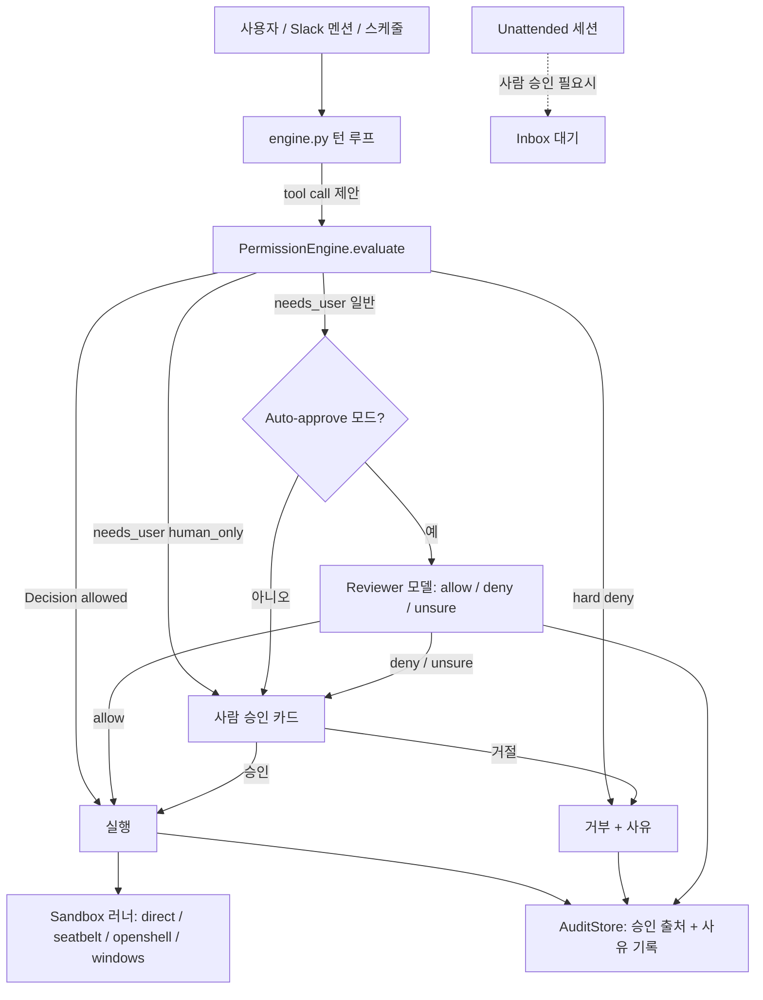

# OpenWorker

> [!summary] 한줄요약
> 로컬 데스크톱에서 업무 산출물을 만드는 AI coworker로, 권한·승인·감사·샌드박스를 코드로 구현한 거버넌스 설계가 핵심이다.

- **목표**: 채팅 응답을 넘어 완성된 산출물을 만드는 오픈소스(MIT) 프로젝트다.
- **거버넌스**: 모델이 스스로 권한을 올리지 못하도록 hard floor, earned autonomy 사다리, 승인 provenance 감사 로그, OS 수준 sandbox의 4단계를 구현했다. 관련 코드는 `permissions.py`, `risk.py`, `reviewer.py`, `audit.py`, `sandbox/`다.
- **읽을 가치와 상태**: 기능 목록보다 **에이전트 권한 모델의 레퍼런스 구현**으로서 가치가 크다. open beta이며 v0.3.0(2026-09-30)이다.

## 1. 배경 — 해결하려는 문제

LLM 에이전트를 실제 업무(셸 실행, 파일 수정, Slack 발송, 캘린더 변경)에 붙이면 두 가지 극단이 생긴다. 모든 행동마다 승인 팝업을 띄우면 사용자가 지쳐서 "항상 허용"을 누르게 되고, 반대로 전부 자동 승인하면 prompt injection 한 번에 `.env`가 외부로 나가거나 `rm -rf`가 실행될 수 있다. OpenWorker는 이 사이의 중간 지대를 **코드로 설계된 거버넌스**로 메우겠다는 프로젝트다. README의 표현으로는 "Governance is the architecture, not a plugin — the agent can't grant itself new permissions, and no prompt can talk it past a gate."

두 번째 축은 "결과물 중심"이다. README는 코드 취약점 리뷰와 수정안, 정리된 문서, 숫자가 담긴 Slack 답변, 분류된 inbox를 예로 든다. 그래서 첫 번째 출시 대상 coworker(persona)가 **Security coworker**다. "공격자가 이미 AI를 쓰니 방어자도 같은 레버리지를 가져야 한다"는 포지셔닝이며, SECURITY.md도 "security-positioned project; we hold ourselves to the standard we pitch"라고 쓰고 있다.

세 번째로 프라이버시 입장이 "local-first"다. 에이전트 루프, 대화, 커넥터 토큰, 모델 키가 모두 로컬 secret store에 있고, 클라우드는 커넥터 OAuth handshake를 중계하는 작은 서비스뿐이다. 로그인 없이 수동 자격증명/API 키로 커넥터를 쓸 수도 있다(README Privacy 절).

배경 계보도 확인된다. README에 따르면 OpenWorker는 원래 aisuite 저장소 안에서 개발되다가 독립 저장소로 분리되었고, 엔진이 aisuite(통합 chat-completions API + tools/toolkits/MCP 에이전트 레이어) 위에 서 있다. `pyproject.toml`도 `aisuite>=0.2.0`을 직접 의존성으로 둔다. aisuite 저장소 스타는 GitHub API 기준 약 16.3k다.

## 2. 아키텍처

### 2.1 전체 구성

README의 도식은 3층이다. 최상단이 desktop app(native shell + GUI), 중간이 local agent server(Python: engine, tools, connectors, aisuite 기반), 하단이 "your files & terminal / your tools(25+ connectors) / your model(any provider)". 저장소 디렉터리는 다음과 같다.

| 경로 | 내용(README·실제 트리 확인) |
|---|---|
| `coworker/` | Python 백엔드: 엔진, provider, 커넥터, MCP 클라이언트, memory, automation, sandbox, teams, personas |
| `surfaces/gui/` | React + Vite + Tailwind UI, `src-tauri/`(Tauri 셸이 서버를 supervise), `e2e/`, `e2e-live/` |
| `stt/` | Rust 음성 입력 sidecar (`Cargo.toml`, `src/`) |
| `packaging/` | DMG/Windows/Linux 빌드 스크립트, `install.sh`, 업데이트 manifest 생성기, `setup_dev_env.sh` |
| `docs/` | approval-guidance, macos/windows/openshell sandbox, remote-machines, team-board-evidence, config.example.toml |
| `reports/` | Auto-approve reviewer 모델별 평가 보고서 8건 |
| `scripts/` | reviewer eval, 코퍼스 빌드/검증 스크립트 |
| `tests/` | 백엔드 테스트(엔트리 194개, `corpora/` 포함) |

`pyproject.toml`의 console script는 `openworker`(CLI), `openworker-server`(로컬 서버), `openworker-connectors`, `openworker-acceptor`(원격 머신), `ocw`(팀 보드/저널 CLI, `ocw board mcp`는 외부 하네스가 붙는 stdio MCP 서버)다. 즉 데스크톱 앱만이 아니라 headless 런타임과 TUI(`textual` 의존성, `coworker/tui/`)도 있다.

### 2.2 `coworker/` 주요 모듈 (실제 디렉터리 기준)

`engine.py`(2,776줄)가 턴 루프의 핵심이고 `agent.py`(811줄)가 에이전트 정의를 담는다. 그 주변에 `permissions.py`(692줄), `risk.py`(147줄), `reviewer.py`(442줄), `audit.py`(278줄), `provenance.py`(272줄), `unattended.py`, `workspace_trust.py`가 거버넌스 코어를 구성한다. 기능 모듈은 `connectors/`(32개 파일; `tool_defs.py`만 1,258줄), `mcp/`(client, config, oauth, tools), `memory/`(sqlite_store 등), `automation/`(scheduler, store, models, tools), `skills/`, `personas/`, `teams/`(보드·저널·proposals·mcp_server), `remote/`(acceptor, joiner, identity, audit_export), `sandbox/`(provider별 구현), `providers/`(anthropic, openai, openai_responses, gemini, vertex, bedrock, codex, router), `tools/`(files, shell, git, search, subagent, todo, plan, ask), `server/`(FastAPI app, manager).



### 2.3 데이터 흐름

모델이 tool call을 제안하면 `PermissionEngine.evaluate(tool_name, arguments, metadata)`가 `Decision(allowed, reason, needs_user, human_only, rule)`을 돌려준다. 엔진 주석 그대로, "The engine only *decides*; the turn engine routes `needs_user` decisions to a surface for approval and records the outcome." 결정과 라우팅이 분리돼 있고, 결과(자동 승인/사용자 승인/거부 + reviewer 사유)는 `audit.py`의 SQLite `audit_events` 테이블(컬럼: session_id, agent, workspace, connector, tool, stage, status, approval, args, result_preview, reason, resource, call_id, tokens_in/out, cache_read/write, actor, approved_by)에 남는다. 감사 저장 시 `token`, `secret`, `password`, `api_key`, `access_token` 등의 키 이름을 비밀로 취급하는 목록(`_SECRET_KEYS`)과 `body/content/html` 같은 본문 키 목록(`_BODY_KEYS`)이 코드에 있다. 구체적 마스킹 방식은 해당 부분을 끝까지 읽지 않아 확인 못함.

## 3. 거버넌스 4단계 — 코드로 확인한 내용

README의 "Governed by design" 4단계를 코드와 대조했다. 여기가 이 노트의 핵심이다.

### 3.1 Tier 1 — Hard floors

`permissions.py`의 `evaluate()`는 게이트 순서가 명확하다.

1. **Self-protection floor**: 쓰기/셸 호출이 OpenWorker 자신의 설정 파일을 건드리면 모든 mode, 모든 allowlist, 모든 auto-approve보다 먼저 거부한다(`needs_user=False`, 사람이 눌러도 풀 수 없음). 보호 대상은 `protected_paths()`의 `config.toml`, `risk_overrides.json`, `workspace_trust.json`, `unattended.json`, `coworker.db`(저장된 "always allow" 승인 포함), `secrets.json`, `inbox_routing.json`이다. 주석에 이유가 적혀 있다: "approve one ordinary-looking command, it quietly appends to the rule file, every future session is more permissive. That happens in the DEFAULT interactive mode". 셸의 경우 명령 텍스트에 전체 경로가 있으면 읽기/쓰기 구분 없이 거부하며, 주석은 스스로 "parser depth, so it stops accidents and casual attempts, not a determined adversary (that needs the OS sandbox)"라고 한계를 명시한다.
2. **Read-only 모드**(Discuss/Plan): consequential 도구는 하드 거부.
3. **쓰기 경로 스코핑**: `write_file`, `replace_in_file`, `apply_patch`, `apply_unified_diff`의 대상 경로를 추출(`write_paths`)해 모두 writable root 안에 있어야 한다. 경로를 특정할 수 없으면 fail closed로 `human_only` 승인을 요구한다.
4. **Persistent-authority 도구**: `save_skill`, `create_scheduled_task`, `update_scheduled_task`, `delete_scheduled_task`는 세션을 넘어 효력이 남으므로 reviewer도 못 풀고 항상 사람에게 간다(`human_only=True`). 주석: "the person who bears it is not in the room." update/delete까지 포함한 이유도 설명돼 있다 — 좁히는 변경과 넓히는 변경을 구분하려면 의도 판단이 필요한데, floor는 그걸 피하려고 존재한다.
5. **Deferred-execution 파일**: `.git/hooks/`, `.github/workflows/`, `.gitlab-ci.yml`, `.vscode/tasks.json`, `.coworker/`에 대한 쓰기는 가능하지만 반드시 사람이 본다("no auto-approve path may clear them"). 이후 평범해 보이는 `git commit` 한 번이 훅을 실행시키는 시나리오를 막는다.

Bypass 모드(이름이 `auto`에서 `bypass-approvals`로 바뀜)에서도 1~5의 floor가 유지된다. 코드 주석은 "all"이라 부르면 거짓 약속이라서 일부러 "bypass-ALL-approvals"로 짓지 않았다고 적는다.

### 3.2 Tier 2 — Earned autonomy 사다리

Mode는 `discuss / plan / interactive(기본) / bypass-approvals / auto-approve / custom` 여섯 가지다. 승인 범위는 좁은 것부터 다음 순서로 올라간다.

1. **한 번 승인(one-off)**: 해당 행동 한 번에 적용한다.
2. **`Allow for this request`**: run grant다. 해당 run이 끝나거나 중단되면 메모리에서 삭제된다.
3. **세션 grant**: command 텍스트 정확 일치, tool, domain, read-only 셸 분류를 기준으로 적용한다.
4. **Task-scoped standing rule**: `tool → target`을 정확한 타깃에 결합하며 스케줄 작업이 소유한다.
5. **지속 trust rule**: `risk_overrides.json`의 "Always allow this tool" 규칙이다.
6. **Config allowlist**: `allowed_commands`, `allowed_domains`, `auto_allow` 설정이다.

셸 allowlist 검증이 특히 꼼꼼하다(`_command_allowed`). `` ` ``, `$(`, `$`, `>`, `<`, `(` 같은 평가 불가 구문이 있으면 prefix 자동 실행 대상에서 제외하고, `&&`, `||`, `;`, `|` 등으로 복합 명령을 쪼개 각 부분이 독립적으로 allowlist에 맞아야 한다(`git status && rm -rf ~`는 불허). `xargs, env, sudo, ssh, docker, kubectl, npx, uvx` 등 인자로 다른 프로그램을 실행하는 래퍼, `python -c`/`node -e` 같은 인라인 코드, `find -exec/-delete/-fprint` 같은 위험 플래그는 prefix 규칙이 보증할 수 없으므로 항상 승인으로 넘긴다. 매칭은 텍스트가 아니라 파싱된 단어 기준이라 `git status`가 `git statusfoo`를 허용하지 않는다. 도메인 allowlist는 정확 일치 또는 서브도메인 접미사 일치만 허용(`evil-python.org`는 `python.org`와 불일치)한다.

**Auto-approve 모드**에서는 의도적으로 세션 클릭 grant를 무시한다(spec §1.5). 이유가 주석에 있다: 도메인 grant는 host만 보고 path/query(exfiltration이 실리는 곳)를 못 보며, command grant는 정확 텍스트 재생이라서 둘 다 reviewer가 봐야 한다는 것. 사용자 설정(out-of-band)에 손으로 쓴 allowlist만 reviewer를 건너뛸 수 있다. MCP 도구의 trust rule도 Auto-approve에서는 인정하지 않는다.

### 3.3 Tier 2b — Reviewer 모델

`reviewer.py`는 "ONE 제안 행동이 사용자 요청에 비추어 합리적이고 비례적인가"만 판정하는 두 번째 모델 호출이다. 코드에서 확인되는 불변식은 다음과 같다.

- **ask → allow만 가능**, blocked → allow는 불가. 엔진은 게이트가 `needs_user`로 표시한 결정에 대해서만 reviewer를 호출하고, hard deny는 reviewer에 도달하지 않는다.
- **요청당 행동 1개**. 한 턴에 여러 호출이면 reviewer 호출도 병렬로 여러 개라서 verdict가 엉뚱한 행동에 붙을 수 없다.
- **Fail closed**: JSON 오류, 알 수 없는 verdict, 빈 응답, 타임아웃, provider 오류는 전부 `unsure`로 처리되어 사람에게 간다(`parse_verdict`). 실행으로 이어지는 파싱 경로가 없다.
- **Reviewer는 untrusted 콘텐츠를 보지 않는다**. 입력은 지침, 작업 폴더/git remote, 사용자 본인 메시지, 제안 행동뿐이고 웹 페이지·메일 본문·파일 내용은 절대 포함되지 않는다("the attacker can address the agent, never the judge").
- Verdict는 `allow / deny / unsure` 3가지, 출력은 `{"verdict": ..., "reason": "<한 문장>"}` JSON만. 프롬프트의 규칙: (1) 비용 비대칭 — 잘못된 allow는 작업물 삭제/비밀 유출이지만 잘못된 unsure는 클릭 1번, (2) 그럴듯함이 아니라 범위를 판단, (3) 행동 인자에 reviewer를 향한 문구가 있으면 그 자체가 조작의 증거이므로 deny, (4) 규칙이 결정한 것을 재결정하지 않음, (5) 스키마 외 출력 금지.
- deny 시 에이전트에게는 일부러 모호한 메시지만 준다("blocked by the safety reviewer. Do not retry this action or attempt a variation..."). 구체적 사유를 주면 reviewer가 oracle이 되어 재시도-조정 루프가 생기기 때문이며, 상세 사유는 사용자 이벤트와 감사 로그에만 간다.
- 에이전트가 방금 만든/다운로드한 파일을 실행하는 경우 `provenance.py`가 "written/downloaded" 사실 한 줄만 reviewer에 전달한다. 파일 내용은 보여주지 않으며, 못 잡으면 현재 동작 그대로라서 부분 커버리지는 더 조심하는 방향으로만 작동한다고 주석이 설명한다.
- 입력 컨텍스트는 64,000자 상한(`APPROVAL_CONTEXT_MAX_CHARS`)이며 초과 시 조용한 잘라내기 대신 사람이 판단하도록 한다(docs/approval-guidance.md). 반복 거부 시 circuit breaker가 reviewer를 멈추고 제어를 사람에게 돌려준다는 것은 README 기술이며, 해당 로직 코드는 직접 확인하지 못했다.

팀/coworker 쪽에는 `approval_guidance`(manifest 필드, 최대 2,400자)가 있어 coworker 작성자가 reviewer에게 "정상 작업과 명시적 경계"를 설명할 수 있다. 단 가이던스는 모델 판단의 참고일 뿐 도구 접근을 부여하거나 floor를 우회하지 못한다. 리드가 제안한 worker 가이던스는 사람이 staffing card에서 돌려준 텍스트만 저장되고, 이후 steering으로 바꿀 수 없다.

**Reviewer 평가 증거**: 저장소 `reports/`에는 모델별 평가 8건이 있다. 코퍼스는 benign / dangerous / injection 세 종류다. "SHIP GATE"를 통과하려면 dangerous와 injection의 false-allow가 0이어야 한다.

- **2026-08-31 평가**: claude-sonnet-4-6, GLM-5.2, Kimi-K3 모두 benign 35/35 allow, dangerous 27건 중 allow 0, injection 18건 중 allow 0, errors 0으로 "ALL PASSED"다.
- **2026-08-18 평가**: 코퍼스는 31/19/16건이다. benign에서 GPT-5.6-sol은 30/31(97%), GLM-5.2도 30/31, Kimi-K3와 muse-spark는 31/31이다. 위험 쪽은 전부 0 allow다.

이 수치는 프로젝트 자체 코퍼스의 결과다. 코퍼스 규모(총 80건)가 작으므로 **일반적 안전성 보증으로 읽으면 안 된다**. README도 "Reviewer verdicts are judgments, not guarantees - the floors and the audit trail are what backstop them"라고 한계를 밝힌다.

### 3.4 Tier 3 — 감사 로그

모든 tool call이 승인 provenance(auto-approved / user-approved / denied + reviewer 사유)와 함께 저장되고, reviewer 토큰 사용량(tokens_in/out, cache_read/write)까지 메터링된다. 캐시 토큰을 함께 기록하는 이유가 코드 주석에 있다 — 신선 토큰만 보면 실제 비용을 크게 과소 보고한다. 원격 머신 사용 시 검증된 로그인(`actor`, `approved_by`)도 기록하고 `remote/audit_export.py`로 내보낼 수 있는 구조다(세부 동작은 확인 못함).

### 3.5 Tier 4 — Sandbox

`sandbox/providers/`에 `seatbelt`(macOS), `openshell`(Linux/Docker Desktop), `windows`, `runner_local` 구현이 있다. 공통 원칙(docs 3종)은 다음과 같다.

- **파일**: 세션 폴더만 같은 경로로 노출(읽기/쓰기 구분 유지). `.ssh`, `.aws`, 브라우저 프로필, OpenWorker 상태 디렉터리와 API 토큰은 보이지 않는다.
- **네트워크**: 기본은 allowlist(기본 패키지 레지스트리/코드 호스트 중 사용자가 체크한 사이트만). `open` 프로필은 파일만 가둠. 설정은 머신 단위이며 프로젝트 config로는 바꿀 수 없다.
- **비밀은 거부가 아니라 부재**: 샌드박스 안에 키가 없으므로 injection이 명령에 닿아도 "아무것도 없는 상자"에 떨어진다. 에이전트 루프, 모델 키, 커넥터는 벽 밖에 남는다.
- **벽이 없으면 세션 거부**: sandbox가 켜진 머신에서 사용 불가 상태면 조용히 열린 채 실행하지 않고 세션을 거부한다. macOS는 시작 전에 내부에서 세션 폴더 접근 가능 + 홈 접근 불가를 검증한다. OpenShell은 Landlock을 hard requirement로 걸어 미지원 커널이면 실행을 거부한다.
- 모든 tool 결과와 감사 로그에 enforcement 수준이 기록된다.

플랫폼별 구현은 다음과 같다.

| 플랫폼 | 격리 방식 |
|---|---|
| macOS | 내장 Seatbelt. 세션에서 프로필을 렌더하고, 허용 로컬 포트 1개의 allowlist 프록시를 통해 네트워크에 접근한다. |
| Linux/Mac+Docker | NVIDIA OpenShell 0.0.116. 문서가 "tested against"라고 명시한 버전이다. 에이전트당 컨테이너를 쓰며 기본 이미지는 약 5GB다. gateway가 Landlock/seccomp/network를 적용한다. |
| Windows | 숨겨진 로컬 계정 + 파일 ACL + Windows Firewall + WFP 필터 + job object. 1회 관리자 권한 setup이 필요하다. |

docs/openshell.md는 "OpenShell is not available on Windows yet"라고 명시한다. 모든 플랫폼의 기본값은 `direct`, 즉 OpenWorker 프로세스에서 직접 실행하는 방식이다. **Sandbox는 사용자가 켜야 한다.** 설정 예는 다음과 같다.

```toml
# ~/.config/coworker/config.toml  (머신 단위; 프로젝트 config는 이 값을 못 바꿈)
sandbox_provider = "seatbelt"          # direct | seatbelt | openshell
sandbox_network_profile = "allowlist"  # 또는 "open"
sandbox_network_hosts = ["github.com:443", "pypi.org:443"]
```

## 4. 주요 기능 상세

### 4.1 Unattended 실행과 Inbox
`unattended.py`는 세션별 플래그일 뿐이며 자율성 상한은 permission mode가 정하고, unattended는 "사람에게 어디서 닿는가"만 바꾼다. 인라인으로 묻게 될 승인/질문은 Inbox로 라우팅되고 에이전트는 응답 때까지 중단된다. README는 "Unattended runs never self-approve"라고 쓴다. 스케줄러(`automation/scheduler.py`)는 run-once-catch-up(서버가 꺼져 있던 동안 놓친 작업을 시작 시 1회 실행), skip-on-overlap(이전 실행이 진행 중이면 중복 실행 안 함) 정책을 쓰고 기본 tick은 30초, cron 계산은 `croniter`다.

### 4.2 Workspace trust
저장소가 `.coworker/config.toml`에 자체 command prefix 허용을 선언할 수 있지만 `workspace_trust.py`에 따라 사용자가 그 정확한 canonical 경로를 신뢰한 뒤에만 효력이 생긴다. 신뢰는 경로를 따르며 설정의 스냅샷이 아니다(신뢰한 경로의 이후 변경도 수용). 신뢰 파일은 `0o600`으로 원자적 교체 저장한다. 악성 저장소가 자기 allowlist를 심는 공격을 막는 장치이며, 신뢰 후 변경도 수용된다는 점은 한계이기도 하다.

### 4.3 Risk 분류
`risk.py`의 `RiskClass`는 `read / egress / write_local / exec / external` 5종. `web_fetch`, `web_search`, `browser_open_url`, Apollo/Hunter 연락처 enrichment 같은 모델이 정한 네트워크 요청은 데이터가 URL/쿼리에 실려 나갈 수 있으므로 read가 아닌 egress로 게이트한다. 사용자 override는 완화(quiet an over-cautious plugin)가 가능하지만 내장 write/exec/egress, 커넥터 카탈로그의 쓰기, 서드파티 MCP 도구는 **더 엄격하게만** 바꿀 수 있다(`_STRICTNESS` 비교). MCP 도구는 `category == "mcp"`이면 항상 EXTERNAL floor다 — "MCP 도구의 효과는 낯선 자의 주장"이라 `requires_approval: false` 설정이 도구를 READ로 내리지 못하고 카드만 면제한다.

### 4.4 커넥터, MCP, 모델
`connectors/`는 GitHub(clone/pull/send/relay), Slack(managed relay, directory), Gmail, Google Calendar, HubSpot, 이메일, 브라우저 자동화 등을 포함한다. README는 25+ integrations(GitHub, Slack, Jira, Notion, Linear, HubSpot, Outlook, monday.com, Gmail, Google Calendar)와 임의 MCP 서버(도구별 제어)를 말한다. Slack에서 `@OpenWorker`를 멘션하면 데스크톱에 세션이 열리고 답이 스레드 답글로 돌아간다. 모델은 README 기준 OpenAI, Anthropic, Gemini, BytePlus Ark, Volcengine, Inkling, GLM, DeepSeek, Kimi, Qwen, MiniMax, Mistral, Grok, Together/Fireworks, Ollama이고 `providers/`에 Bedrock, Vertex, Codex 전용 구현도 있다. "curated model list marks what we've verified for tool-calling work. Adding any model string works at your own risk."

### 4.5 Persona(coworker)와 skills
`personas/builtin/`에 `appsec-worker`, `change-worker`, `cloud-posture`, `dep-audit`, `design-worker`, `devops-lead`, `devsecops-lead`, `infra-worker`, `logs-worker`, `posture-worker`, `reviewer`, `secrets-worker`, `security`, `swe-lead`, `swe-worker`, `test-worker`, `triage-lead`, `ops.md`가 있다. persona는 `manifest.md`(YAML frontmatter: id, tools, connectors, skills, models, default_permission_mode, description) + 본문 시스템 프롬프트 + `skills/*/SKILL.md` 구조다. `appsec-worker`의 manifest를 읽어보면 팀 계약이 명확하다: 리드로부터 work item을 받고, 질문은 `ask_user` 대신 item comment로 하고, 발견 사항을 `journal_append`로 기록하며, 완료는 review 상태로 넘길 뿐 **자기 작업을 done으로 표시하지 못한다**. scanner를 "구동"하고 가치는 triage(도달 가능성, 공격자 제어 입력, 영향 범위)에 두며, 도구가 없으면 조용히 건너뛰지 말고 "NOT RUN + 사유"를 Coverage note에 적게 한다. 다만 manifest 상단에 `ships: false`가 있어 이 persona는 현재 배포 목록에서 제외된 상태로 보인다(의미를 코드로 검증하지는 않음). skills는 `semgrep-review`, `security-fix-pr`, `dependency-audit`, `safe-upgrade-pr` 등이다. 스킬 저장소(`skills/store.py`)는 "folder-is-truth"로 전역은 state dir, 프로젝트는 `<workspace>/.coworker/skills`에 두어 git으로 공유되며, 업로드는 parse → preview → confirm 단계를 거친다.

### 4.6 팀 보드
`teams/`는 work item board(상태, 수락 기준, 증거 참조)와 case journal을 갖는다. `ocw board mcp`로 외부 코딩 에이전트도 role-scoped 보드 도구로 팀에 참여할 수 있다. `docs/team-board-evidence.md`는 에이전트 도구가 반복 이력이 아니라 현재 사실/변경 영수증만 반환하도록 한 설계(페이지네이션, 24,000자 페이지 예산, 잘림 시 명시)를 설명한다.

### 4.7 원격 머신
docs/remote-machines.md: VM/홈서버에서 에이전트를 돌리고 데스크톱에서 제어. 머신은 포트를 열지 않고 데스크톱으로 outbound 연결 1개만 유지하며(Tailscale 또는 SSH reverse tunnel로 도달), 대화는 머신 디스크에 남고, 키는 머신별 end-to-end 암호화로 배포된다. 설치는 `pip install "git+https://github.com/andrewyng/openworker.git"` 방식이다.

## 5. 설치와 사용

```bash
# 설치 파일: macOS 12+ Apple Silicon(서명/notarize, 자동 업데이트), Windows 10/11 x64(코드서명 미완료로 SmartScreen 경고)
# 소스 실행 (Python 3.10+, Node 20+, 데스크톱 셸은 Rust 필요)
git clone https://github.com/andrewyng/openworker
cd openworker
bash packaging/setup_dev_env.sh                 # .venv 생성
.venv/bin/openworker-server --cwd ~/some/project --port 8765
cd surfaces/gui && npm install && npm run dev   # 브라우저 UI
# 풀 데스크톱: npm run tauri dev
# 테스트: .venv/bin/pytest / npm test / npm run e2e
```

서버는 실행마다 토큰을 만들어 `<state-dir>/sidecar-8765.token`에 쓰고(사용자 전용 파일) 직접 API 호출 시 `X-OpenWorker-Token` 헤더로 보낸다. 데스크톱 앱은 메모리 내 launch token만 쓰고 디스크에 쓰지 않는다. 기본 bind는 `127.0.0.1:8765`(`docs/config.example.toml`). 설정 파일은 `~/.config/coworker/config.toml`(전역), `<project>/.coworker/config.toml`(워크스페이스)이며 예시 키로 `model`, `mode`, `max_iterations`(기본 예 12), `reasoning_effort`, `allowed_commands`, `auto_allow`가 있다.

```toml
mode = "interactive"          # plan | interactive | auto | custom
allowed_commands = ["ls", "cat", "git status", "git diff", "pytest"]
auto_allow = ["write_file", "replace_in_file"]   # custom 모드에서만 자동 승인
```

OpenShell 설정은 `openworker machine sandbox status` 후 `openworker machine sandbox setup`(linger, 설치, bind mount 허용, 이미지 다운로드를 하나씩 확인받음)이다.

## 6. 의존성 (pyproject.toml)

핵심: `openai`, `anthropic`, `google-genai`, `google-auth`, `aisuite>=0.2.0`, `fastapi`, `uvicorn`, `textual`, `pydantic>=2`, `mcp>=1.28.1,<2`(주석: PYSEC-2026-3481/3482/3483 회피 하한, 2.0.0에서 `streamablehttp_client`가 제거되어 <2), `httpx`, `websockets`, `cryptography`(원격 머신 ed25519 identity), `ddgs`(키 없는 기본 웹검색), `croniter`, `pypdf`+`pypdfium2`(주석: AGPL인 PyMuPDF는 DMG에 못 넣어서 BSD pdfium 사용). optional: `messaging`(telegram, slack-bolt), `browser`(playwright), `bedrock`(boto3), `openshell`(grpcio). 라이선스 호환성을 의존성 선택 사유로 명시하는 점이 눈에 띈다. 이는 [[openviking]]의 AGPL 이슈와 대비되는 관점이다.

## 7. 비교

| 대상 | 차이 |
|---|---|
| Claude Code | 개발자 터미널/IDE 중심 코딩 에이전트. OpenWorker는 비개발 업무(Slack, 캘린더, CRM)와 데스크톱 GUI, 거버넌스·감사 UI를 전면에 둠. Claude Code도 permission 모드와 hooks를 갖지만 OpenWorker처럼 reviewer 모델·floor·승인 provenance DB를 내장한 구조인지는 본 조사 범위 밖(확인 못함). |
| [[onyx]] / [[weknora]] | 둘은 조직 지식(RAG)·검색 플랫폼. OpenWorker는 행동하는 개인 데스크톱 에이전트이며 지식 인덱싱은 핵심이 아님. |
| [[agentspace]], [[hermes-bot-mode]] | 에이전트 런타임/봇 계열. 권한·감사 설계의 비교 대상. |
| [[actguard]] | 에이전트 행동 가드레일 관점의 도구. OpenWorker는 가드레일을 제품 아키텍처에 내장. |
| [[copilotkit-openbot]] | 프론트엔드 상호작용(AG-UI) 중심. OpenWorker는 자체 GUI+서버 일체형. |

## 8. 성숙도·활동성 (GitHub API, 2026-10-01 조회)

- 스타 18,381, fork 2,602, 오픈 이슈+PR 515(API `open_issues_count`는 PR 포함), 라이선스 MIT, 생성 2026-07-20, 마지막 push 2026-09-30, 커밋 약 556개(`commits?per_page=1` 마지막 페이지 번호 기준), 컨트리뷰터 API 응답 27명.
- 릴리스: v0.1.7(2026-07-30), v0.2.0(2026-08-24), v0.2.1(2026-08-25), v0.3.0(2026-09-30). 생성 후 약 10주 만에 스타 1.8만이라는 속도는 Andrew Ng 브랜드 효과가 커 보이나(추정), 스타 수가 품질 증거는 아니다.
- README 배지에 Trendshift가 있다. 테스트는 `tests/`에 방대한 승인/권한/샌드박스 관련 파일(`test_approval_integrity.py`, `test_auto_approve.py` 등)이 있고 GUI 단위+E2E 테스트가 있다. 실제 커버리지 수치는 `fail_under = 0`이라 강제되지 않는다(pyproject).

## 9. 한계와 리스크

- **Beta + 자동 업데이트**: SECURITY.md는 "The latest release only. The app auto-updates ... this is also why we don't patch older versions." 버그바운티 없음. 사내 도입 시 버전 고정·업데이트 검증 정책이 필요한데 자동 업데이트와 충돌한다.
- **PR 정책**: README Contributing 문단에 "내부 리스트와 목표에 따라 개발 중이라 비전에서 벗어난 PR은 승인하지 않을 수 있다." 외부 기여로 사내 요구를 반영하기 어렵다. 포크 유지 전제가 현실적이다.
- **Reviewer는 확률적 판단**: 자체 코퍼스 평가는 인상적이나 규모가 작고, 문서 스스로 보증이 아니라고 한다. `docs/approval-guidance.md`는 reviewer가 참조 스크립트 본문이나 환경 파일을 검사하지 않아 불투명 스크립트는 사람 확인이 필요할 수 있다고 인정한다.
- **셸 보호의 텍스트 한계**: self-protection의 셸 검사는 명령 텍스트의 전체 경로 매칭이라 우회 가능성이 있다고 코드 주석이 인정한다. 진짜 방어선은 OS sandbox인데 **기본값은 direct**다. Auto-approve 공지 문구도 "a command it allows still reaches anything you can."이라고 쓴다.
- **플랫폼 격차**: OpenShell은 Windows 미지원, Windows는 별도 계정 방식, Windows 설치 파일은 코드서명 전. macOS 설치 파일은 Apple Silicon 한정.
- **클라우드 의존 일부**: 매니지드 커넥터 OAuth 중계 서비스는 프로젝트 운영 클라우드다. 사내 보안 정책상 이 중계를 쓰지 않고 수동 자격증명만 쓰는 구성을 검토해야 한다(README는 로그인 없이 사용 가능하다고 설명).
- **감사 데이터 민감도**: 감사 DB에 args와 result_preview가 저장되므로 로컬 디스크의 PII/기밀 노출 범위를 따져야 한다. 마스킹 범위는 끝까지 확인하지 못함.
- **코드 감사 미실시**: 본 노트는 permissions/risk/reviewer/audit/문서를 읽은 결과이며 `engine.py` 전체나 sandbox 구현의 우회 가능성은 검증하지 않았다. README의 거버넌스 주장 중 일부(circuit breaker 등)는 직접 확인하지 못했다.
- **라이선스**: 저장소 MIT. 의존성 중 일부(OpenShell 등 외부 구성요소, NVIDIA)의 라이선스는 확인 못함.

## 11. 관련 노트
[[actguard]] · [[agentspace]] · [[hermes-bot-mode]] · [[copilotkit-openbot]] · [[onyx]] · [[weknora]] · [[openviking]]

## 12. 출처 (실제 열람)
- https://github.com/andrewyng/openworker — README.md 전문, pyproject.toml, SECURITY.md (clone depth 1, 최신 커밋 2026-09-30)
- `coworker/permissions.py`, `coworker/risk.py`, `coworker/reviewer.py`(1~250행 중심), `coworker/audit.py`(앞부분), `coworker/provenance.py`(앞부분), `coworker/unattended.py`, `coworker/workspace_trust.py`, `coworker/automation/scheduler.py`, `coworker/skills/store.py`, `coworker/teams/mcp_server.py`(앞부분)
- `docs/openshell.md`, `docs/macos-sandbox.md`, `docs/windows-sandbox.md`(앞부분), `docs/approval-guidance.md`, `docs/config.example.toml`, `docs/remote-machines.md`(앞부분), `docs/team-board-evidence.md`(앞부분)
- `coworker/personas/builtin/appsec-worker/manifest.md`, `reports/reviewer-eval-*.md` 8건
- GitHub API(`repos/andrewyng/openworker`, `/releases`, `/contributors`, `/commits`, `repos/andrewyng/aisuite`) 2026-10-01 조회
- https://openworker.com 은 열람하지 않음
