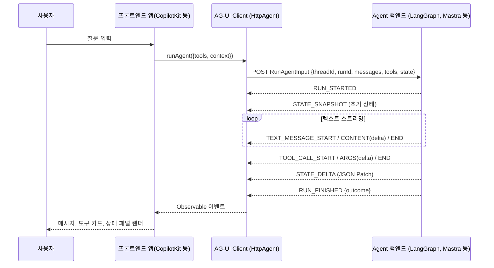
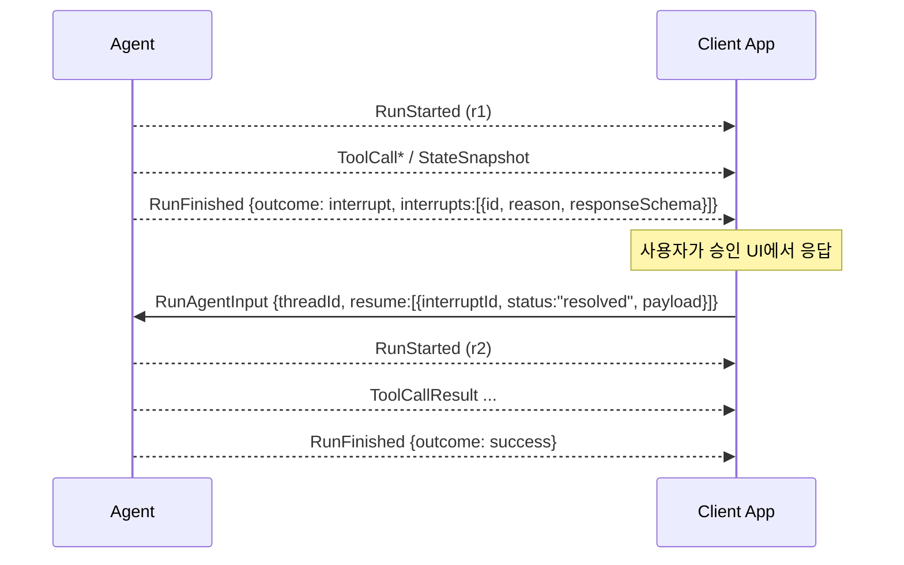

# AG-UI feat. CopilotKit (PyTorchKR)

> [!summary] 한줄요약
> AG-UI를 소개한 PyTorchKR 한국어 포스트를 공식 1.0 스펙과 대조해, 이벤트 스트림과 UI 연결 방식을 정리한 노트다.

- **원문**: PyTorchKR의 9bow(박정환)가 2025-05-15에 게시한 입문용 개념 요약이다. CopilotKit이 공개한 AG-UI를 "백엔드 에이전트와 프론트엔드를 단일 이벤트 스트림으로 잇는 개방형 프로토콜"로 설명한다.
- **이 노트의 범위**: AG-UI 공식 저장소(2026-10-01 clone)의 스펙·문서·SDK 코드와 포스트의 주장을 대조해, 조사 시점의 1.0 기준으로 정정하고 설명을 보강했다.

> [!warning] 포스트 자체의 전제
> 글 말미에 "이 글은 GPT 모델로 정리한 글을 바탕으로 한 것으로, 원문의 내용 또는 의도와 다르게 정리된 내용이 있을 수 있다"는 고지가 있다. 즉 1차 자료가 아니라 2차 요약이다. 특히 포스트가 나열한 이벤트 이름 중 `LIFECYCLE_SIGNAL`은 현재 스펙에 존재하지 않는다(아래 3.3 참조).

## 1. 포스트는 무엇을 말하는가

게시물은 PyTorchKR 포럼의 "읽을거리&정보공유" 카테고리에 2025년 5월 15일 올라왔고, 태그는 ollama, langgraph, protocol, copilotkit, ag-ui, crewai, mastra다. 조회 952회, 포스트 안 링크 3개(2026-10-01 렌더링 시점 표기). 본문은 크게 다섯 덩어리로 구성된다.

1. 문제 제기: AI 에이전트를 실서비스에 넣으려면 백엔드뿐 아니라 프론트엔드와의 연결 방식이 중요한데, 에이전트 프레임워크는 늘어나는 반면 UI와 통합하는 표준화된 방식은 부족하다.
2. 해법 소개: CopilotKit이 공개한 AG-UI(Agent-User Interaction Protocol)는 다양한 에이전트 백엔드와 프론트엔드 프레임워크를 "단일 이벤트 스트림"으로 연결한다. 포스트는 이를 "HTTP 또는 선택적인 바이너리 채널을 통해 단일 JSON 이벤트 스트림을 교환하는 오픈소스 프로토콜"이라고 적는다.
3. 주요 기능 6가지: 단일 POST + 스트리밍 수신, 표준화된 이벤트 타입(`TEXT_MESSAGE_CONTENT`, `TOOL_CALL_START`, `STATE_DELTA`, `LIFECYCLE_SIGNAL`), 실시간 협업, 멀티에이전트 통합, 상태 diff 스트리밍, React 컴포넌트.
4. 동작 예시 4단계: 클라이언트가 POST로 연결 → 서버가 JSON 이벤트를 스트리밍 → 프론트가 이벤트별로 렌더링 → 사용자가 도구 실행을 승인하거나 응답에 피드백하는 양방향 상호작용. 본문에 이미지 2장(1551x644, 1441x524)이 있으나 이 노트에서는 이미지 내용을 확인하지 못했다.
5. 링크: GitHub `ag-ui-protocol/ag-ui`, 공식 문서 사이트(Overview).

통합 대상으로는 OpenAI, LangGraph, Ollama, CrewAI, Mastra가 언급되며 CopilotKit React 컴포넌트와 호환된다고 한다. 글에는 댓글이 없었다(렌더링 결과 기준 "댓글 쓰기"만 표시). 하단에 노출되는 관련 글(Agent Network Protocol, OpenBot, "AI 에이전트 프로토콜 개발자 가이드: MCP부터 A2A, UCP, AP2, A2UI, AG-UI까지(feat. Google)" 등)은 사이트의 추천이며 이 글의 내용은 아니다.

## 2. 배경: 해결하는 문제

에이전트 앱의 어려움은 모델 호출이 "한 번 응답하고 끝나는" 요청/응답이 아니라는 점이다. 에이전트 실행은 수 초에서 수 분 걸리고, 도중에 텍스트가 토큰 단위로 흘러나오고, 도구를 호출하고, 내부 상태(계획, 작업 목록, 문서 초안)가 바뀌고, 때로는 사람의 승인을 기다린다. LangGraph, CrewAI, Mastra, Google ADK, Pydantic AI 같은 프레임워크는 각자 다른 스트리밍 포맷과 콜백 체계를 가지므로, 프론트엔드는 백엔드마다 별도 어댑터를 짜야 한다. AG-UI는 이 사이에 "이벤트 어휘(vocabulary)"를 표준으로 정해 UI 쪽 코드를 재사용 가능하게 만들려는 시도다.

공식 문서(docs.ag-ui.com)와 README는 이를 3계층 스택으로 정리한다. MCP는 에이전트에게 도구를 주고, A2A는 에이전트끼리 소통하게 하며, AG-UI는 에이전트를 사용자 대면 애플리케이션으로 데려온다. README는 AG-UI가 CopilotKit과 LangChain·CrewAI의 초기 파트너십에서 출발했다고 적는다.

## 3. 동작 원리와 아키텍처 (저장소 문서 기준)

### 3.1 핵심 설계 원칙

`docs/concepts/architecture.mdx`는 두 가지 단순한 요구만 둔다고 설명한다. 첫째, 에이전트는 실행 중 표준 이벤트 타입에 "호환되는" 이벤트를 방출한다. 둘째, 에이전트는 사용자 입력(`RunAgentInput`)을 받는다. 그리고 "이벤트가 AG-UI 포맷과 정확히 같을 필요는 없고 호환되면 된다"는 느슨한 매칭을 허용하는 미들웨어 계층을 둔다. 전송 계층도 고정하지 않아 SSE, WebSocket, webhook 등을 쓸 수 있다고 명시한다. 포스트의 "HTTP 또는 선택적 바이너리 채널"은 참조 구현 `HttpAgent`가 지원하는 두 전송, 즉 HTTP SSE와 HTTP binary(protobuf 기반)를 가리키는 것으로 보인다. Python 인코더(`sdks/python/ag_ui/encoder/encoder.py`)에는 `application/vnd.ag-ui.event+proto` 미디어 타입 상수가 있으나, 확인한 Python `EventEncoder.encode`는 SSE(`data: {json}\n\n`)만 반환한다.

### 3.2 구성요소와 데이터 흐름

- Application: 사용자 대면 앱(채팅 UI 등).
- AG-UI Client: `HttpAgent` 같은 범용 클라이언트 또는 기존 프로토콜용 특화 클라이언트.
- Agents: 요청을 처리하고 스트리밍 응답을 만드는 백엔드 에이전트.
- Secure Proxy: 추가 기능을 제공하고 보안 프록시 역할을 하는 백엔드 서비스(문서 다이어그램 기준).

프로토콜의 핵심 추상화는 `run(input: RunAgentInput) -> Observable<BaseEvent>`이다. TypeScript SDK에서는 `AbstractAgent`를 상속해 `run`을 구현하면 되고, RxJS `Observable`로 이벤트가 흐른다. `HttpAgent`는 `RunAgentInput` 본문을 POST로 받아 `BaseEvent` 스트림을 돌려주는 임의의 엔드포인트에 붙을 수 있다.



### 3.3 이벤트 체계: 포스트의 "표준 이벤트 타입"을 현재 스펙과 대조

저장소 `spec/1.0/schema.json`의 `EventType` enum은 31개 값을 가진다. 반면 `architecture.mdx`에는 아직 "16개의 표준 이벤트 타입"이라는 서술이 남아 있고 README도 "~16"이라고 쓰므로, 문서끼리 불일치가 있다. 아래는 스키마 enum 기준 분류다.

| 범주 | 이벤트 |
|---|---|
| 라이프사이클 | `RUN_STARTED`, `RUN_FINISHED`, `RUN_ERROR`, `STEP_STARTED`, `STEP_FINISHED` |
| 텍스트 메시지 | `TEXT_MESSAGE_START`, `TEXT_MESSAGE_CONTENT`, `TEXT_MESSAGE_END`, `TEXT_MESSAGE_CHUNK` |
| 도구 호출 | `TOOL_CALL_START`, `TOOL_CALL_ARGS`, `TOOL_CALL_END`, `TOOL_CALL_CHUNK`, `TOOL_CALL_RESULT` |
| 상태 | `STATE_SNAPSHOT`, `STATE_DELTA`, `MESSAGES_SNAPSHOT` |
| 액티비티 | `ACTIVITY_SNAPSHOT`, `ACTIVITY_DELTA` |
| 특수 | `RAW`, `CUSTOM` |
| 추론(reasoning) | `REASONING_START`, `REASONING_MESSAGE_START/CONTENT/END/CHUNK`, `REASONING_END`, `REASONING_ENCRYPTED_VALUE` |
| 서브에이전트 | `SUBAGENT_STARTED`, `SUBAGENT_FINISHED`, `SUBAGENT_ERROR` |

포스트 대조 결과는 다음과 같다.

- `TEXT_MESSAGE_CONTENT`, `TOOL_CALL_START`, `STATE_DELTA`는 현재도 존재하며 포스트의 설명이 맞다.
- `LIFECYCLE_SIGNAL`은 스키마 enum, `events.mdx`, `architecture.mdx` 어디에서도 발견되지 않았다(`events.mdx` grep 일치 없음). 라이프사이클 이벤트의 실제 이름은 `RUN_STARTED/RUN_FINISHED/RUN_ERROR/STEP_*`다. GPT 요약 과정에서 생긴 이름일 가능성이 높지만, 2025-05 시점 스펙에 그 이름이 있었는지는 이 조사에서 확인하지 못했다.
- 포스트에 없는 interrupt, reasoning, subagent, activity, capabilities는 이후 추가·정리된 것으로 보인다(포스트 시점의 존재 여부는 확인 못함).
- 구 `THINKING_*` 이벤트 5종은 `REASONING_*`로 대체되었고, 1.0 클라이언트는 구 형태를 받으면 경고와 함께 변환한다(`docs/migrating-to-1-0.mdx`, `DEPRECATIONS.md`).

### 3.4 스트리밍 패턴

문서가 정리한 이벤트 흐름 패턴은 세 가지다.

1. **Start-Content-End: 텍스트와 도구 호출**
   `messageId`/`toolCallId`로 같은 논리 스트림을 묶고 `delta`를 순서대로 이어 붙인다. 편의용 `TEXT_MESSAGE_CHUNK`/`TOOL_CALL_CHUNK`는 클라이언트 변환기가 Start→Content→End 3종으로 펼친다. ID가 바뀌거나 스트림이 끝나면 End를 자동 방출한다.
2. **Snapshot-Delta: 상태 동기화**
   `STATE_SNAPSHOT`은 전체 상태를 교체한다. `STATE_DELTA`는 RFC 6902 JSON Patch 배열이며 순서대로 적용한다. 문서에 따르면 불일치가 감지될 때 새 스냅샷을 요청할 수 있다. 포스트의 "차이점만 스트리밍"이 이 패턴이다.
3. **Lifecycle: 실행의 시작과 종료**
   `RunStarted`로 시작하고 `RunFinished` 또는 `RunError`로 반드시 끝난다. Step 이벤트는 선택 사항이다.

실제 이벤트 예시(문서 `tools.mdx`):

```typescript
{ type: EventType.TOOL_CALL_START, toolCallId: "tool-123",
  toolCallName: "confirmAction", parentMessageId: "msg-456" }
{ type: EventType.TOOL_CALL_ARGS, toolCallId: "tool-123", delta: '{"act' }
{ type: EventType.TOOL_CALL_ARGS, toolCallId: "tool-123", delta: 'ion":"Depl' }
{ type: EventType.TOOL_CALL_ARGS, toolCallId: "tool-123", delta: 'oy the application to production"}' }
```

JSON 조각이 스트리밍되므로 UI는 인자를 점진적으로 보여줄 수 있다. 결과는 별도 `TOOL_CALL_RESULT`(messageId, toolCallId, content, role)로 한 덩어리 전달된다.

### 3.5 포스트가 짧게만 언급한 "양방향 상호작용"의 실제 모델

포스트는 "사용자가 도구 실행을 승인하거나 피드백"이라고만 쓴다. 저장소에서 확인한 구체 메커니즘은 두 갈래다.

하나는 프론트엔드 정의 도구다. `RunAgentInput.tools`에 클라이언트가 JSON Schema 기반 도구(예: `confirmAction`)를 실어 보내면, 에이전트가 그 도구를 호출하는 순간 UI가 확인 다이얼로그를 띄우는 human-in-the-loop 패턴이 가능하다. 문서는 "민감한 작업은 에이전트가 아니라 애플리케이션이 통제한다"는 이점을 든다. 다만 `tools`는 클라이언트 제공 도구용이며 백엔드 도구 전체를 담는 용도가 아니라고 못박는다.

다른 하나는 **interrupt-aware 라이프사이클**(`docs/concepts/interrupts.mdx`)이다. 실행이 `RUN_FINISHED { outcome: { type: "interrupt", interrupts: [...] } }`로 끝나면, 클라이언트는 같은 `threadId`로 새 run을 시작하며 `resume: [{interruptId, status: "resolved"|"cancelled", payload?}]`를 보낸다.

재개 계약은 다음과 같다.

- 같은 스레드를 사용한다.
- 모든 open interrupt에 한 번에 응답한다. 부분 resume은 불가하다.
- 대기 중 interrupt가 있으면 새 입력에 resume을 포함해야 한다.
- 동일 요청 재전송은 idempotent하다.
- `expiresAt` 이후 resume은 `RunError`가 된다.
- `responseSchema`로 payload를 검증할 수 있다.
- interrupt 시점에는 재개에 필요한 `StateSnapshot`/`MessagesSnapshot`을 `RunFinished`보다 먼저 방출해야 한다.

단, events.mdx에서는 이 확장이 "DRAFT" 배지 아래에도 표시된다. 문서 내부에서 확정 여부 표기가 엇갈린다는 점에 주의해야 한다.



### 3.6 그 밖의 현재 스펙 요소 (포스트에는 없음)

- 메타데이터: 모든 이벤트에 선택적 `metadata`(토큰 사용량, trace id 등)가 있고 같은 키는 마지막 값이 이긴다.
- Activity 이벤트: 채팅 메시지 사이의 진행 상황을 스냅샷/델타로 표현.
- Reasoning: 추론 요약 표시와 암호화된 reasoning 항목(`REASONING_ENCRYPTED_VALUE`)의 턴 간 이월. 문서는 OpenAI ZDR, Gemini thought signature 개념에서 영감을 받았다고 명시한다.
- Subagent: 이벤트의 `subagentRunId`로 어느 하위 에이전트의 출력인지 귀속한다. 오케스트레이션은 프레임워크 몫이며 AG-UI는 귀속과 시작/종료 보고만 한다고 문서가 선을 긋는다.
- Capabilities: `AbstractAgent.getCapabilities()`로 에이전트가 지원하는 기능을 런타임에 발견한다. "discovery only, 협상 없음", 구현하지 않은 에이전트는 `undefined`.
- 미들웨어: `agent.use(...)`로 이벤트 변환·필터·로깅. 내장 `FilterToolCallsMiddleware` 등이 있다. 문서에는 `connectAgent()`가 현재 미들웨어를 타지 않는다는 한계가 적혀 있다.
- 버전: `RunAgentInput.protocolVersion`이 있고, `DEPRECATIONS.md`는 1.0이 2026-09-17에 릴리스되었다고 적는다. 마이그레이션 문서는 0.x 에이전트와 1.0 클라이언트, 1.0 에이전트와 0.x 클라이언트가 서로 동작한다고 서술한다. 구형 변환 shim의 만료는 릴리스 12개월 후(잠정)다.

## 4. 설치·사용법

포스트에는 설치 절차가 없다. 저장소 README와 문서에서 확인한 시작 방법은 다음과 같다.

```bash
# 새 AG-UI 앱 스캐폴드 (README)
npx create-ag-ui-app my-agent-app
```

서버를 직접 만드는 최소 형태(문서 `quickstart/server.mdx`의 FastAPI 예, 일부 발췌):

```python
from ag_ui.core import RunAgentInput, EventType, RunStartedEvent
from ag_ui.encoder import EventEncoder

@app.post("/")
async def agentic_chat_endpoint(input_data: RunAgentInput, request: Request):
    encoder = EventEncoder(accept=request.headers.get("accept"))
    async def event_generator():
        yield encoder.encode(RunStartedEvent(
            type=EventType.RUN_STARTED,
            thread_id=input_data.thread_id,
            run_id=input_data.run_id))
        # TextMessageStart/Content/End ... RunFinished
    return StreamingResponse(event_generator(), media_type="text/event-stream")
```

클라이언트(TypeScript, 문서 `architecture.mdx`):

```typescript
const agent = new HttpAgent({ url: "https://your-agent-endpoint.com/agent",
  agentId: "unique-agent-id", threadId: "conversation-thread" });
agent.runAgent({ tools: [...], context: [...] }).subscribe({
  next: (event) => { switch (event.type) {
    case EventType.TEXT_MESSAGE_CONTENT: /* UI 갱신 */ break; } },
  error: (e) => console.error(e), complete: () => console.log("done") });
```

패키지 자체의 요구사항과 퀵스타트의 요구사항을 구분해야 한다.

| 구분 | 패키지·버전 또는 요구사항 |
|---|---|
| TypeScript 패키지 | npm `@ag-ui/core`, `@ag-ui/client`. 저장소 `package.json` 버전 1.0.1 |
| Python 패키지 | `ag-ui-protocol`. `pyproject.toml` 버전 1.0.0, pydantic>=2.11.2 의존, Python >=3.9 |
| 서버 퀵스타트 | Python 3.12+, Poetry, OpenAI 키. protobuf/nx/pnpm 설치 필요 |
| 클라이언트 퀵스타트 | Node.js 22.13.0 이상 |

모두 문서에 기재된 조건이며 실제 실행은 하지 않았다.

## 5. 저장소 구조에서 확인한 것

최상위 디렉터리는 다음과 같다. `apps/`(`dojo` 데모 뷰어, `client-cli-example`), `docs/`(Mintlify 형식 문서), `integrations/`(a2a, adk-middleware, ag2, agent-spec, agno, aws-strands, claude-agent-sdk, claude-managed-agents, community, crew-ai, langchain, langgraph, langroid, llama-index, mastra, microsoft-agent-framework, pydantic-ai, server-starter, vercel-ai-sdk, watsonx), `middlewares/`(a2a, a2ui, event-throttle, mcp, mcp-apps, starter), `sdks/`(typescript의 client/core/encoder/proto/cli/a2ui-toolkit, python, dotnet, community, fixtures), `spec/`(1.0 스키마, conformance, 생성기·하네스). `docs/sdk/`에는 dart, dotnet, go, java, js, kotlin, python, ruby, rust 문서가 있다. 마이그레이션 문서는 스키마가 단일 진실 원천이고 각 SDK의 프로토콜 타입은 스키마에서 생성된다고 밝힌다. TypeScript 클라이언트 `src/`에는 agent, apply, chunks, compact, interrupts, middleware, transform, verify 같은 모듈이 있어 스트림 검증과 정규화가 클라이언트 쪽 비중이 큼을 보여 준다(파일명 기준 관찰이며 코드 내부는 읽지 않았다).

포스트가 말한 통합 대상(OpenAI, LangGraph, Ollama, CrewAI, Mastra) 중 현재 README 통합 표에서 확인되는 것은 LangGraph(파트너십), CrewAI(파트너십), Mastra(1st party)다. OpenAI Agent SDK는 "In Progress"로 표시되고, Ollama는 README 표에 없다(Ollama 연동 여부는 확인하지 못함).

## 6. 비교 대상

- MCP: 에이전트와 도구/데이터 사이. AG-UI와 층이 다르며 상보적이다. 저장소에 `mcp-middleware`, `mcp-apps-middleware`가 있어 연결을 지원한다.
- A2A: 에이전트와 에이전트 사이. `integrations/a2a`와 `middlewares/a2a-middleware`가 있고 README는 A2A를 Partnership 지원으로 표기한다.
- Vercel AI SDK의 UI 스트림 프로토콜: 스트리밍 UI라는 목적은 유사하다. `integrations/vercel-ai-sdk`가 존재한다는 것까지만 확인했고 두 프로토콜의 세부 비교는 하지 않았다.
- 프레임워크 자체 스트리밍(LangGraph stream events 등): AG-UI는 이를 어댑터로 감싸 같은 이벤트로 정규화하는 위치다.
- A2UI(Google): 저장소에 `middlewares/a2ui-middleware`와 generative-ui-specs 문서가 있으나 상세 비교는 확인하지 못했다.

## 7. 장단점·한계·성숙도

사실(GitHub API, 2026-10-01): `ag-ui-protocol/ag-ui` 스타 16,173, fork 1,470, 오픈 이슈 419(PR 포함 수치), 라이선스 MIT, 생성 2025-05-07, 마지막 push 2026-09-30. 릴리스는 날짜 태그(`release/2026-09-30`, `release/2026-09-29`, `release/2026-09-23`)로 매우 자주 나온다. 포스트가 쓰인 시점(2025-05-15)은 저장소 생성 8일 뒤, 즉 공개 직후였다. CopilotKit 본체는 스타 37,633, MIT(GitHub API).

장점은 프레임워크 중립 이벤트 어휘로 UI를 재사용할 수 있다는 것, 상태 diff와 HITL이 1급 개념이라는 것, 통합 목록이 넓다는 것, 스키마·conformance 기반의 1.0 스펙이 확정되었다는 것, 다국어 SDK다.

한계와 주의는 다음과 같다.
- 포스트는 초기 시점 요약이라 이벤트 수(16 vs 31), interrupt/reasoning/subagent 등 최신 요소가 빠져 있다. 사내 교육 자료로는 입문용으로만 쓰고 스펙은 공식 문서로 보강해야 한다.
- 문서 내부 불일치(16개 vs 31개, interrupt의 DRAFT 표기)가 있어 기능 확정 여부는 `spec/1.0/schema.json`을 기준으로 확인해야 한다.
- 통합 일부는 community/in-progress다. 프로토콜은 UI 컴포넌트를 직접 제공하지 않고 CopilotKit 같은 클라이언트가 담당하는 구조라, React UI가 필요하면 사실상 CopilotKit 생태계와 결합하기 쉽다. CopilotKit의 호스티드 기능 조건은 별도 확인이 필요하다.
- 오픈 이슈 419건은 활발한 사용과 함께 안정화 부담을 시사하나 이슈 내용은 읽지 않았다.

## 8. 보안·라이선스·운영 리스크

- 라이선스: AG-UI 저장소와 CopilotKit 모두 MIT(GitHub API). `docs/LICENSE`는 별도로 있으나 내용은 확인하지 못했다.
- 인증/권한은 프로토콜 범위 밖이다. 문서는 Secure Proxy와 미들웨어(`agent.use(authMiddleware)`)로 처리하라는 방식을 보여 줄 뿐 표준 인증 스킴을 정의하지 않는다(본 조사 범위). 사내 도입 시 엔드포인트 인증, 레이트 리밋, 로그 마스킹은 직접 설계해야 한다.
- 이벤트에는 도구 인자(`TOOL_CALL_ARGS`)와 상태 스냅샷이 평문으로 흐른다. PII·기밀이 상태나 도구 인자에 섞이면 브라우저 devtools와 로그로 노출되므로 필드 필터링 미들웨어가 필요하다.
- `RunAgentInput.forwardedProps`는 애플리케이션 값을 에이전트에 그대로 전달하므로(스키마 설명: 'untouched') 서버 측 검증 없이 신뢰하면 안 된다.
- 프론트엔드가 정의한 도구의 실행 주체는 사용자 브라우저이므로 서버 측 권한 검사를 대체하지 못한다.
- 하위 호환 shim에는 12개월 시한이 있어(잠정) 0.x 에이전트를 오래 운영하려면 업그레이드 계획이 필요하다. 릴리스 주기가 짧으므로 버전 고정과 검증 정책도 필요하다.

## 10. 확인하지 못한 항목

- 포스트의 이미지 2장 내용(동작 다이어그램으로 보임).
- `LIFECYCLE_SIGNAL`이 2025-05 시점 스펙/문서에 존재했는지.
- Ollama 연동 현황, OpenAI 직접 통합의 현재 형태.
- 이벤트 수가 16에서 31로 늘어난 시점별 이력.
- 실제 코드 실행 검증(예제 서버·dojo는 실행하지 않음, 문서·스키마 읽기 기준).
- CopilotKit 호스티드/상용 기능의 라이선스 경계.

## 관련 노트
[[ag-ui-docs]] · [[copilotkit-openbot]] · [[openworker]] · [[onyx]] · [[weknora]]

## 출처
- https://discuss.pytorch.kr/t/ag-ui-feat-copilotkit/6952 (headless Chrome 렌더로 본문 전체 확인, 2026-10-01)
- https://github.com/ag-ui-protocol/ag-ui (clone: README.md, docs/concepts/{architecture,events,interrupts,tools,state,middleware,capabilities,subagents}.mdx, docs/quickstart/{server,clients}.mdx, docs/migrating-to-1-0.mdx, DEPRECATIONS.md, spec/1.0/schema.json, sdks/python, sdks/typescript, integrations/ 목록)
- GitHub API: repos/ag-ui-protocol/ag-ui, releases, repos/CopilotKit/CopilotKit (2026-10-01)
- 기존 노트 [[ag-ui-docs]] (docs.ag-ui.com/introduction 요약본과 대조)
