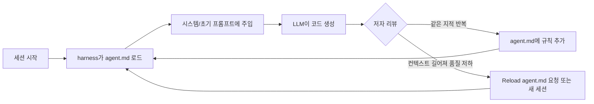

# Fabien Sanglard — "My agent.md to improve LLM-assisted code quality"

> [!summary] 한줄요약
> 반복되는 코드 리뷰 지적을 `agent.md` 규칙으로 남겨 다음 LLM 코딩 세션에도 적용하는 방법을 다룬 개인 사용기다.

Fabien Sanglard는 2026-08-21 게시한 글에서 코드 품질이 눈에 띄게 좋아졌다고 설명한다. 실제 규칙 전문(14개 규칙 + 커밋 메시지 7규칙)도 공개했다. 다만 **사람이 코드를 읽고 검증하는 일은 계속 필요하다**고 명시한다.

## 1. 배경: 누가, 왜 이 글을 썼나

저자 Fabien Sanglard는 게임 엔진·그래픽스 코드 분석 글로 알려진 개인 사이트(fabiensanglard.net)의 운영자다. 이 글은 이론이나 벤치마크가 아니라 **개인 작업 경험을 시간순으로 적은 사용기**다. 글에 나오는 흐름은 다음과 같다.

| 시점 | 저자가 적은 상황 |
|---|---|
| 2025년 중반 | Rust로 mDNS를 구현한 `libadbmdns` 작업 중 LLM을 처음 써 봤다. 생성된 코드가 컴파일조차 되지 않았고 인상은 좋지 않았다. |
| 2026년 1월 | 다시 시도. 복잡한 indexed-binary heap 클래스를 작성했고, Rust `polling` crate에서 Windows IOCP 구현에서 비롯된 모호한 버그까지 짚어냈다. 다만 코드 품질은 "주석도 구조도 없는 스파게티"였다. |
| 2026년 3월 | Antigravity, VS Code의 Claude Code 플러그인 같은 **agentic IDE**를 사용. 스테이징된 코드를 두고 "iterate"할 수 있게 됐다. |

저자가 겪은 문제는 생성 속도보다 **반복되는 수정과 리뷰 비용**이었다. 코드를 빨리 얻더라도 프로덕션 기준으로 손보는 데 시간을 다 쓰면 이득이 없다.

agentic IDE에서 LLM을 "한없이 인내심 있는 주니어 CS 전공생"처럼 대하며 지적을 반복했다. 예를 들면 "magic number 쓰지 마라", "여기에 짧은 주석 달아라", "함수 이름 짧게 써라" 같은 요청이다. 그 결과 품질이 크게 좋아졌고, 저자는 "손으로 쓴 것에 매우 가깝다"고 표현했다.

그러나 **새 세션마다 같은 말을 되풀이해야 했다**. 이 반복을 줄이기 위해 도입한 파일이 agent.md다. 글의 초점은 LLM의 코드 생성 능력 자체보다, 개인의 스타일·아키텍처 선호를 세션 간에 유지하는 방법에 있다.

## 2. 핵심 아이디어: agent.md는 무엇이고 어떻게 동작하나

글에 따르면 코딩 세션이 시작될 때 **coding harness가 `agent.md`라는 파일을 읽어 프롬프트에 주입**한다. 저자는 이 위치가 코딩 스타일 선호를 미세 조정하기에 가장 좋은 곳이라고 본다. 운영 규칙은 단순하다.

- 같은 지적을 두 번 하고 있다면 그것을 agent.md에 한 줄 추가한다.
- 프로젝트 루트에 두면 충분하다.
- 도구마다 파일명이 다르면(`gemini.md`, `claude.md`) agent.md로 **symlink**를 걸어 어디서든 활성화되게 한다.
- 규칙을 직접 편집기로 추가하지 않고 **에이전트에게 "agent.md를 업데이트하라"고 시키는** 방식도 쓴다(글의 "Auto-update agent.md" 절). 이 절은 본문이 짧아서 상세 절차는 글에 없다.



이 구조에서 사람의 리뷰는 규칙의 **공급원**이다. 리뷰에서 반복되는 지적이 규칙이 되고, 규칙이 늘수록 리뷰에서 스타일 지적이 줄어 아키텍처·설계 쪽으로 시간이 옮겨 간다. 저자도 "이제는 보통 코드 스타일이 아니라 아키텍처와 설계에 집중한다"고 쓴다.

## 3. 공개된 agent.md 규칙 전문 정리

저자는 자신의 파일(`https://fabiensanglard.net/agent.md/agent.md`, 제목 "FAB's AGENT.MD")을 시작점으로 쓰라고 공개했다. 직접 받아 읽은 내용을 항목별로 정리한다(요약·의역).

### 3.1 소통·태도 규칙
1. **사람이 읽는 모든 산출물(주석, 커밋 메시지, 프롬프트 응답)은 최소한의 단어로.** 단어를 하나하나 골라 분량을 극단적으로 줄이고 요점만 말한다. "Less is more."
2. **최상급 표현과 칭찬 금지.** "당신이 완전히 맞습니다"라고 말하지 말고 "냉정한 진실"을 달라. (LLM의 sycophancy를 겨냥한 규칙.)

### 3.2 코드 스타일 규칙
3. **magic number/string 제거.** 반복되거나 의미 있는 값은 설명적 const/enum으로 추출한다. 단, 자명한 일회성 값은 인라인으로 두어 번잡함을 피한다. 스펙에서 온 값(예: HTTP 200 OK)은 항상 상수를 쓴다. 단순 금지가 아니라 **예외 기준이 같이 적혀 있다**는 점이 눈에 띈다.
4. **들여쓰기 축소.** Arrow Anti-Pattern을 피하고 early return과 `continue`를 활용한다.
5. **함수 이름은 짧게, 30자 미만.**
6. **함수 파라미터에 boolean 대신 enum.**
7. **코드가 숨 쉬게.** 논리 블록 사이에 빈 줄을 넣는다.
8. **짧고 요점만 있는 주석으로 "무엇을" 하는지와 "왜"를 설명.** 가능하면 예시를 쓰고, 전체 시스템을 설명할 때는 ASCII 도식을 제안한다.
9. **항상 `{}` 사용.** 한 줄짜리 `if`에도 중괄호를 쓴다.

### 3.3 설계·변경 범위 규칙
10. **멤버 가시성 변경은 설계 변경으로 간주.** 외부 접근이 설계상 꼭 필요하지 않다면 필드와 함수를 전부 private으로 유지한다. private에서 internal/public으로 바꾸기 전에는 **사용자에게 명시적 승인을 요청**한다. 에이전트의 권한 확장을 사람 승인 게이트로 막는, 가장 "에이전트다운" 규칙이다.
11. **추상화 수준에 맞춰 프로그래밍.** 저수준 메커니즘(raw 하드웨어 I/O, sector 파싱, 직접 소켓 스트림)은 별도 driver/abstraction 계층에 캡슐화하고, 나머지 애플리케이션에는 도메인 개념의 고수준 API만 노출한다.
12. **기능과 무관한 코드는 건드리지 말 것.** 자신이 만들거나 수정하지 않은 블록에 주석을 달지 않는다. 변경 줄 수를 가능한 한 최소화한다. (diff 소음과 리뷰 부담을 줄이는 규칙. LLM이 "친절하게" 주변 코드를 손대는 습성을 막는다.)
13. **계층 경계 엄수.** 각 레이어는 바로 아래 이웃 레이어와만 직접 통신한다. 컨트롤러나 UI가 DB 쿼리·하드웨어 드라이버·저수준 네트워크 클라이언트를 직접 호출해서 계층에 "구멍을 뚫는" 일을 금지하고, 항상 중간 service/abstraction 계층을 거친다.

### 3.4 커밋 메시지 7규칙
파일에는 아래 7개 규칙이 그대로 들어 있다. (널리 알려진 "좋은 git 커밋 메시지 7규칙"과 같은 내용이다. 파일이 출처를 밝히는지는 확인하지 못함.)
1. subject와 body 사이에 빈 줄 하나.
2. subject는 50자 제한(72자는 절대 상한).
3. subject 첫 글자 대문자.
4. subject 끝에 마침표 금지.
5. subject는 명령형. "If applied, this commit will [subject]" 문장이 성립해야 한다.
6. body는 72자에서 수동 줄바꿈.
7. body는 how가 아니라 what과 why를 설명(how는 코드가 설명한다고 가정).

### 3.5 버그 수정 절차
14. **버그 수정 프롬프트면 바로 고치지 말고 먼저 테스트를 쓴다.** 테스트가 실패하는 것을 확인하고, 수정한 뒤, 테스트가 통과하는 것을 확인한다. 이것은 스타일이 아니라 **워크플로우 규칙**이며, 에이전트가 "그럴듯한 수정"을 검증 없이 내놓는 것을 방지한다.

### 3.6 규칙의 성격 분석
규칙의 성격은 다음처럼 묶을 수 있다.

- **응답 톤**: 2개
- **순수 스타일**: 7개
- **구조·범위**: 4개
- **프로세스**: 커밋 7규칙과 테스트 선행의 2묶음

핵심은 대부분이 **판정 가능한 문장**(30자 미만, 50자 제한, `{}` 사용)이거나 **승인 게이트**(가시성 변경 시 질문)라는 점이다. "가독성 좋게" 같은 모호한 표현은 거의 없어, 리뷰어가 준수 여부를 빠르게 확인할 수 있다. 사내 가이드를 만들 때 참고할 만한 설계 원칙이다.

## 4. 한계 인정과 컨텍스트 희석(context dilution) 대응

### 4.1 "마법의 탄환이 아니다"
저자는 이 방식으로 생성 코드가 상당히 좋아졌다고 하면서도 곧바로 "코드를 읽지 않아도 되는 것은 아니다"라고 쓴다. LLM은 계속 hallucinate하고 신뢰할 수 없으므로 여전히 많이 검증하고 반복해야 한다. 변한 것은 리뷰의 초점이 스타일에서 아키텍처·설계로 옮겨 갔다는 점뿐이다.

### 4.2 Lost in the Middle
저자는 **"context dilution"(attention dilution)** 현상을 Lost in the Middle 논문(arXiv:2307.03172)으로 설명한다. 논문 초록은 직접 열어 확인했으며, 논문의 결과와 저자의 적용은 구분해야 한다.

- **논문이 측정한 것**: 다중 문서 질의응답과 key-value 검색 두 과제다. 관련 정보가 입력 컨텍스트의 **처음이나 끝**에 있을 때 성능이 가장 높고, **중간**에 있을 때 크게 떨어졌다. 긴 컨텍스트를 명시적으로 지원하는 모델에서도 나타난 현상이다.
- **저자가 적용한 해석**: "컨텍스트가 길어질수록 모델이 중간의 지시보다 처음과 끝에 주의를 더 둔다"고 요약한다. 원인은 작성 시점에 잘 이해되지 않았다고 덧붙인다.

**검증 범위 주의**: 논문은 문서 QA/검색 결과를 다루며 지시문 준수율을 직접 측정하지 않았다. 저자의 적용은 유추에 가깝다.

저자가 찾은 완화책은 두 가지뿐이다.
1. **컨텍스트를 짧게 유지.** 기능 하나당 새 세션을 시작한다.
2. **harness에 agent.md를 명시적으로 재로딩시키기.** 품질이 떨어지는 느낌이 들면 "Reload agent.md"라고 말하면 충분하다.

## 5. 설치·사용법 (도구 설치 없음)

저자의 방식은 도구가 아니라 **파일 한 개와 습관**이다.

```bash
# 1) 저자의 파일을 시작점으로 받기
curl -fsSL https://fabiensanglard.net/agent.md/agent.md -o AGENTS.md

# 2) 도구별 파일명이 다르면 symlink (저자는 gemini.md / claude.md를 예로 듦)
ln -s AGENTS.md CLAUDE.md
ln -s AGENTS.md GEMINI.md

# 3) 세션 중 품질이 떨어지면 채팅창에서
#    "Reload agent.md"
```

주의: Claude Code는 `CLAUDE.md`를 읽는다. 저자는 `agent.md`라는 파일명을 쓰지만 표준 이름은 `AGENTS.md`(복수형)이므로, 실제 사용 시 사용 도구가 어떤 파일명을 읽는지 확인해야 한다. 이 글이 링크한 agentsmd/agents.md 저장소의 이슈 #135는 AGENTS.md 관례를 명문화하자는 제안이다(6절).

## 6. 글이 링크한 AGENTS.md 생태계 (직접 확인)

**agents.md 사이트(https://agents.md)**: "코딩 에이전트를 안내하는 단순하고 열린 형식. 6만 개 넘는 오픈소스 프로젝트에서 사용"이라고 적혀 있다(사이트 문구). "agents를 위한 README"로 소개하며, README.md는 사람용(빠른 시작, 설명, 기여 가이드), AGENTS.md는 에이전트용(빌드 단계, 테스트, 관례)으로 **의도적으로 분리**했다고 설명한다. 호환 도구로 Codex, GitHub Copilot coding agent, Gemini CLI, Cursor, Windsurf, Zed, Aider, Jules, Devin, Junie 등이 나열된다(나열된 이름 기준. 각 도구의 실제 지원 깊이는 확인하지 못함). 예시로 Setup commands / Code style / Dev environment tips / Testing instructions / PR instructions 같은 섹션이 제시된다.

**agentsmd/agents.md 저장소**: GitHub API 기준 스타 약 24.7k, 라이선스 MIT, 마지막 push 2026-09-10.

**이슈 #135(저자가 링크)**: 제목 "Proposal: AGENTS.md v1.1: Making Implicit Semantics Explicit, Clarifying Scope, and Recommendation for Progressive Disclosure", 2026-01-08 생성, 상태 closed. 본문은 이미 널리 쓰이는 암묵적 관례(계층적 scope, 우선순위, progressive disclosure)를 명문화하고, AGENTS.md가 주로 **행동 기대치·규칙·제약**에 관한 것임을 분명히 하며 SKILL.md와는 **경쟁이 아니라 보완 관계**로 두자는 초안이다. 이슈가 closed라고 해서 v1.1이 채택됐다는 뜻인지는 확인하지 못함.

## 7. 비교: agent.md vs CLAUDE.md vs AGENTS.md vs Cursor rules vs SKILL.md

| 구분 | 로드 방식 | 범위 | 비고 |
|---|---|---|---|
| Sanglard `agent.md` | harness가 세션 시작 시 주입, 필요 시 수동 재로딩 | 프로젝트(루트) 또는 symlink로 전역 | 개인 스타일 + 프로세스 규칙. 표준이 아니라 "한 사람의 내용물" |
| `AGENTS.md`(agents.md 형식) | 도구가 지원하면 자동 로드 | 프로젝트, 하위 디렉터리 계층(이슈 #135가 명문화 시도) | 도구 중립 표준을 지향. 사이트 기준 다수 도구 호환 |
| `CLAUDE.md` | Claude Code가 자동 로드 | 전역·프로젝트 | Anthropic 도구 전용 이름. 저자는 symlink로 통합 |
| Cursor rules 등 | 에디터 고유 형식 | 프로젝트 | 형식 세부는 확인하지 못함 |
| SKILL.md | 필요할 때 로드되는 단위 기능 | 작업별 | 이슈 #135는 AGENTS.md를 SKILL.md의 보완재로 규정 |

핵심 차이는 "상시 주입되는 지침(agent.md/AGENTS.md/CLAUDE.md)"과 "필요 시 로드되는 절차(skill)"의 구분이다. 상시 주입 파일은 길어질수록 4.2절의 희석 문제를 키우므로, 저자의 14개 규칙처럼 **짧게** 두고 작업별 절차는 skill로 빼는 편이 합리적이다. 관련 skill 모음은 [[agent-skills]], [[mengto-skills]], 페르소나 모음은 [[agency-agents]]에서 다뤘다.

## 8. 장단점·한계·성숙도

**장점**
- 비용 0, 즉시 적용. 파일 하나로 시작할 수 있다.
- 규칙이 판정 가능한 문장이라 리뷰가 쉽다.
- 리뷰 지적 → 규칙화라는 피드백 루프가 명확하다.
- 에이전트의 권한 확장(visibility), 변경 범위(minimal diff), 검증(test first)을 규칙으로 통제한다.

**한계**
- 단일 저자의 경험담이다. 정량 평가(규칙 적용 전후 결함률, 리뷰 시간)는 글에 없다. "dramatically", "considerably" 같은 표현은 저자의 주관이다.
- 규칙 수가 늘면 희석 문제가 심해진다. 저자도 인정하며 해법이 세션 분할과 수동 재로딩이라는 점은 **사람이 개입해야 하는 방식**이다.
- Lost in the Middle 논문을 지시문 준수에 적용한 것은 유추이며, 논문이 지시문 준수를 측정한 것은 아니다(4.2절).
- 규칙 일부는 언어 취향이다. 예컨대 "함수명 30자 미만", "항상 `{}`"는 팀마다 다르고, Rust·C 계열 작업에서 나온 선호가 사내 Java/Python 코드에 그대로 맞는지는 확인하지 못함.
- "Auto-update agent.md" 절은 짧아서 에이전트가 규칙을 스스로 고칠 때의 안전장치(누가 승인하나)는 글에 나오지 않는다.

## 9. 보안·라이선스·운영 리스크

- **프롬프트 주입 표면**: agent.md는 시스템 프롬프트급으로 주입되는 파일이다. 외부 저장소를 clone한 뒤 그 안의 AGENTS.md/agent.md를 그대로 신뢰하면 악성 지시가 들어올 수 있다. 신뢰하지 않는 저장소에서는 에이전트 실행 전에 내용을 확인해야 한다.
- **에이전트가 지침 파일을 스스로 수정**할 때는 변경이 diff로 남고 사람이 승인하도록 해야 한다(규칙 오염 방지).
- **민감정보 금지**: 지침 파일에 API 키, 내부 URL, 개인정보를 넣지 않는다. 사내 정책(PII·키 비처리)과도 직접 연결된다.
- **라이선스**: 저자의 agent.md 파일에 라이선스 표기가 있는지는 확인하지 못함. 사내 문서로 옮길 때는 그대로 복사하기보다 우리 규칙으로 다시 쓰는 것이 안전하다. agents.md 저장소는 MIT.
- 사내 아키텍처 규칙(계층 구조 명칭 등)을 적은 파일은 내부 문서로 취급해야 한다.

## 11. 확인하지 못한 것
- "Auto-update agent.md" 절의 상세 절차(본문이 거기서 끝남).
- 저자 agent.md의 라이선스, 커밋 7규칙의 출처 명시 여부.
- 규칙 도입 전후의 정량 효과.
- Cursor rules의 현재 형식과 각 도구의 AGENTS.md 지원 깊이.
- 이슈 #135의 최종 결론(closed의 의미).

## 관련 노트
[[mengto-skills]] · [[agency-agents]] · [[gepa]] · [[ai-engineering-from-scratch]] · [[agent-skills]] · [[claude-code-best-practice]]

## 출처 (실제로 연 URL)
- https://fabiensanglard.net/agent.md/index.html (본문 전체, 2026-08-21 글)
- https://fabiensanglard.net/agent.md/agent.md (규칙 파일 원문)
- https://github.com/agentsmd/agents.md/issues/135 (GitHub API로 조회)
- https://github.com/agentsmd/agents.md (GitHub API: 스타·라이선스·push 일자)
- https://agents.md (렌더 텍스트)
- https://arxiv.org/abs/2307.03172 (Lost in the Middle, 초록)
