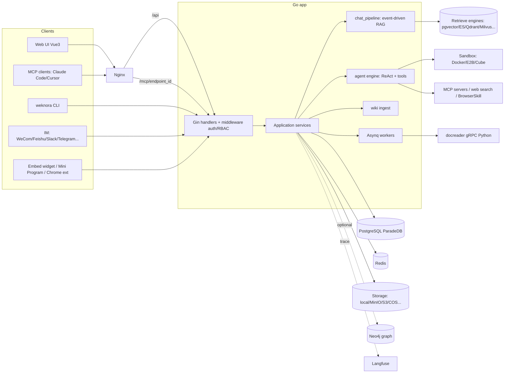
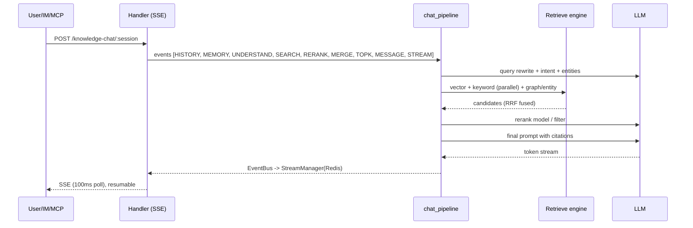

# WeKnora (Tencent)

> [!summary] 한줄요약
> 같은 문서 지식베이스를 RAG 질의응답·다단계 Agent 작업·Wiki 지식 정리에 활용하는 Tencent의 오픈소스 플랫폼이다.

- **구성**: Go 백엔드 + Python docreader(gRPC) + Vue 3 프런트.
- **제품 범위**: 자체 호스팅, 워크스페이스 RBAC, 내장 MCP Server, 스킬 샌드박스를 갖춘 엔터프라이즈 지식 플랫폼으로, 문서 검색보다 넓은 기능을 제공한다.
- **조사 시점 상태**: 스타 약 31.5k, v0.8.2, MIT + 서드파티 예외 라이선스.

> [!info] 조사 방법
> `git clone --depth 1`(커밋 `bccb4b1`, 2026-09-30)로 README 전문, `website-docs/`(아키텍처·기능 문서), `docker-compose.yml`, `.env.example`, `go.mod`, `docreader/pyproject.toml`, `internal/` 디렉터리 구조, LICENSE/THIRD_PARTY_NOTICES를 직접 읽고 `gh api`로 통계를 확인했다. 소스 코드 전체를 정독한 것은 아니며, 동작 서술은 저장소 내 공식 문서(`website-docs/`)와 디렉터리/파일 구성 기준이다. 문서 기반인지 구조 기반인지는 본문에서 구분했다.

## 1. 배경 — 해결하려는 문제

사내 문서 기반 질의응답(RAG)을 실제로 운영하려 하면 "벡터 DB에 청크를 넣고 LLM에 붙인다"는 최소 구성으로는 곧 한계에 부딪힌다. 문서 포맷이 PDF·Word·Excel·이미지·웹 페이지로 제각각이고, 문서가 계속 바뀌며, 부서별로 볼 수 있는 범위가 다르고, 한 번 묻고 끝나는 질문이 아니라 "여러 계약서를 비교해서 표로 정리해줘" 같은 다단계 작업 요구가 늘어난다. WeKnora는 이 전체를 하나의 제품으로 묶으려는 시도다. README의 표현으로는 "팀의 문서를 모아 검색하고, 추론하고, 최신 상태로 유지하는 LLM 기반 지식 프레임워크"다.

핵심 설계 아이디어는 **같은 knowledge base(KB) 위에 세 가지 사용 방식을 얹는 것**이다.

- **RAG (Quick Q&A)**: 질문 → 하이브리드 검색 → 재순위 → 근거 인용 포함 답변. 호출 횟수가 적고 예측 가능하다.
- **Agent (Smart reasoning)**: ReAct 방식의 에이전트가 KB 검색, 웹 검색, MCP 도구, 스킬, 로컬 브라우저를 골라 여러 턴에 걸쳐 작업한다.
- **Wiki**: 문서에서 인물·제품·개념을 추출해 서로 링크된 Markdown 페이지를 자동 생성하고, 사람이 편집·롤백할 수 있게 한다. 지식 그래프 뷰도 제공한다.

이 세 모드가 같은 KB를 공유한다는 점이 Onyx 같은 "검색 중심" 플랫폼이나 단순 RAG 프레임워크와의 가장 큰 차이다. 또한 Tencent 제품답게 WeCom·Feishu·DingTalk·WeChat 등 중국권 협업 도구 연동이 일급 시민으로 취급된다.

## 2. 한눈에 보는 수치 (확인한 사실)

| 항목 | 값 | 출처 |
|---|---|---|
| 스타 / 포크 | 31,543 / 4,210 | `gh api repos/Tencent/WeKnora` (2026-10-01) |
| 오픈 이슈 / 오픈 PR | 343 / 265 | `gh api search/issues` (repo API의 open_issues_count 608은 이슈+PR 합산치) |
| 생성일 / 마지막 push | 2025-07-22 / 2026-09-30 | GitHub API |
| 최신 릴리스 | v0.8.2 (2026-09-24), 직전 v0.8.0 (2026-09-03), v0.7.2 (08-07), v0.7.1 (07-24), v0.7.0 (07-17) | `gh api releases` |
| 라이선스 | GitHub 판정 NOASSERTION, LICENSE 본문은 MIT + 서드파티 예외 | LICENSE 파일 |
| 주 언어 | Go (`go 1.26.0`) | go.mod |
| `internal/` Go 파일 | 약 2,373개, 그중 `_test.go` 1,170개 | 로컬 clone에서 `find` |
| DB 마이그레이션 | `migrations/versioned` 230개 파일 (mysql/paradedb/sqlite 별도 디렉터리) | 로컬 clone |
| CHANGELOG | 1,714줄 | 로컬 clone |
| 문서 사이트 | 약 360개 API endpoint, 약 150개 환경변수 문서화(README 주장) | README |

릴리스 주기가 2~4주 간격으로 매우 빠르고 마지막 커밋이 조사 하루 전이다. 기능 추가 속도가 빠른 만큼 breaking change도 잦다(v0.8.2에서 DingTalk 채널이 Stream 전용으로 바뀌고 sandbox 명령이 `root`로 실행되도록 변경됨 — README의 Breaking 공지).

## 3. 아키텍처

### 3.1 전체 구성

저장소 루트와 `docker-compose.yml`에서 확인되는 서비스 구성은 다음과 같다.

- **frontend** (`weknora-ui` 이미지): Vue 3.5 + Vite 7 + TypeScript + TDesign(`tdesign-vue-next`) + Pinia. Nginx가 정적 파일과 `/api/`, `/mcp/` 프록시를 담당.
- **app** (`weknora-app`): Go 백엔드. Gin(`gin-gonic/gin`), Asynq(`hibiken/asynq`, Redis 기반 작업 큐), golang-migrate, mark3labs/mcp-go, pgx, chromedp 등을 사용(go.mod).
- **docreader** (`weknora-docreader`): Python gRPC 서비스. 파일/URL → Markdown 변환 담당. markitdown, opendataloader-pdf, pypdf/pypdfium2, python-docx, ebooklib, trafilatura, playwright 등에 의존(`docreader/pyproject.toml`, Python ≥3.10.18).
- **postgres**: 기본 이미지가 `paradedb/paradedb:v0.22.6-pg17` — pgvector + BM25를 한 DB에서 제공.
- **redis** (`redis:7.0-alpine`): Asynq 큐와 SSE 스트림 매니저.
- 선택 프로파일: `neo4j`(지식 그래프), `minio`(오브젝트 스토리지), `langfuse`(트레이싱: langfuse-web/worker + clickhouse + 별도 postgres/minio), `searxng`, `qdrant`, `milvus`, `weaviate`, `doris`(FE/BE), `dex`(OIDC 테스트용), 샌드박스 관련 프로파일, `full`(전부).



`internal/` 아래 디렉터리 이름만으로도 책임 분할이 드러난다. `agent`(엔진·프롬프트·approval·skills·tools), `application`(service/repository), `handler`, `router`, `middleware`, `im`(채널 어댑터), `datasource`(커넥터), `mcp`/`mcpserver`, `sandbox`, `browserskill`, `reranking`, `stream`, `tracing`, `ratelimit`, `storageallowlist`, `ipclass`(IP 분류, SSRF 대응용으로 보이나 코드는 읽지 않음), `textconv`(중국어 간·번체 변환용 OpenCC 사전), `localsandbox`, `embedpolicy` 등. 의존성 주입은 `internal/container`에서 `container.Provide/Invoke` 방식으로 조립된다(공식 문서 인용 기준).

### 3.2 문서 입고(Ingestion) 파이프라인

공식 문서(`02-architecture/03-document-pipeline.md`)에 따르면 입고는 **Asynq(Redis) 기반 분산 비동기 파이프라인**이다. HTTP 핸들러는 저장과 enqueue만 하고, 무거운 일은 별도 worker 풀이 한다.

1. 진입: 파일 업로드 / URL 가져오기 / 수동 생성 / 재파싱(`reparse`). 확장자 검사는 `supportedImportFileExtensions` 단일 표를 공유한다(pdf, txt, docx, doc, epub, html, htm, mhtml, md, markdown, xmind, png/jpg/jpeg/gif, csv, xlsx, xls, pptx, ppt, json, mp3/wav/m4a/flac/ogg). 과거 URL 가져오기는 별도 화이트리스트라 "업로드는 되는데 URL은 거부" 불일치(#2447)가 있었고 통일되었다고 문서가 설명한다.
2. 생성: MD5 해시로 중복 제거 → 스토리지 백엔드에 저장 → `Knowledge` 레코드(`parse_status=pending`) → `TypeDocumentProcess` 작업 enqueue.
3. 코어 worker: docreader(gRPC)로 변환 → (오디오는 ASR) → 이미지 추출·스토리지 업로드 → 청킹(`Split` / `SplitParentChild`) → DB에 청크 저장 → 임베딩 + 벡터/키워드 인덱싱.
4. 보강 worker: 이미지 OCR + VLM caption, 요약 생성, 질문 생성(20 chunk 단위), 그래프 추출(chunk당 1 작업), Wiki 페이지 생성. 모든 하위 작업이 원자적 카운터 감소(`FinalizeSubtask`)로 끝나면 `parse_status=completed`.

업로드마다 처리 설정(`process_config`)을 KB 기본값 위에 덮어쓸 수 있다. 문서 파싱 타임라인(Langfuse 스타일 span tree)과 "파싱 중지" 기능이 UI에 있다(README v0.6.1 항목). 큐 대시보드와 DLQ가 있어 4만 문서 규모 Wiki ingest까지 확장했다고 README(v0.5.2)가 적는다.

### 3.3 docreader — 문서 파싱

`docreader/parser/`에는 `pdf_parser`, `docx_parser`/`docx2_parser`, `doc_parser`, `excel_parser`, `ppt_convert`, `epub_parser`, `html_parser`, `mhtml_parser`, `markdown_parser`, `markitdown_parser`, `image_parser`, `xmind_parser`, `opendataloader_parser`, `web_parser`, `chain_parser`(폴백 체인), `registry.py` 등이 있다. 문서(`03-document-parsing.md`)에는 보안 관련 서술이 있다. textract 경로는 SSRF 취약점 때문에 **코드는 남기되 주석 처리로 비활성화**했고, 웹 페이지 파서는 playwright로 렌더링하되 탐색 전에 `is_ssrf_safe_url`로 검증하고 모든 하위 요청·리다이렉트에도 라우트 가드를 건다고 한다. 다만 pyproject에는 아직 `textract==1.5.0`이 의존성으로 남아 있다(코드 경로 비활성화와 의존성 존재는 별개라는 사실만 확인했고 위험 평가는 하지 않았다).

README에 따르면 Office 파일은 v0.8.0부터 Go 쪽 **in-process `anydoc`**(`third_party/anydoc-go`)로 파싱한다. docreader와 Go 내장 파서가 공존하는 과도기 구조로 보이며, 정확한 라우팅 규칙은 확인하지 못했다.

### 3.4 RAG 질의 파이프라인 — 이벤트 기반 플러그인 체인

`website-docs/02-architecture/04-rag-pipeline.md`가 가장 상세하다. 요점은 다음과 같다.

- `internal/application/service/chat_pipeline/`의 `Plugin` 인터페이스(`OnEvent(ctx, eventType, chatManage, next)` + `ActivationEvents()`)를 구현한 플러그인이 `EventManager`에 등록되고, 같은 이벤트에 대해 **책임 연쇄(next())** 로 엮인다. 등록 순서가 곧 체인 순서이며, 먼저 등록된 플러그인이 바깥쪽이다.
- 요청별로 `PipelineBuilder`가 이벤트 목록을 동적으로 조립한다. KB도 웹검색도 없으면 `LOAD_HISTORY → MEMORY_RECALL → CHAT_COMPLETION_STREAM`의 순수 채팅, RAG면 `LOAD_HISTORY → MEMORY_RECALL → QUERY_UNDERSTAND → CHUNK_SEARCH_PARALLEL → CHUNK_RERANK → (WEB_FETCH) → CHUNK_MERGE → FILTER_TOP_K → (DATA_ANALYSIS) → INTO_CHAT_MESSAGE → CHAT_COMPLETION_STREAM`.
- `QUERY_UNDERSTAND`는 질의 재작성·의도 분류·엔티티 추출(`PluginExtractEntity`)을 한다. 검색은 벡터/키워드를 병렬로 수행하고 상위 레벨에서 **RRF(Reciprocal Rank Fusion)** 로 합친다(검색 엔진 문서: 엔진이 하이브리드를 제공하든 말든 WeKnora의 하이브리드는 항상 상위 계층의 RRF 융합). 재순위 단계에는 Wiki 페이지 가중(`PluginWikiBoost`)과 기억 친화도(`PluginMemoryAffinity`)가 체인으로 붙는다. 병합 단계에는 겹침 병합, 인접 청크 확장(`merge_expand`), FAQ 병합, 히스토리 병합이 있다.
- 검색 결과가 없을 때 `ErrSearchNothing`이 "실패"가 아니라 fallback 응답을 트리거한다.
- 생성 결과는 HTTP에 직접 쓰지 않고 요청별 `EventBus` → `AgentStreamHandler` → `StreamManager`(메모리 또는 Redis)로 흘러가며, HTTP 계층이 100ms 폴링으로 SSE를 보낸다. 덕분에 연결이 끊겨도 `continue-stream` 엔드포인트로 이벤트를 이어받을 수 있다.



### 3.5 검색 엔진 계층

`internal/application/repository/retriever/` 아래에 `postgres`, `sqlite`, `elasticsearch`(v7/v8), `opensearch`, `qdrant`, `milvus`, `weaviate`, `doris`, `tencentvectordb`, `neo4j` 구현이 있다. 문서의 능력 매트릭스에 따르면 기본 PostgreSQL은 pgvector `halfvec` + HNSW 표현식 인덱스와 ParadeDB BM25를 쓰고, SQLite(Lite/desktop)는 `sqlite-vec` vec0 + FTS5(중국어는 앱 측 bigram)를 쓰며, ES 7은 키워드 전용이라 다른 벡터 엔진과 조합해야 한다. `RETRIEVE_DRIVER`에 쉼표로 여러 드라이버를 지정하면 쓰기는 전부에 브로드캐스트, 검색은 타입별로 라우팅한다. KB마다 "VectorStore" 인스턴스를 바인딩할 수도 있으나 **KB 생성 후에는 바꿀 수 없고 엔진 교체는 재인덱싱이 필요**하다고 문서가 못 박는다.

### 3.6 Agent 엔진

`internal/agent/`에는 `engine.go`, `think.go`, `act.go`, `observe.go`, `finalize.go`(ReAct 루프의 구성 요소로 보이는 이름), `steer.go`(실행 중 요구사항 추가), `checkpoint.go`(되감기), `compaction/`, `approval/`(도구 승인 게이트), `skills/`, `token/`이 있다. `tools/` 디렉터리에서 확인되는 도구 군은 다음과 같다.

- 지식 검색: `search_knowledge`, `read_document`, `list_documents`, `query_knowledge_graph`, `search_conversations`, `search_memory`
- 웹: `web_search`, `web_fetch`, `read_web_page`
- 샌드박스/파일: `shell_exec`, `sandbox_write/edit/ls/diff`, `read_file`, `skill_file`
- 분석: `data_analysis`(DuckDB), `database_query`, `sequentialthinking`, `todo_write`
- Wiki: `wiki_write_page`, `wiki_replace_text`, `wiki_rename_page`, `wiki_delete_page`, `wiki_flag_issue` 등
- 외부: `mcp_tool`, `mcp_catalog`, `mcp_oauth`, `browserskill`

`scope_authorization.go`, `execution_policy.go`, `tool_policy_coverage_test.go` 같은 파일명은 도구 호출이 권한 범위에 묶인다는 것을 시사하나, 구현 상세는 읽지 못했다. 문서(`07-agent.md`)는 "에이전트 설정이 접근 가능한 자료와 도구를 결정하지만 실제 호출은 현재 사용자/채널의 권한에 제약된다"고 명시한다. 공유 에이전트는 읽기 전용이며 수신자는 요청의 `summary_model_id`를 무시하고 에이전트에 설정된 모델을 쓴다.

MCP 도구는 "서비스 사용 설명을 먼저 읽고 필요한 도구를 지연 로딩"하는 카탈로그 방식이며, 도구별로 활성/승인필요를 설정하고, 승인 불가 시 기본은 fail-close(`WEKNORA_AGENT_TOOL_APPROVAL_FAIL_OPEN` 미설정)다(.env.example 주석). 승인 대기 기본 타임아웃은 600초.

### 3.7 스킬과 샌드박스

스킬은 `SKILL.md` + 스크립트 + 템플릿 구성이며, ClawHub/SkillHub/Git/ZIP로 워크스페이스 카탈로그에 등록한 뒤 **샌드박스별로 설치(이미지 스냅샷 생성)** 한다(`22-skills-sandbox.md`). 백엔드는 Docker, E2B, CubeSandbox. v0.8.0에서 로컬 호스트 프로세스 백엔드를 제거했고, Docker 백엔드는 `WEKNORA_SANDBOX_DOCKER_ENABLED=false`가 기본이다. `.env.example` 주석이 이유를 직접 적는다: 로컬 `docker.sock`은 호스트 root와 동등하기 때문이다. 세션 동안 같은 작업공간이 유지되고 대화창 옆에 터미널·그래픽 데스크톱이 붙는다. `internal/sandbox/`에는 `docker_engine`, `e2b_remote_client`, `cube_remote_client`, `docker_idle_sweeper`, `orphan_reaper`, `session_binding_redis` 등이 있어 세션-샌드박스 바인딩과 유휴/고아 정리를 구현한 것으로 보인다. macOS Lite 데스크톱은 호스트 샌드박스를 쓴다(README).

### 3.8 Wiki 모드

KB 편집의 "인덱스 전략"에서 Wiki를 켜면 문서에서 엔티티/개념을 추출해 출처 인용이 달린 페이지를 비동기로 생성한다(`14-wiki.md`). 추출 강도는 `focused / standard / exhaustive`. 페이지 이력은 자동 생성·에이전트·사람 편집·롤백 출처를 구분하며, 롤백은 새 버전을 만든다. 이력은 50개에서 자동 생성본부터 정리하고 200개를 하드 상한으로 둔다. 장기 보존이 필요하면 별도 보관하라고 문서가 경고한다.

### 3.9 장기 기억

`23-memory.md`에 따르면 워크스페이스 관리자가 기본 꺼짐 상태의 스위치를 켜고 `explicit_only`(명시적으로 기억하라고 한 것만) 또는 `auto`(백그라운드 LLM 추출) 모드를 고른다. 프로필·선호·사실·작업·관심사로 분류되고, 추론된 항목은 `pending`으로 시작해 사용자가 확인해야 프롬프트에 주입된다. 워크스페이스·호출자(IM 사용자, 임베드 방문자)별로 격리된다. 개인정보를 모으는 기능이므로 사내 도입 시 기본 꺼짐 유지가 안전하다.

### 3.10 테넌트와 권한

`01-tenant-auth.md`에 따르면 **워크스페이스(백엔드의 Tenant)가 자원·권한 경계**다. KB, 모델, 에이전트, 세션, 스토리지 쿼터가 여기에 속한다. 한 사용자는 여러 워크스페이스에 서로 다른 역할로 참여할 수 있다.

| 역할 | 권한 범위 |
|---|---|
| Viewer | 열람·질문 |
| Contributor | KB 생성·업로드 |
| Admin | 멤버·설정 관리 |
| Owner | 삭제·이전 |

역할은 위 4단계다. "조직"을 통해 워크스페이스끼리 KB와 에이전트를 공유할 수 있지만, 공유가 수신 쪽 역할을 자동으로 높이지는 않는다. 전체 배포를 관리하는 시스템 관리자 권한도 워크스페이스 Owner와 별도로 부여한다.

접근 방식은 두 가지다.

- **사용자 로그인**: 비밀번호 또는 OIDC.
- **프로그램 접근**: `X-API-Key` 헤더의 API Key. 검색/질의/입고/관리 능력과 KB 범위를 선택한다.

## 4. 핵심 기능 상세

### 4.1 데이터 소스 자동 동기화
`internal/datasource/connector/`에 `confluence`, `dingtalk`, `feishu`, `gitlab`, `ima`, `notion`, `rss`, `yuque`가 있고 `scheduler.go`가 주기 동기화를 맡는다. 커넥터 구현 가이드(`CONNECTOR_IMPLEMENTATION_GUIDE.md`)가 있어 확장 규약이 문서화돼 있다. Slack·SharePoint·Google Drive 커넥터는 디렉터리에 보이지 않는다. 사내 Microsoft 365/Google 환경에서는 직접 만들거나 파일 export로 우회해야 할 가능성이 크다.

### 4.2 IM 채널
`internal/im/`에 dingtalk, feishu, mattermost, qqbot, slack, telegram, wechat, wecom, yunzhijia 어댑터가 있다. 슬래시 명령(`/help`, `/info`, `/search`, `/clear`, `/stop`)과 QA 큐(`qaqueue.go`), 채널 보안(`channel_security.go`)도 확인된다.

### 4.3 내장 MCP Server (v0.8.2)
`website-docs/03-features/08-mcp.md` 요약은 다음과 같다.
MCP 연결은 두 방향을 지원한다.

1. **외부 도구 사용**: WeKnora가 MCP 클라이언트로 외부 서버에 연결한다. SSE / Streamable HTTP를 지원하며 stdio는 보안상 지원하지 않는다. 인증은 API Key/Bearer/OAuth2.0(DCR + PKCE)이다.
2. **지식베이스 제공**: WeKnora가 MCP 서버가 되어 워크스페이스별 `/mcp/<endpoint_id>` 엔드포인트를 발급한다.

서버 엔드포인트의 설정과 제약은 다음과 같다.

- 엔드포인트마다 토큰(`Authorization: Bearer mcp_…`, SHA-256 저장, 재발급 가능, 생성 시 1회만 표시), KB 범위, 분당 호출 한도(기본 60), 도구 그룹을 지정한다. 도구 그룹은 4개다. 검색·읽기(`list_knowledge_bases`, `search_knowledge`, `grep_chunks`, `list_documents`, `read_document`), 질의(`ask`), Wiki(`wiki_search`, `wiki_read_page`, `wiki_index`), 쓰기(`add_document`, `update_document`, `delete_document`). **기본은 읽기 전용이고 쓰기는 꺼져 있다.**
- 구현은 mark3labs/mcp-go의 stateless Streamable HTTP이며 에이전트의 네이티브 도구를 재사용하고, 권한은 API Key 스코프 모델로 환산한다(문서 설명).
- 문서가 스스로 한계를 적은 부분이 있다. `grep_chunks`는 인덱스에서 후보를 최대 30개 뽑은 뒤 정규식으로 거르므로 "있으면 반드시 찾는다"는 보장이 없다.
- 기존 Python `mcp-server/`는 deprecated.

### 4.4 CLI `weknora`
`cli/` 디렉터리에 별도 go.mod가 있다. "agent-first" 설계로 모든 명령이 기본적으로 안정된 JSON envelope를 내고 오류 코드가 exit code에 매핑되며 `--format text`로 사람용 출력을 한다. `weknora mcp serve`로 정제된 MCP 도구 면을 노출하고 Agent Skills를 번들한다. README의 예:

```bash
weknora profile add prod --host https://kb.example.com --use
weknora auth login
weknora kb list
weknora link --kb my-knowledge-base    # 현재 디렉터리를 KB에 바인딩
weknora doc upload notes.md
weknora chat "summarise the design doc"
# CI/헤드리스: WEKNORA_API_KEY + WEKNORA_HOST 환경변수만으로 동작(디스크에 자격증명 미기록)
```

### 4.5 기타 클라이언트
Chrome 확장(선택한 텍스트/이미지/페이지를 지식으로 저장), WeChat 미니프로그램(`miniprogram/`), 웹사이트 임베드 위젯(`embed.html`, 보안 모드 토큰 교환 + 속도 제한), Go SDK(`client/`), ClawHub 스킬, DeepSeek Harness 플러그인(npm `@wxg-prc-cpg/dsh-weknora`, 읽기 전용 도구 4개), BrowserSkill 확장(사용자의 Chrome/Edge를 에이전트가 조작, 로그인/CAPTCHA는 사람에게 인계).

### 4.6 대화 제어 (v0.8.2)
실행 중인 턴에 요구사항 추가(steer), 이전 질문에서 fork, 샌드박스 체크포인트와 함께 제자리 되감기(rewind), 세션별 reasoning effort 선택, 생성 파일을 모아 보는 artifacts 라이브러리가 있다.

### 4.7 모델·평가·관측
27개 빌트인 vendor(모델 카탈로그는 컨텍스트 윈도/최대 출력/추론/비전 메타데이터를 생성해 보유)가 있고, 임베딩은 Ollama/BGE/GTE/Zhipu/OpenAI 호환 API를 쓴다. 엔드 투 엔드 평가(recall, BLEU/ROUGE; `dataset/`, `15-evaluation.md`), Langfuse OTLP 트레이싱, 작업 큐 대시보드가 있다.

## 5. 설치·사용법

### 5.1 Docker Compose (표준)

```bash
git clone https://github.com/Tencent/WeKnora.git
cd WeKnora
cp .env.example .env     # 아래 필수 항목 점검
docker compose pull
docker compose up -d     # http://localhost (UI), :8080 (API)

# 선택 서비스
docker compose --profile neo4j --profile minio pull
docker compose --profile neo4j --profile minio up -d
docker compose down
```

`.env.example`은 760줄 안팎이며 섹션 A~H로 나뉜다. 주요 항목은 용도별로 확인하면 된다.

- **버전**: `WEKNORA_VERSION`. 기본값은 latest이므로 운영에서는 버전 고정을 권장한다.
- **저장·검색·큐**: `DB_DRIVER=postgres`, `STREAM_MANAGER_TYPE=redis`, `RETRIEVE_DRIVER=postgres`, `STORAGE_TYPE=local`.
- **마이그레이션**: `AUTO_MIGRATE=true`.
- **모델·관측 연동**: `OLLAMA_BASE_URL`, Langfuse 키.
- **운영 시크릿**: `JWT_SECRET` / `SYSTEM_AES_KEY` / `SYSTEM_SIGNING_KEY`. 빈 값으로 제공되므로 운영 전에 직접 생성해 채워야 한다.
- **Docker 샌드박스**: `WEKNORA_SANDBOX_DOCKER_ENABLED=false`.

예시 파일의 DB/Redis용 데모 비밀번호도 교체해야 한다. 이 노트에는 해당 값을 옮기지 않았다.

로컬 Ollama를 쓰려면 `ollama serve`를 먼저 띄운다. 업그레이드 시 `.env`의 `WEKNORA_VERSION`을 목표 릴리스로 바꾸고 `docker compose pull && docker compose up -d`를 실행한다. `up -d`만 하면 캐시된 이미지가 재사용돼 UI 버전이 어긋날 수 있다는 README 경고가 있고, v0.8.0에서 올라올 때는 업그레이드 노트 확인이 필요하다.

### 5.2 다른 배포 형태
- **Helm**: `helm/` 차트(프로덕션 클러스터).
- **Lite 단일 바이너리**: SQLite + 인메모리 큐, 외부 의존성 없음. `docs/LITE.md` 기준 단일 워크스페이스·가입 불필요·기본 로컬 접근만·파서는 Simple 엔진만 내장(다른 파서는 Cloud 등으로 연결). 공유 공간(멤버 초대, 교차 공유)은 없다. `deploy/weknora-lite.service`(systemd 유닛)도 있다.
- **Desktop 앱**: Lite 런타임 + GUI(THIRD_PARTY_NOTICES에 Wails 템플릿 언급이 있어 Wails 기반으로 보임). 설치 파일은 미배포, 소스 빌드.
- 개발 모드: `make dev-start` / `make dev-app` / `make dev-frontend`(Air 핫리로드), 검증은 `make fmt && make lint && make test`.

### 5.3 MCP로 Claude Code에 붙이기 (문서 서술 기준)
UI에서 "설정 → 발행 통합 → MCP Server"로 엔드포인트를 만들면 토큰과 `/mcp/<endpoint_id>` 주소가 한 번 표시되고, Cursor/VS Code/Claude Desktop용 `mcpServers` JSON과 Claude Code용 한 줄 명령을 UI가 제공한다. 정확한 명령 문구는 UI에서만 확인 가능해 여기 옮기지 않았다. 리버스 프록시를 직접 쓸 경우 `/mcp/` 경로, `Authorization` 및 MCP 프로토콜 헤더 전달, 응답 버퍼링 해제, 긴 read timeout이 필요하다고 문서가 명시한다. 개략적으로는 다음 형태의 일반 MCP 설정이 될 것이다(주소·토큰은 자리표시자).

```json
{
  "mcpServers": {
    "weknora": {
      "url": "https://<your-host>/mcp/<endpoint_id>",
      "headers": { "Authorization": "Bearer <ENDPOINT_TOKEN>" }
    }
  }
}
```

## 6. 디렉터리·코드 구조에서 확인한 것

| 경로 | 내용 |
|---|---|
| `cmd/server`, `cmd/desktop`, `cmd/download`, `cmd/milvus-migrate` | 서버/데스크톱 진입점, 모델 다운로드, Milvus 마이그레이션 유틸 |
| `internal/agent` | ReAct 엔진, 도구 구현 다수, approval, skills, compaction |
| `internal/application/service` | 비즈니스 서비스, `chat_pipeline/` 플러그인 약 27개 소스 파일 |
| `internal/application/repository` | DB 저장소, `retriever/` 10개 엔진 |
| `internal/im`, `internal/datasource` | 채널 어댑터 / 데이터 소스 커넥터 |
| `internal/mcp`, `internal/mcpserver` | MCP 클라이언트 / 서버(`tools_ask/ingest/retrieve/wiki.go`) |
| `internal/sandbox`, `internal/localsandbox`, `internal/browserskill` | 샌드박스 백엔드, 호스트 샌드박스, 브라우저 연동 |
| `docreader/` | Python 파서 서비스(gRPC proto, splitter 포함) |
| `frontend/` | Vue 3 UI |
| `website-docs/` | 문서 사이트 원본(01 시작하기 ~ 07 릴리스, 본문은 중국어 중심) |
| `migrations/` | versioned 230개 + mysql/paradedb/sqlite |
| `cli/`, `client/`, `miniprogram/`, `packages/`, `mcp-server/`(deprecated) | 클라이언트 군 |
| `third_party/anydoc-go`, `licenses/` | 번들 파서와 서드파티 라이선스 |

테스트 파일 비율이 `internal/`에서 절반에 가깝다(1,170 / 2,373). 숫자만으로 품질을 단정할 수는 없지만 회귀 테스트(`*_regression_test.go`)와 권한 테스트(`scope_authorization_test.go` 등)가 눈에 띈다.

## 7. 비교 대상

| 축 | WeKnora | [[onyx]] | [[openviking]] |
|---|---|---|---|
| 정체 | 지식 플랫폼(RAG+Agent+Wiki) | 엔터프라이즈 검색·에이전트 플랫폼 | 에이전트용 컨텍스트 DB(가상 파일시스템) |
| 언어 | Go + Python docreader + Vue | Python + Next.js | Python(+Rust CLI) |
| 라이선스 | MIT + 서드파티 예외 | CE MIT / EE 별도 | AGPL-3.0 |
| 강점 | Wiki 자동 생성, 샌드박스 스킬, 내장 MCP Server, IM 채널, 중국권 SaaS 커넥터 | 50+ 앱 커넥터, Deep Research | L0/L1/L2 계층 컨텍스트, 디렉터리 스코프 검색 |
| 약점 | 서비스 수·옵션이 많아 운영 복잡, 중문 문서 중심 | 인덱싱/커넥터 운영 부담 | 라이선스 검토 필요 |

[[onyx]]와는 "기업 앱 커넥터 폭(Onyx) vs. 한 KB 위의 세 모드와 에이전트 도구 생태(WeKnora)"로 갈린다. [[openviking]]은 에이전트의 메모리/컨텍스트를 파일시스템으로 다루는 하위 계층 인프라이고, WeKnora는 완성된 제품에 가깝다. 대체재라기보다 계층이 다르며 WeKnora의 MCP Server 뒤에 어떤 컨텍스트 계층이든 둘 수 있다. 권한·승인을 다루는 방식은 [[openworker]]의 승인 사다리와 비교해볼 만하다. Dify, RAGFlow, FastGPT 같은 워크플로형 RAG 앱 빌더도 경쟁 범주지만 이번 조사에서는 직접 비교하지 않았다.

## 8. 장단점·한계·성숙도

**장점**
- 기능 범위가 매우 넓다. 하이브리드 RAG, ReAct 에이전트, Wiki, 장기 기억, 스킬/샌드박스, MCP 양방향, IM·임베드 채널, 평가·관측이 한 제품에 있다.
- 배포 선택지가 다양하다. Compose / Helm / Lite 단일 바이너리 / 데스크톱. 벡터 DB 10종, 오브젝트 스토리지 8종을 교체할 수 있다.
- 보안 장치가 문서·환경변수 수준에서 의식적으로 설계되어 있다. 도구 승인 fail-close, Docker 샌드박스 기본 비활성, SSRF 방어(Go와 Python 양쪽), 자격증명 AES-256-GCM 암호화(README v0.6.0), 쓰기 도구 기본 비활성 MCP 엔드포인트, API Key 스코프.
- 활동성이 높고(최근 push 1일 전, 릴리스 2~4주 주기) 테스트 비중이 높다.

**단점·한계**
- 0.x 버전에서 빠르게 변하며 breaking change가 있다(v0.8.2). 운영 중 업그레이드 절차(마이그레이션 `AUTO_MIGRATE`, 이미지 pull)를 관리해야 한다.
- 구성요소가 많다(app, docreader, postgres, redis, 선택적 neo4j/minio/langfuse/sandbox 등). 소규모 팀에는 운영 부담이다.
- 공식 문서 본문은 중국어 중심이다. README는 영/중/일/한을 제공하고 UI는 중/영/일/한/러를 지원한다고 README가 밝힌다.
- 커넥터가 중국권 SaaS 중심이다. 사내 M365/SharePoint/Google Drive용 기성품은 디렉터리에서 확인되지 않는다.
- 오픈 이슈 343·PR 265는 성장 속도 대비 처리 대기열이 쌓이고 있음을 시사한다(해석이며 이슈 내용은 정독하지 않았다).
- 문서 스스로 인정하는 한계가 있다(예: `grep_chunks`의 비완전 재현율, Wiki 이력 상한).
- 평가 도구(BLEU/ROUGE/recall)는 있으나 공개된 비교 벤치마크 수치는 확인하지 못했다.

## 9. 보안·라이선스·운영 리스크

1. **라이선스**: GitHub API는 NOASSERTION이다. LICENSE는 "MIT License except for the third-party components listed below"로 시작하며 Tencent 저작권(2025) 하의 MIT 본문 뒤에 서드파티 목록(예: Apache-2.0 paddle 등)이 이어진다. `THIRD_PARTY_NOTICES.md`에는 MPL-2.0 컴포넌트(`go-sql-driver/mysql` v1.10.0, `shoenig/go-m1cpu` v0.1.6), OpenCC 사전(Apache-2.0), Wails 템플릿(MIT)이 명시돼 있다. MPL-2.0은 파일 단위 카피레프트라 수정 없이 링크만 하면 부담이 작지만, 바이너리 재배포 시 해당 소스 아카이브·고지 문서를 함께 배포해야 한다(문서는 컨테이너 `/app`에 번들한다고 설명). 사내 서비스로 쓰면 보통 문제 되지 않으나 사외 배포 시 법무가 NOTICES를 확인해야 한다.
2. **샌드박스 = 코드 실행**: 에이전트가 스킬/쉘을 실행하므로 Docker 백엔드는 호스트 격리 수준이 핵심이다. 기본 비활성이지만 켜는 순간 `docker.sock` 접근 리스크가 생긴다. 원격 E2B/Cube 또는 별도 호스트 격리를 권한다. v0.8.2에서 sandbox 명령이 root로 실행되도록 바뀐 점도 컨테이너 내부 권한 설계 확인 대상이다.
3. **BrowserSkill**: 사용자의 실제 Chrome/Edge 세션(로그인 쿠키 포함)을 에이전트가 조작할 수 있다. 사내 SSO 세션이 열린 브라우저에는 사용을 제한해야 하며, 사내 정책상 기본 비활성을 권장한다.
4. **외부 노출**: README가 사내망 배포, 방화벽, 정기 업데이트를 명시적으로 요구한다. MCP 엔드포인트와 임베드 위젯은 외부 접근 경로를 만들므로 토큰 로테이션·rate limit·KB 범위 제한이 필수다.
5. **시크릿**: `JWT_SECRET`, `SYSTEM_AES_KEY`, `SYSTEM_SIGNING_KEY`는 .env에서 비어 있는 채로 제공되어 직접 생성해야 한다. 데모 DB/Redis 비밀번호가 예시 파일 기본값에 있으므로 교체한다. 이 노트에는 어떤 비밀 값도 옮기지 않았다.
6. **공급망**: Go 의존성이 매우 넓고(AWS/Aliyun/Volcengine/Tencent SDK 등) docreader는 `textract==1.5.0`을 여전히 의존성에 둔다. 컨테이너 이미지는 `wechatopenai/*` Docker Hub 계정에서 받으므로 사내 레지스트리 미러링과 이미지 digest 고정을 권한다.
7. **데이터 주권**: 모델 vendor 27개 중 다수가 외부 API다. 기밀 문서를 쓸 때는 Ollama/사내 vLLM 같은 로컬 모델만 활성화하고 웹 검색은 끈다. README v0.8.2에 "whitelist-only outbound 모드"가 언급되나 상세 동작은 확인하지 못했다.
8. **장기 기억·PII**: 기본 꺼짐. 켜면 사용자 프로필/선호가 DB에 저장되므로 개인정보 정책 검토가 필요하다.
9. **취약점 신고**: `SECURITY.md`는 GitHub private vulnerability reporting을 권장하고 48시간 내 접수 확인을 목표로 한다고 적는다.

## 11. 확인하지 못한 항목
- 소스 코드 줄 단위 검증(동작 서술의 상당수는 공식 문서와 파일명 기준).
- 한국어 검색 품질, 처리량, 메모리 요구량 실측.
- ParadeDB의 한국어 토크나이징 지원 범위, anydoc과 docreader의 라우팅 규칙.
- Enterprise/상용 지원 정책, Tencent 내부 사용 현황.
- 오픈 이슈 중 보안 이슈 현황.
- 공개 벤치마크 비교 수치.

## 관련 노트
[[onyx]] · [[openviking]] · [[openworker]] · [[ag-ui-docs]] · [[copilotkit-openbot]] · [[gepa]] · [[actguard]] · [[insane-search]] · [[agentspace]]

## 출처
- https://github.com/Tencent/WeKnora (README.md 전문, 로컬 clone 커밋 `bccb4b1`)
- 로컬 clone 파일: `LICENSE`, `THIRD_PARTY_NOTICES.md`, `SECURITY.md`, `docs/LITE.md`, `go.mod`, `docker-compose.yml`, `.env.example`, `docreader/pyproject.toml`, `internal/` 디렉터리 구조, `cli/`, `frontend/package.json`
- `website-docs/02-architecture/03-document-pipeline.md`, `04-rag-pipeline.md`; `website-docs/03-features/01-tenant-auth.md`, `05-retrieval-engines.md`, `07-agent.md`, `08-mcp.md`, `14-wiki.md`, `22-skills-sandbox.md`, `23-memory.md`, `03-document-parsing.md`
- GitHub API: `repos/Tencent/WeKnora`, `/releases`, `search/issues`(2026-10-01)
- 공식 사이트 https://weknora.weixin.qq.com (README 링크, 직접 열람하지 않음)
